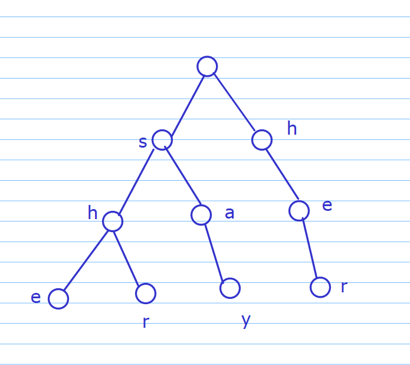
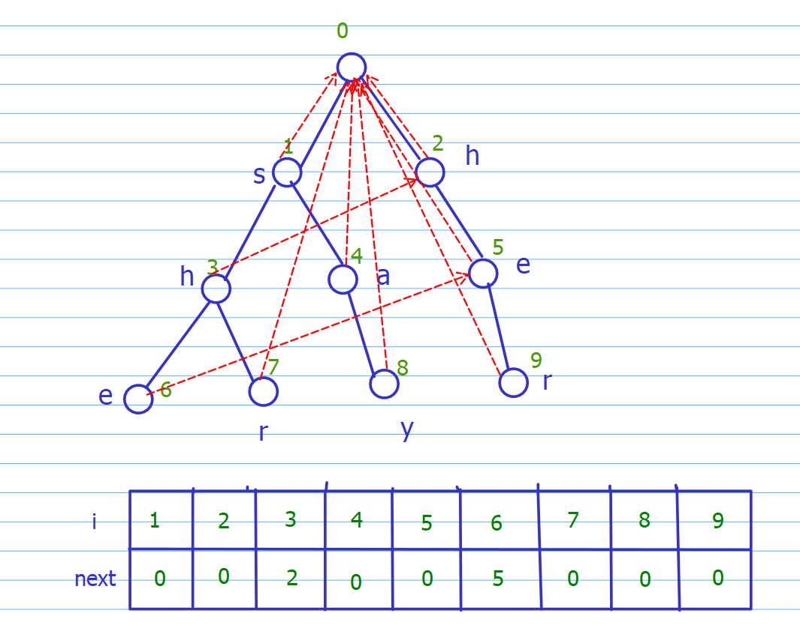

## AC自动机

其实就是 Trie + kmp......

AC自动机常适用于多模式串匹配中，效率和KMP处理单模式串匹配相当

解决的问题诸如：

`she`，`he`，`say`，`shr`，`her`
以上哪些模式串在文本串 `yasherhs` 中出现过

### 概述

首先对这些模式串建一棵trie树：


然后对每个节点求一个next数组

这里对next数组重新定义一下：对于节点 $i$ , $next[i]$ 表示从根节点到 $i$ 的路径代表的字符串的后缀能够在trie树中匹配到的最长路径的指针。

文字叙述绕得离谱，画画图。


~~图也很乱......~~ 结合下面表格凑合着理解吧...

对next数组我们可以逐层求解，用上一层求解下一层(BFS)

这里实现的时候手写了队列
```cpp
void build()//构建AC自动机
{
	int head=0,tail=-1;
	for(int i=0;i<26;i++)
	{
		if(tr[0][i])
			q[++tail]=tr[0][i];//初始化
	}

	while(head<=tail)
	{
		int x=q[head++];//当前节点
		for(int i=0;i<26;i++)
		{
			int y=tr[x][i];//子节点
			if(!y) continue;//判断此节点是否存在
			int j=nxt[x];//用已经算好的上一个next继续算
			while(j && !tr[j][i]) j=nxt[j];//匹配失败就跳走
			if(tr[j][i]) j=tr[j][i];
			nxt[y]=j;
			q[++tail]=y;//入队，继续扩展
		}
	}
}

```

与kmp相同的一点是，查询与构造时的操作都是差不多的，这里直接放全代码

```cpp
#include <bits/stdc++.h>
using namespace std;
typedef long long ll;
const int N=10010,S=55,M=1000010;

int n;
int tr[N*S][26],cnt[N*S];
char str[M];
int q[N*S],nxt[N*S],idx;

void insert(char* str)//trie插入字符串
{
	int p=0;
	for(int i=0;str[i];i++)
	{
		int t=str[i]-'a';
		if(!tr[p][t]) tr[p][t]=++idx;
		p=tr[p][t];
	}
	cnt[p]++;
}

void build()//构建AC自动机
{
	int head=0,tail=-1;
	for(int i=0;i<26;i++)
	{
		if(tr[0][i])
			q[++tail]=tr[0][i];//初始化
	}

	while(head<=tail)
	{
		int x=q[head++];//当前节点
		for(int i=0;i<26;i++)
		{
			int y=tr[x][i];//子节点
			if(!y) continue;//判断此节点是否存在
			int j=nxt[x];//用已经算好的上一个next继续算
			while(j && !tr[j][i]) j=nxt[j];//匹配失败就跳走
			if(tr[j][i]) j=tr[j][i];
			nxt[y]=j;
			q[++tail]=y;//入队，继续扩展
		}
	}
}

int main()
{
	int T;
	scanf("%d",&T);
	while(T--)
	{
		memset(tr,0,sizeof tr);
		memset(cnt,0,sizeof cnt);
		memset(nxt,0,sizeof nxt);
		idx=0;

		scanf("%d",&n);
		for(int i=0;i<n;i++)
		{
			scanf("%s",str);
			insert(str);
		}
		build();
		scanf("%s",str);

		int res=0;
		for(int i=0,j=0;str[i];i++)
		{
			int t=str[i]-'a';
			while(j && !tr[j][t]) j=nxt[j];
			if(tr[j][t]) j=tr[j][t];

			int p=j;
			while(p)
			{
				res+=cnt[p];
				cnt[p]=0;
				p=nxt[p];
			}
		}

		printf("%d\n",res);
	}
	return 0;
}

```
