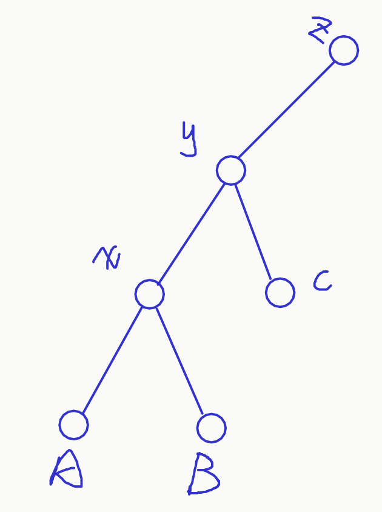
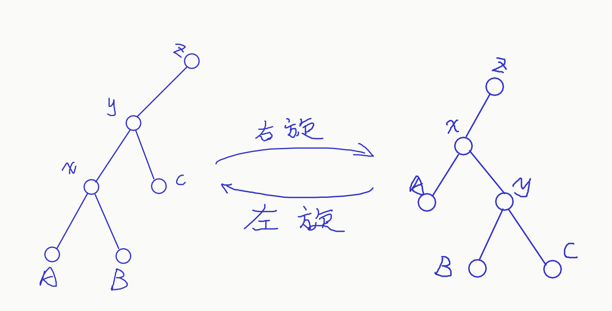
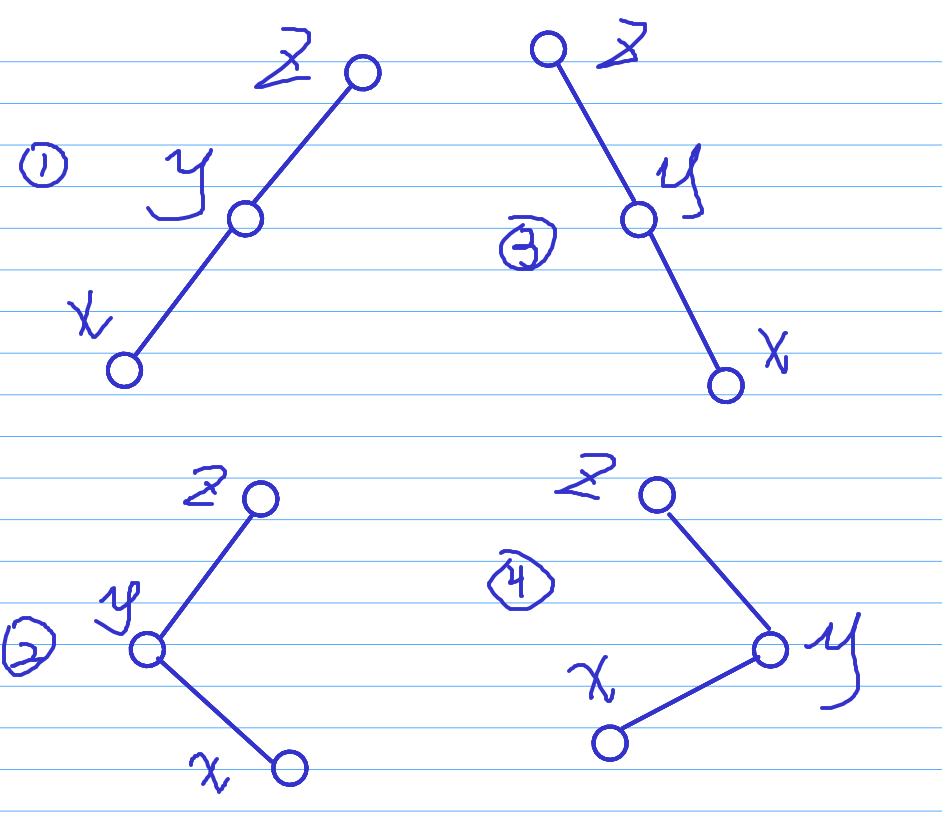
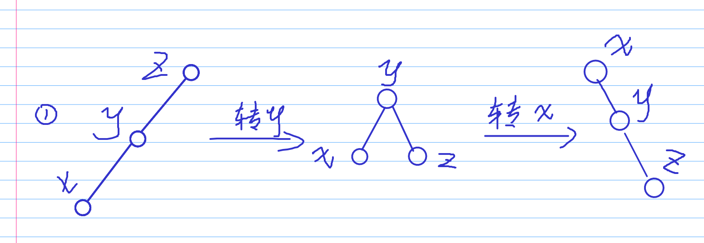
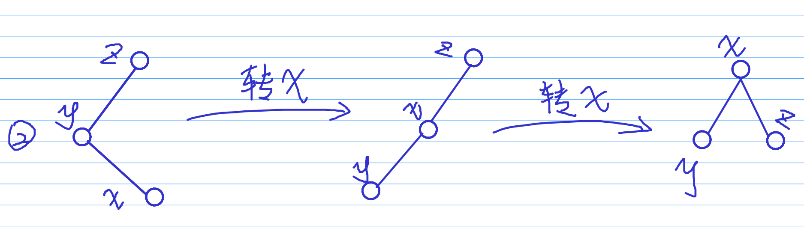

## Splay

首先这是一个[二叉搜索树](https://oi-wiki.org/ds/bst/)。

类似的还有，红黑树，treap，AVL，SBT ~~(傻x树)~~ 等等

Splay因其代码适中，使用灵活，~~深受广大OIer喜爱(~~

### 左旋与右旋

Splay有一个左旋和右旋的的操作，是这种数据结构的核心

让我们直接来看过程。

假设我们有棵这样的树：



把 $x$ 右旋之后:



左旋也是同样的道理。

Splay就是通过旋转来保持平衡，并进行插入，查询的。

我们每次操作一个节点，均将该节点旋转到树根。

听起来麻烦，但按照 Splay 的操作方式单次操作平均时间复杂度只有 $O(log\ n)$ 级别。

我们如何将一个节点转至根节点？

定义一个 $Splay$ 操作 $Splay(x,k)$ 为将点 $x$ 旋转到点 $k$ 的下面。

向上旋转分四种情况：


我们只讨论前两种情况，后面的情况都是前面的镜像。

对于第一种情况，我们先右旋 $y$ ，再右旋 $x$，得到下面的东西。



每次旋转，$x$ 节点向上跳 $2$ 层。

对于第二种情况，我们连续转两次 $x$ 就可以了,先左旋一次再右旋一次。



**注意**：不要随便瞎转，只有这样转才能保证 $log$ 级的复杂度。

还有这个 $k$ ，一般就两个值，一个是 $0$ (表示转到根节点下面)，一个是根节点。

### 插入

一般的插入，我们只需要将 Splay 当做一般的二叉搜索树，插入到它该被插入的地方。

然而还有其他情况。

比如让我们把一个序列插在 $y$ 后面。也就是说在中序遍历里面序列在 $y$ 的后面。

我们第一步先找到 $y$ 的后继。

第二步，我们将 $y$ 转到根上，即  $Splay(y,0)$。

第三步，将 $z$ 转到 $y$ 的后面。

有平衡树的性质，所以我们知道 $z$ 的左子树一定是空的。

我们把要插入的序列构造成二叉搜索树直接接上去就好了。

### 删除

我们希望删除 $L,R$ 内的所有数。

第一步，找到 $L$ 的前驱 $L-1$ 和 $R$ 的后缀 $R+1$。

第二步，将 $L-1$ 转到根节点， $R+1$ 转到根节点的右儿子上。

第三步，此时，我们要删除的区间就是右儿子的左子树。直接清空左子树即可。

### 维护信息

Splay如何取维护一个信息呢?

以下面的模板题为例。

我们要求找到第 $k$ 个数，所以要维护子树的节点个数  $size$。

第二个是区间翻转的懒标记 $flag$ 。

首先是 $pushup$ 操作：

当前节点所在子树的 $size=$ 这个节点的左子树的 $size+$ 右子树的 $size+1$ 。

另外一个就是 $pushdown$ 操作，就是下传懒标记。

对于这个题的区间翻转，我们首先要交换左右两个儿子。

然后将 $flag$ 下传到左右儿子，清空当前点的 $flag$。

$pushup$ 函数应道放在旋转的最后。

$pushdown$ 应该放在所有向下遍历过程的开头。

Splay应保证中序遍历是当前序列的顺序。


## 例题

### [模板] 文艺平衡树

~~啥玩意名字~~

您需要写一种数据结构（可参考题目标题），来维护一个有序数列。

其中需要提供以下操作：翻转一个区间，例如原有序序列是 $5\ 4\ 3\ 2\ 1$，翻转区间是 $[2,4]$ 的话，结果是 $5\ 2\ 3\ 4\ 1$。

#### 输入格式

第一行两个正整数 $n,m$，表示序列长度与操作个数。序列中第 $i$ 项初始为 $i$。

接下来 $m$ 行，每行两个正整数 $l,r$，表示翻转的区间。

#### 输出格式
输出一行 $n$ 个正整数，表示原始序列经过 $m$ 次变换后的结果。

#### 输入样例：
```
6 3
2 4
1 5
3 5
```
#### 输出样例：
```
5 2 1 4 3 6
```

#### 解析

~~我们其实可以块状链表大力艹过~~但是这不符合我们本意。

写Splay罢。

splay板子

```cpp
#include<bits/stdc++.h>
using namespace std;

const int N=100010;

int n,m;
struct node
{
	int s[2],p,v;
	int size,flag;

	void init(int _v,int _p)
	{
		v=_v, p=_p;
		size=1;
	}
} tree[N];

int root,idx=0;

#define lnode tree[node].s[0]
#define rnode tree[node].s[1]

void push_up(int node)
{
	tree[node].size=tree[lnode].size+tree[rnode].size+1;
}

void push_down(int node)
{
	if(tree[node].flag)
	{
		swap(lnode,rnode);
		tree[lnode].flag^=1;
		tree[rnode].flag^=1;
		tree[node].flag=0;
	}
}

void rotate(int x)//旋转(左旋和右旋合并在一起)
{
	int y=tree[x].p,z=tree[y].p;
	int k=tree[y].s[1]==x;// k=1 右儿子 k=0 左儿子

	tree[z].s[tree[z].s[1]==y]=x;
	tree[x].p=z;

	tree[y].s[k]=tree[x].s[k^1];
	tree[tree[x].s[k^1]].p=y;

	tree[x].s[k^1]=y; tree[y].p=x;
	push_up(y); push_up(x);
}

void splay(int x,int k)
{
	while(tree[x].p!=k)
	{
		int y=tree[x].p,z=tree[y].p;
		if(z!=k)
		{
			if((tree[y].s[1]==x)^(tree[z].s[1]==y))//是否为折线关系
				rotate(x);
			else rotate(y);
		}
		rotate(x);
	}
	if(!k) root=x;
}

void insert(int v)//一般二叉树插入
{
	int u=root,p=0;
	while(u) p=u,u=tree[u].s[v>tree[u].v];
	u=++idx;
	if(p) tree[p].s[v>tree[p].v]=u;
	tree[u].init(v,p);
	splay(u,0);
}

int get_(int k)//找到中序遍历下第k个数
{
	int u=root;
	while(1)
	{
		push_down(u);
		if(tree[tree[u].s[0]].size>=k) u=tree[u].s[0];
		else if(tree[tree[u].s[0]].size+1==k) return u;
		else k-=tree[tree[u].s[0]].size+1,u=tree[u].s[1];
	}
	return -1;
}

void output(int node)//中序遍历
{
	push_down(node);
	if(lnode) output(lnode);
	if(tree[node].v>=1 && tree[node].v <= n) printf("%d ",tree[node].v);
	if(rnode) output(rnode);
}

int main()
{
	scanf("%d%d",&n,&m);
	/*由于我们在操作的时候要取区间的前一个点或后一个点，
	  所以要在序列首尾添加两个哨兵防止越界*/
	for(int i=0;i<=n+1;i++) insert(i);//插入
	for(int i=1;i<=m;i++)
	{
		int l,r;
		scanf("%d%d",&l,&r);
		l=get_(l),r=get_(r+2);//我们加了哨兵，所以序号要平移一位
		splay(l,0),splay(r,l);
		tree[tree[r].s[0]].flag^=1;
	}
	output(root);
	return 0;
}

```

---

## 例题

### 『NOI2004』 郁闷的出纳员

(题目背景我就不复制了)

#### 输入格式
第一行有两个非负整数 $n$ 和 $min$，$n$ 表示下面有多少条命令，$min$ 表示工资下界。

接下来的n行，每行表示一条命令，命令可以是以下四种之一：

- I命令，格式为”$I\_ k$”，表示新建一个工资档案，初始工资为k。如果某员工的初始工资低于工资下界，他将立刻离开公司。
- A命令，格式为”$A\_ k$”，表示把每位员工的工资加上k。
- S命令，格式为”$S\_ k$”，表示把每位员工的工资扣除k。
- F命令，格式为”$F\_ k$”，表示查询第k多的工资。

_（下划线）表示一个空格，I 命令、A 命令、S 命令中的 $k$ 是一个非负整数， F 命令中的$k$是一个正整数。

在初始时，可以认为公司里一个员工也没有。

#### 输出格式
输出行数为 F 命令的条数加一。

对于每条 F 命令，你的程序要输出一行，仅包含一个整数，为当前工资第k多的员工所拿的工资数，如果k大于目前员工的数目，则输出 $-1$。

输出文件的最后一行包含一个整数，为离开公司的员工的总数。

注意，如果某个员工的初始工资低于最低工资标准，那么将不计入最后的答案内。

#### 数据范围
 I 命令的条数不超过 $100000$，
 A 命令和S命令的总条数不超过 $100$，
 F 命令的条数不超过 $100000$，
每次工资调整的调整量不超过 $1000$，
新员工的工资不超过 $100000$。

#### 输入样例：
```
9 10
I 60
I 70
S 50
F 2
I 30
S 15
A 5
F 1
F 2
```
#### 输出样例：
```
10
20
-1
2
```

#### 解析

题目有如下操作。

1. 招收一个员工
2. 给所有员工涨薪 $k$，若薪水低于 $mid$ 的不进入公司。
3. 给所有员工降薪 $k$，薪水低于 $mid$ 直接离职。
4. 在剩余员工中找到第 $k$ 大的数。
5. 我们要统计因为降薪而离职的总人数。

我们发现如果没有第二个或第三个操作的话，我们可以很容易的使用刚才的板子做出来。

但是我们这个题有修改操作，~~非常蛋疼~~。

其实Splay是可以支持区间加的。但是这个问题我们每次都只会对整个区间整体操作，所以我们想一想会不会有取巧的办法。

我们可以搞一个全局的偏移量 $\Delta$ 。比如在树中我们查询到的值是 $x$ ，真实值就是 $x+\Delta$。每次我们只需要看一下哪些 $x<min-\Delta$ 就可以确定哪个区间的人离职了。

那么如何删除区间呢？

我们先插两根哨兵：$-\infty$ 和 $+\infty$。

此时我们将 $L$ 设为 $>-\infty$ 的第一个数，$R$ 设为 $\ge min-\Delta$ 的第一个数。

我们首先将 $R$ 转到根，再将 $L$ 转到R的下面，此时 $L$ 的右子树就是我们要删的区间。

我们只需要置空其子树即可。

这个题非常好的体现了 Splay 作为一棵平衡树的维护有序序列的能力。

```cpp
#include <bits/stdc++.h>
using namespace std;

const int N=1e5+10,INF=1e8;

int n,m;
struct node
{
	int s[2],p,v;
	int size;

	void init(int _v,int _p)
	{
		v=_v,p=_p;
		size=1;
	}
} tree[N];

int root,idx=0,delta;

void push_up(int x)
{
	tree[x].size=tree[tree[x].s[0]].size+tree[tree[x].s[1]].size+1;
}

void rotate(int x)
{
	int y=tree[x].p, z=tree[y].p;
	int k=(tree[y].s[1]==x);

	tree[z].s[tree[z].s[1]==y]=x;
	tree[x].p=z;

	tree[y].s[k]=tree[x].s[k^1];
	tree[tree[x].s[k^1]].p=y;

	tree[x].s[k^1]=y; tree[y].p=x;
	push_up(y),push_up(x);
}

void splay(int x,int k)
{
	while(tree[x].p!=k)
	{
		int y=tree[x].p, z=tree[y].p;
		if(z!=k)
			if((tree[y].s[1]==x)^(tree[x].s[1]==y))rotate(x);
			else rotate(y);
		rotate(x);
	}
	if(!k) root=x;
}

int insert(int v)
{
	int u=root,p=0;
	while(u) p=u,u=tree[u].s[v>tree[u].v];
	u=++idx;
	if(p) tree[p].s[v>tree[p].v]=u;
	tree[u].init(v,p);
	splay(u,0);
	return u;
}

int get_(int v)
{
	int u=root,res;
	while(u)
	{
		if(tree[u].v>=v) res=u,u=tree[u].s[0];
		else u=tree[u].s[1];
	}
	return res;
}

int get_k(int k)
{
	int u=root;
	while(1)
	{
		if(tree[tree[u].s[0]].size>=k) u=tree[u].s[0];
		else if(tree[tree[u].s[0]].size+1==k) return tree[u].v;
		else k-=tree[tree[u].s[0]].size+1,u=tree[u].s[1];
	}
	return -1;
}

int main()
{
	scanf("%d%d",&n,&m);
	int L=insert(-INF),R=insert(INF);

	int tot=0;
	for(int i=1;i<=n;i++)
	{
		char op[2];
		int k;
		scanf("%s%d",op,&k);
		if(*op=='I')
		{
			if(k>=m) k-=delta,insert(k),++tot;
		}
		else if(*op=='A') delta+=k;
		else if(*op=='S')
		{
			delta-=k;
			R=get_(m-delta);
//			printf("##%d %d\n",R, delta);//test
			splay(R,0); splay(L,R);
			tree[L].s[1]=0;
			push_up(L),push_up(R);
		}
		else if(*op=='F')
		{
			if(tree[root].size-2<k) printf("-1\n");
			else printf("%d\n",get_k(tree[root].size-k)+delta);//补集思想
		}
	}
	printf("%d\n",tot-tree[root].size+2);
	return 0;
}

```

### 『HNOI2012』 永无乡

永无乡包含 $n$ 座岛，编号从 $1$ 到 $n$ ，每座岛都有自己的**独一无二**的重要度，按照重要度可以将这 $n$ 座岛排名，名次用 $1$ 到 $n$ 来表示。

某些岛之间由巨大的桥连接，通过桥可以从一个岛到达另一个岛。

如果从岛 $a$ 出发经过若干座（含 $0$ 座）桥可以到达岛 $b$ ，则称岛 $a$ 和岛 $b$ 是连通的。

现在有两种操作：

- `B x y` 表示在岛 $x$ 与岛 $y$ 之间修建一座新桥。
- `Q x k` 表示询问当前与岛 $x$ 连通的所有岛中第 $k$ 重要的是哪座岛，即所有与岛 $x$ 连通的岛中重要度排名第 $k$ 小的岛是哪座，请你输出那个岛的编号。

#### 输入格式
第一行是用空格隔开的两个正整数 $n$ 和 $m$ ，分别表示岛的个数以及一开始存在的桥数。

接下来的一行是用空格隔开的 $n$ 个数，依次描述从岛 $1$ 到岛 $n$ 的重要度排名。

随后的 $m$ 行每行是用空格隔开的两个正整数 $a_i$ 和 $b_i$ ，表示一开始就存在一座连接岛 $a_i$ 和岛 $b_i$ 的桥。

后面剩下的部分描述操作，该部分的第一行是一个正整数 $q$ ，表示一共有 $q$ 个操作，接下来的 $q$ 行依次描述每个操作，操作的格式如上所述，以大写字母 `Q` 或 `B` 开始，后面跟两个不超过 $n$ 的正整数，字母与数字以及两个数字之间用空格隔开。

#### 输出格式
对于每个 `Q x k` 操作都要依次输出一行，其中包含一个整数，表示所询问岛屿的编号。

如果该岛屿不存在，则输出 $−1$。

#### 数据范围
对于 $20\%$ 的数据 $n≤1000\ ,\ q≤1000$

对于 $100\%$ 的数据 $n≤100000\ ,\ m≤n,q≤300000$
#### 输入样例：
```
5 1
4 3 2 5 1
1 2
7
Q 3 2
Q 2 1
B 2 3
B 1 5
Q 2 1
Q 2 4
Q 2 3
```
#### 输出样例：
```
-1
2
5
1
2
```

#### 解析

本题首先让我们维护联通性，且没有删边操作。所以我们可以使用并查集来维护。

考虑其查询，是在查询排名某个集合内的第 $k$ 大数。

动态查询第 $k$ 大是可以使用平衡树的。

但是我们还涉及到两个集合的合并，而Splay暴力合并复杂度极高，可以达到 $n^2logn$ 。我们又怎么样去合并？

我们可以启发式合并，将节点少的合并到节点数多的。时间复杂度立马就会降到 $nlog^2n$ 。

```cpp
#include <bits/stdc++.h>
using namespace std;

const int N=5e5+10,INF=1e8+10;

int n,m;
struct node
{
	int s[2],p,v,id;//splay按v，即重要度排序
	int size;

	void init(int _v,int _id,int _p)
	{
		v=_v,id=_id,p=_p;
		size=1;
	}
} tree[N];

int root[N],idx=0;

int fa[N];
int find(int x)
{
	int x_root=x;
	while(fa[x_root]!=x_root) x_root=fa[x_root];
	while(x!=x_root)
	{
		int tmp=fa[x];
		fa[x]=x_root;
		x=tmp;
	}
	return x_root;
}

void push_up(int x)
{
	tree[x].size=tree[tree[x].s[0]].size+tree[tree[x].s[1]].size+1;
}

void rotate(int x)
{
	int y=tree[x].p,z=tree[y].p;
	int k=tree[y].s[1]==x;

	tree[z].s[tree[z].s[1]==y]=x;
	tree[x].p=z;

	tree[y].s[k]=tree[x].s[k^1];
	tree[tree[x].s[k^1]].p=y;

	tree[x].s[k^1]=y; tree[y].p=x;
	push_up(y),push_up(x);
}

void splay(int x,int k,int b)
{
	while(tree[x].p!=k)
	{
		int y=tree[x].p,z=tree[y].p;
		if(z!=k)
		{
			if((tree[y].s[1]==x)^(tree[z].s[1]==y))
				rotate(x);
			else rotate(y);
		}
		rotate(x);
	}
	if(!k) root[b]=x;
}

void insert(int v,int id,int b)
{
	int u=root[b],p=0;
	while(u) p=u,u=tree[u].s[v>tree[u].v];
	u=++idx;
	if(p) tree[p].s[v>tree[p].v]=u;
	tree[u].init(v,id,p);
	splay(u,0,b);
}

int get_k(int k,int b)
{
	int u=root[b];
	while(u)
	{
		if(tree[tree[u].s[0]].size>=k) u=tree[u].s[0];
		else if(tree[tree[u].s[0]].size+1==k) return tree[u].id;
		else k-=tree[tree[u].s[0]].size+1,u=tree[u].s[1];
	}
	return -1;
}

void dfs(int u,int b)//遍历u，将所有节点插入b
{
	if(tree[u].s[0]) dfs(tree[u].s[0],b);
	if(tree[u].s[1]) dfs(tree[u].s[1],b);
	insert(tree[u].v,tree[u].id,b);
}

int main()
{
	scanf("%d%d",&n,&m);
	for(int i=1;i<=n;i++)
	{
		fa[i]=root[i]=i;
		int d;
		scanf("%d",&d);
		tree[i].init(d,i,0);
	}
	idx=n;
	for(int i=1;i<=m;i++)
	{
		int a,b;
		scanf("%d%d",&a,&b);
		a=find(a),b=find(b);
		if(a!=b)
		{
			if(tree[root[a]].size>tree[root[b]].size) swap(a,b);
			dfs(root[a],b);
			fa[a]=b;
		}
	}
	scanf("%d",&m);
	for(int i=1;i<=m;i++)
	{
		char op[2];
		int a,b;
		scanf("%s%d%d",op,&a,&b);
		if(*op=='B')
		{
			a=find(a),b=find(b);
			if(a!=b)
			{
				if(tree[root[a]].size>tree[root[b]].size) swap(a,b);
				dfs(root[a],b);
				fa[a]=b;
			}
		}
		if(*op=='Q')
		{
			a=find(a);
			if(tree[root[a]].size<b) printf("-1\n");
			else printf("%d\n",get_k(b,a));
		}
	}
	return 0;
}

```
---
### 『NOI2005』维护数列

请写一个程序，要求维护一个数列，支持以下 $6$ 种操作(格式 一栏中的下划线‘ _ ’表示实际输入文件中的空格)：

|编号|名称|格式|说明|
|:---:|:---:|:---:|:---:|
|1|插入|`INSERT_pos_tot_c1_c2_..._ctot`|在第 $pos$ 个数字后插入 $tot$ 个数字 $c_1,c_2\cdots c_{tot}$|
|2|删除|`DELETE_pos_tot`|从当前数列的第 $pos$ 个数字开始连续删除 $tot$ 个数字|
|3|修改|`MAKE-SAME_pos_tot c`|从当前数列的第 $pos$ 个数字开始的连续 $tot$ 个数字统一修改为 $c$|
|4|翻转|`REVERSE_pos_tot`|取出从当前数列的第 $pos$ 个数字开始的 $tot$ 个数字，翻转后放入原来的位置|
|5|求和|`GET-SUM_pos_tot`|计算从当前数列的第 $pos$ 个数字开始的 $tot$ 个数字的和并输出|
|6|求最大子列和|`MAX-SUM`|求出当前数列中和最大的一段子列，并输出最大和|

#### 输入格式
第 $1$ 行包含两个数 $N$ 和 $M$，$N$ 表示初始时数列中数的个数，$M$ 表示要进行的操作数目。

第 $2$ 行包含 $N$ 个数字，描述初始时的数列。

以下 $M$ 行，每行一条命令，格式参见问题描述中的表格。

#### 输出格式
对于输入数据中的 `GET-SUM` 和 `MAX-SUM` 操作，向输出文件依次打印结果，每个答案（数字）占一行。

#### 数据范围与约定
你可以认为在任何时刻，数列中至少有 $1$ 个数。

输入数据一定是正确的，即指定位置的数在数列中一定存在。

$50\%$ 的数据中，任何时刻数列中最多含有 $30000$ 个数； $100\%$ 的数据中，任何时刻数列中最多含有 $500000$ 个数。

$100\%$ 的数据中，任何时刻数列中任何一个数字均在 $[-1000, 1000]$ 内。

$100\%$ 的数据中，$M≤20000$ ，插入的数字总数不超过 $4000000$ 个，输入文件大小不超过 $20MBytes$ 。

#### 输入样例：
```
9 8
2 -6 3 5 1 -5 -3 6 3
GET-SUM 5 4
MAX-SUM
INSERT 8 3 -5 7 2
DELETE 12 1
MAKE-SAME 3 3 2
REVERSE 3 6
GET-SUM 5 4
MAX-SUM
```
#### 输出样例：
```
-1
10
1
10
```

#### 解析

我们可以发现，只要不对序列的结构进行修改，这三个查询操作线段树都可以完成。

但是这个题有插入删除翻转操作，所以我们考虑 Splay。

我们先考虑一下 Splay 应该维护哪些信息，以及怎么维护信息。

首先由于带有翻转等操作，所以我们平衡树的关键字应该是节点下标。

我们要求最大子段和，所以我们还要维护 $ms$ 最大子段和，$ls$ 最大前缀和，$rs$ 最大后缀和，$sum$ 区间和。

这四个数据的更新方式和线段树中一模一样。

翻转需要一个懒标记 $rev$ ，修改也需要懒标记 $sim$。

我们先把序列搞成一棵平衡二叉树，看看怎么打标记。

首先取出中点，然后递归处理左边和右边，分别建成 Splay ，将这两棵 Splay 接到左右儿子上，返回根节点编号。

非常线段树的建树方式，但是很优秀。~~其实你要是喜欢可以把Splay建成一条链~~

对于插入操作：

我们先将给定的序列按刚刚的方法建成一棵平衡二叉树。设 $L=pos,R=pos+1$ 我们先把 $L$ 转到根，再把 $R$ 转到 $L$ 下方，那么我们 $R$ 的左边就空了，我们把建成的平衡二叉树接上去，更新信息即可。

对于删除操作：

我们要删除 $pos$ 开始的 $tot$ 个数，首先确定删除区间 $[L,R]$，将 $L-1$ 转到根，$R+1$ 转到 $L-1$ 的下面，删去 $R+1$ 的左子树就可。我们可以写内存回收(回收站优化)来节省内存。

对于修改操作：

我们先找到修改区间的前一个数 $L-1$，和后一个数 $R+1$ 。仍然向上面那样旋转，将左子树的 $sim$ 标记并更新信息。

对于翻转操作：

仍然是与上面相同的旋转方式，我们标记对应子树的 $rev$ 即可。

对于求和操作：

我们像上面那样旋转，左子树根节点的 $sum$ 就是这个区间的总和。

对于最大子段和操作：

我们直接返回根节点的 $ms$ 就可以了。

```cpp
#include <bits/stdc++.h>
using namespace std;

const int N=5e6+10,INF=1e9;

int n,m;
struct node
{
	int s[2],p,v;
	int rev,sim;
	int size,sum,ms,ls,rs;

	void init(int _v,int _p)
	{
		s[1]=s[0]=0;
		p=_p,v=_v; rev=sim=0;
		size=1; sum=ms=v;
		ls=rs=max(v,0);
	}
} tree[N];

int root,rabb[N],tt=0;
int w[N];

void push_up(int x)
{
	auto &u=tree[x], &l=tree[u.s[0]], &r=tree[u.s[1]];
	u.size=l.size+r.size+1;
	u.sum=l.sum+r.sum+u.v;
	u.ls=max(l.ls,l.sum+u.v+r.ls);
	u.rs=max(r.rs,r.sum+u.v+l.rs);
	u.ms=max(max(l.ms,r.ms),l.rs+u.v+r.ls);
}

void push_down(int x)
{
	auto &u=tree[x], &l=tree[u.s[0]], &r=tree[u.s[1]];
	if(u.sim)//如果要变成一个数
	{
		u.sim=u.rev=0;//区间翻转也跟着无效了
		if(u.s[0]) l.sim=1, l.v=u.v, l.sum=l.v*l.size;
		if(u.s[1]) r.sim=1, r.v=u.v, r.sum=r.v*r.size;
		if(u.v>0)
		{
			/*当权值大于 0 的时候，ms应该是整段的和*/
			if(u.s[0]) l.ms=l.ls=l.rs=l.sum;
			if(u.s[1]) r.ms=r.ls=r.rs=r.sum;
		}
		else
		{
			/*当权值小于 0 时由于ms至少包括一个数，ms就是这一个数的值*/
			if(u.s[0])l.ms=l.v,l.ls=l.rs=0;
			if(u.s[1])r.ms=r.v,r.rs=r.ls=0;
		}
	}
	else if(u.rev)
	{
		u.rev=0;l.rev^=1;r.rev^=1;
		swap(l.ls,l.rs); swap(r.rs,r.ls);//翻转的话前缀变后缀
		swap(l.s[0],l.s[1]); swap(r.s[0],r.s[1]);
	}
}

void rotate(int x)
{
	int y=tree[x].p,z=tree[y].p;
	int k=tree[y].s[1]==x;

	tree[z].s[tree[z].s[1]==y]=x;
	tree[x].p=z;

	tree[y].s[k]=tree[x].s[k^1];
	tree[tree[x].s[k^1]].p=y;

	tree[x].s[k^1]=y; tree[y].p=x;
	push_up(y),push_up(x);
}

void splay(int x,int k)
{
	while(tree[x].p!=k)
	{
		int y=tree[x].p,z=tree[y].p;
		if(z!=k)
		{
			if((tree[y].s[1]==x)^(tree[z].s[1]==y))
				rotate(x);
			else rotate(y);
		}
		rotate(x);
	}
	if(!k) root=x;
}

int build(int l,int r,int p)//左右端点和父节点
{
	int mid=(l+r)>>1;
	int u=rabb[tt--];
	tree[u].init(w[mid],p);
	if(l<mid) tree[u].s[0]=build(l,mid-1,u);
	if(r>mid) tree[u].s[1]=build(mid+1,r,u);
	push_up(u);
	return u;
}

int get_k(int k)
{
	int u=root;
	while(u)
	{
		push_down(u);
		if(tree[tree[u].s[0]].size>=k) u=tree[u].s[0];
		else if(tree[tree[u].s[0]].size+1==k) return u;
		else k-=tree[tree[u].s[0]].size+1,u=tree[u].s[1];
	}
	return -1;
}

void dfs(int u)
{
	if(tree[u].s[0]) dfs(tree[u].s[0]);
	if(tree[u].s[1]) dfs(tree[u].s[1]);
	rabb[++tt]=u;
}

int main()
{
	for(int i=1;i<N;++i)
		rabb[++tt]=i;
	scanf("%d%d",&n,&m);
	tree[0].ms=-INF;
	w[0]=w[n+1]=-INF;//哨兵
	for(int i=1;i<=n;i++)
		scanf("%d",&w[i]);
	root=build(0,n+1,0);

	char op[20];
	for(int i=1;i<=m;i++)
	{
		scanf("%s",op);
		if(!strcmp(op,"INSERT"))
		{
			int pos,tot;
			scanf("%d%d",&pos,&tot);
			for(int i=0;i<tot;i++) scanf("%d",&w[i]);
			int l=get_k(pos+1),r=get_k(pos+2);
			splay(l,0);splay(r,l);
			int u=build(0,tot-1,r);
			tree[r].s[0]=u;
			push_up(r); push_up(l);
		}
		else if(!strcmp(op,"DELETE"))
		{
			int pos,tot;
			scanf("%d%d",&pos,&tot);
			int l=get_k(pos),r=get_k(pos+tot+1);
			splay(l,0),splay(r,l);
			dfs(tree[r].s[0]);//删掉左子树
			tree[r].s[0]=0;
			push_up(r);push_up(l);
		}
		else if(!strcmp(op,"MAKE-SAME"))
		{
			int pos,tot,c;
			scanf("%d%d%d",&pos,&tot,&c);
			int l=get_k(pos),r=get_k(pos+tot+1);
			splay(l,0),splay(r,l);
			auto& son=tree[tree[r].s[0]];//取出子树的根节点
			son.sim=1; son.v=c; son.sum=c*son.size;
			if(c>0)son.ms=son.ls=son.rs=son.sum;
			else son.ms=c,son.ls=son.rs=0;
			push_up(r);push_up(l);
		}
		else if(!strcmp(op,"REVERSE"))
		{
			int pos,tot;
			scanf("%d%d",&pos,&tot);
			int l=get_k(pos),r=get_k(pos+tot+1);
			splay(l,0); splay(r,l);
			auto& son=tree[tree[r].s[0]];
			son.rev^=1;
			swap(son.ls,son.rs);//翻转的话前缀变后缀，后缀变前缀
			swap(son.s[0],son.s[1]);
			push_up(r);push_up(l);
		}
		else if(!strcmp(op,"GET-SUM"))
		{
			int pos,tot;
			scanf("%d%d",&pos,&tot);
			int l=get_k(pos),r=get_k(pos+tot+1);
			splay(l,0); splay(r,l);
			printf("%d\n",tree[tree[r].s[0]].sum);
		}
		else printf("%d\n",tree[root].ms);
	}
	return 0;
}
```
