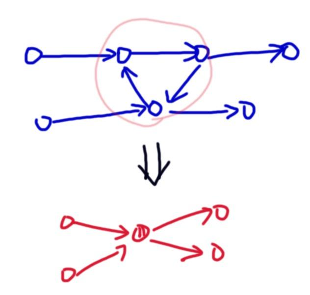
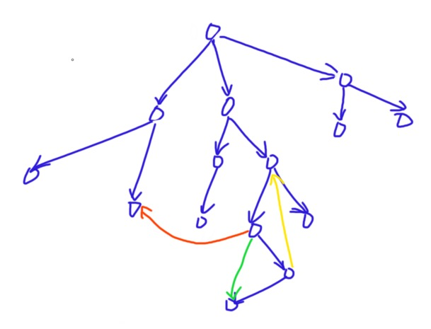
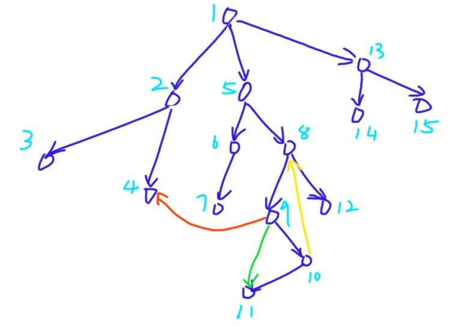
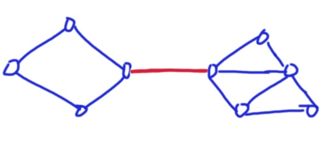
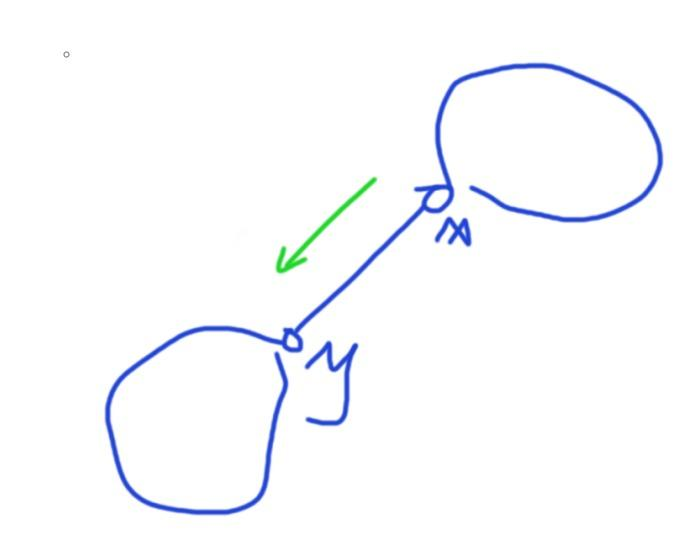
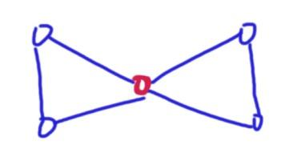
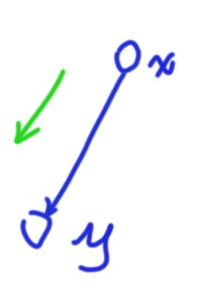
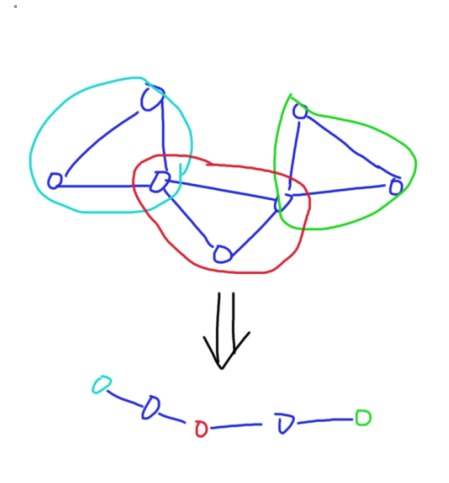

本文主要讲解强连通分量，双连通分量，以及缩点，割点与桥。

## 有向图的强连通分量

定义有向图中 **连通分量** $G(V,E)$ 为对于任意两点 $u,v\in V$ 都存在两条路径双向联通 $u,v$ 。**强连通分量** 即是图中的极大连通分量。

### Tarjan 缩点

缩点实现了将一个有向图转换成一个 DAG 的方法：将所有的强连通分量缩成一个点，然后连接。



所以关键在于 **求强连通分量** 。

>
>Q.那么我们要怎样才能判断一个点是否在一个强连通分量中？
>

我们对一个图 DFS ，得到一个 DFS 树：



我们把整个图中的边分为四大类：

1. 树枝边：即搜索树上的边，如图中蓝色边。
1. 前向边：祖先指向子孙的边，如图中绿色的边。树枝边可以看做是特殊的前向边。
1. 后向边：由子孙指向祖先的边，如图中黄色边。
1. 横向边：指向之前搜过的其他分支上的点的边，如图中橙色边。

分类之后我们发现，如果一个点能够 **通过横向边以及后向边走到自己的祖先**，那么他就在一个强联通分量，这个强连通分量 **至少包含它回到祖先经过的所有点和边，以及祖先到它的经过的所有点和边** 。

很好理解，如果出现了上面的情况，那么就构成了一个回路，一个回路一定是一个强连通分量。

#### Tarjan 求强连通分量

基于这个想法，Tarjan给出了一种求 SCC(强连通分量 strongly connected components 缩写) 的方法。

首先我们给每个点 $i$ 一个时间戳 $dfn_i$，即每个点被遍历到的顺序：



然后我们发现对于一条横向边或者后向边 $(x,y)$，$y$ 的时间戳总是大于等于 $x$。等于的情况是自环。

同时我们对每个点还需要记录一个时间戳 $low_i$ ，表示从 $i$ 开始走能遍历到的最小时间戳是什么。

现在有一个性质，若 $i$ 是一个 SCC 中的最高点，则有 $dfn_i=low_i$。

这个感性理解即可，不要求严谨证明，~~留作练习~~。

那么我们发现有一个点 $u$ 满足条件的时候，把它所在的强连通分量找出来即可，可以使用栈实现这个过程。

由于每个点只遍历一次，时间复杂度是线性的。

```cpp
void tarjan(int x)
{
	dfn[x]=low[x]=++tsp;//记录时间戳，low初始为自己的时间戳
	stk[++top]=x;inst[x]=1;//进栈，栈里的点可大致理解为当前没有搜完的SCC的所有点
	for(int i=head[x];i;i=nxt[i])
	{
		int y=ver[i];
		if(!dfn[y])//如果当前点没有被遍历过
		{
			tarjan(y);
			low[x]=min(low[x],low[y]);//更新dfn
		}
		else if(inst[y]) low[x]=min(low[x],dfn[y]);//如果被遍历过了，说明这是一个后向边或横叉边
	}
	if(dfn[x]==low[x])
	{
		++scc_cnt;
		int y;
		do{
			y=stk[top--];
			inst[y]=0;//出栈
			id[y]=scc_cnt;
			size_[scc_cnt]++;//标记当前点所在SCC编号，统计scc大小与点权和
			sum[scc_cnt]+=poi[y];
		}while(y!=x&&top);//一直出到 x 出栈。
	}
}
```

#### 求完之后

仅仅求一个强连通一般是不够的，我们要把图转化成一个 DAG。

我们遍历所有点，然后遍历所有相邻点，若发现 $i,j$ 不在同一个 SCC 中，那么我们在两个 SCC 之间加一条边。

然后就可以使用 DAG 的方法来解决问题了。

但是要注意的是，缩点之后按照 SCC 编号递减排序的序列一定是拓补序，所以很多时候我们不需要写拓补排序。

----

## 例题

### 校园网络

[$link$](https://www.luogu.com.cn/problem/P2746)

简化题意：

给定一张有向图，有两个子任务：
A. 最少从几个点开始遍历，能够遍历整个图？
B. 最少加几条边，能够保证整个图都是强连通的？

#### 解析

这种关系类的问题，我们可以先从 DAG 开始考虑。

- 对于 A 问题，我们可以很容易想到，在 DAG 情况下，我们需要且仅 需要对所有入度为 $0$ 的点发软件，那么所有学校就都会接受到软件。

    故答案就是入度为 $0$ 的点的个数。

- 对于 B 问题，我们需要把整个 DAG 连成一个 SCC ，关键在于入度为 $0$ 和出度为 $0$ 的点。

    由 A 问题启发，我们可以试着将所有入度为 $0$ 的点连成一个环，这样对于任意一个发到入度为 $0$ 的点软件，其他入度为 $0$ 的点都会收到这个软件。

    对于出度为 $0$ 的点，由于我们上面的一些入度为 $0$ 的点都对应了一个或几个出度为 $0$ 的点，我们要使得他们联通，需要把不对应的起点和终点连成一个环，可以构造出需要的最小代价为起点与终点里面最多的那类点的个数。

    所以答案就是入度为 $0$ 的点的个数与出度为 $0$ 的点的个数的最大值。

上面讨论了 DAG 的情况，对于不是 DAG 的情况，我们缩点即可。由于缩点缩的是强连通分量，里面的点两两可到达，故对答案没有影响。

```cpp
#include <bits/stdc++.h>
using namespace std;

const int N=500,M=1e5+10;

int head[M],ver[M],nxt[M],tot=0;
void add(int x,int y)
{
	ver[++tot]=y; nxt[tot]=head[x]; head[x]=tot;
}
int dfn[N],low[N],tsp=0;
int stk[N],top=0;
bool inst[N];
int id[N],scc_cnt=0;
int n;
int ind[N],oud[N];

void tarjan(int x)
{
	dfn[x]=low[x]=++tsp;
	stk[++top]=x; inst[x]=1;
	for(int i=head[x];i;i=nxt[i])
	{
		int y=ver[i];
		if(!dfn[y])
		{
			tarjan(y);
			low[x]=min(low[x],low[y]);
		}
		else if(inst[y]) low[x]=min(low[x],dfn[y]);
	}
	if(dfn[x]==low[x])
	{
		++scc_cnt;
		int y;
		do{
			y=stk[top--];
			id[y]=scc_cnt;
			inst[y]=0;
		}while(y!=x);
	}
}

int main()
{
	scanf("%d",&n);
	for(int i=1;i<=n;i++)
	{
		int x;
		while(scanf("%d",&x)!=EOF&&x) add(i,x);
	}
	for(int i=1;i<=n;i++)
		if(!dfn[i]) tarjan(i);
	for(int x=1;x<=n;x++)
	{
		for(int i=head[x];i;i=nxt[i])
		{
			int y=ver[i];
			if(id[x]!=id[y])
			{
				ind[id[y]]++;oud[id[x]]++;
			}
		}
	}
	int ans1=0,ans2=0;
	for(int i=1;i<=scc_cnt;i++)
	{
		if(!ind[i]) ans1++;
		if(!oud[i]) ans2++;
	}
	if(scc_cnt==1) printf("1\n0");
	else printf("%d\n%d",ans1,max(ans1,ans2));
	return 0;
}
```

### 『SCOI2011』糖果

[$link\ to\ luogu$](https://www.luogu.com.cn/problem/P3275)

简化题意：

有 $n$ 个变量，有 $k$ 组关系，关系有以下 $5$ 种：

1. $x_i=x_j$
2. $x_i<x_j$
3. $x_i\ge x_j$
4. $x_i>x_j$
5. $x_i\le x_j$

已知所有的 $x\ge 1$ ，求最小和。

#### 解析

在 [差分约束](https://www.cnblogs.com/IzayoiMiku/p/15308100.html) 中我们已经讨论了它的差分约束的SPFA做法。

但是这个题还可以使用强连通的做法来做，时间复杂度稳定线性。

我们观察这个图，发现：这个图的所有边权 $\ge 0$。

我们首先要求有无正环，若没有正环，我们要求某个点到各个点的最长路。同时我们考虑到一个环一定是强连通的，所以我们可以找出所有的强连通分量，判断里面的所有边边权是否大于 $1$。

若存在边权等于 $1$ 那么就无解；若不存在，我们考虑里面的所有点，它们的最长路一定是一样的，假如不一样，那么最长路最长的那个点可以没有损失地将它的最长路分享给其他点。最后仍然是一样的。

所以我们可以直接缩点在拓补序上 DP，时间复杂度 $O(n+m)$。

```cpp
#include <bits/stdc++.h>
using namespace std;
typedef long long ll;

const int N=3e5+10;

int head[N],ver[N<<1],nxt[N<<1],edg[N<<1],tot=0;
void add(int x,int y,int w)
{
	ver[++tot]=y; nxt[tot]=head[x]; edg[tot]=w; head[x]=tot;
}
int head2[N],ver2[N<<1],nxt2[N<<1],edg2[N<<1],tot2=0;
void add2(int x,int y,int w)
{
	ver2[++tot2]=y; nxt2[tot2]=head2[x]; edg2[tot2]=w; head2[x]=tot2;
}
int n,m;
int dfn[N],low[N],tsp=0;
int stk[N],top=0;
bool inst[N];
int scc_cnt=0,id[N],size_[N];
ll f[N<<1];

void tarjan(int x)
{
	dfn[x]=low[x]=++tsp;
	stk[++top]=x; inst[x]=1;
	for(int i=head[x];~i;i=nxt[i])
	{
		int y=ver[i];
		if(!dfn[y])
		{
			tarjan(y);
			low[x]=min(low[x],low[y]);
		}
		else if(inst[y])low[x]=min(low[x],dfn[y]);
	}
	if(dfn[x]==low[x])
	{
		int y;
		++scc_cnt;
		do{
			y=stk[top--];
			inst[y]=0;
			id[y]=scc_cnt;
			size_[scc_cnt]++;
		}while(y!=x);
	}
}

int main()
{
	scanf("%d%d",&n,&m);
	memset(head,-1,sizeof head);
	memset(head2,-1,sizeof head2);
	bool flag=0;
	for(int i=1;i<=m;i++)
	{
		int opt,x,y;
		scanf("%d%d%d",&opt,&x,&y);
		if(opt==1) add(x,y,0), add(y,x,0);
		if(opt==2) add(x,y,1), flag=(x==y?1:flag);
		if(opt==3) add(y,x,0);
		if(opt==4) add(y,x,1), flag=(x==y?1:flag);
		if(opt==5) add(x,y,0);
	}
	if(flag) {printf("-1");return 0;}
	for(int i=1;i<=n;i++) add(0,i,1);
	tarjan(0);
	for(int x=0;x<=n;x++)
	{
		for(int i=head[x];~i;i=nxt[i])
		{
			int y=ver[i];
			if(id[x]==id[y]&&edg[i]==1) return printf("-1")&0;
			if(id[x]!=id[y])
				add2(id[x],id[y],edg[i]);
		}
	}
	memset(f,-0x3f,sizeof f);
	f[scc_cnt]=0;
	for(int x=scc_cnt;x>=1;x--)
	{
		for(int i=head2[x];~i;i=nxt2[i])
		{
			int y=ver2[i];
			f[y]=max(f[x]+(ll)edg2[i],f[y]);
		}
	}
	ll ans=0;
	for(int i=1;i<=scc_cnt;i++)
		ans+=(ll)f[i]*1LL*size_[i];
	printf("%lld",ans);
	return 0;
}
```

----
----

## 无向图的双连通分量

双连通分量(DCC)是一个很泛的概念，一般有两种双连通分量：**点双连通分量(e-DCC)** 和 **边双连通分量(v-DCC)**。

### 边双连通分量

要定义边双连通分量，我们要引入一个概念：**桥**。

**桥**：桥是一条边，当删去这条边之后其所在连通子图不再连通。



上图中的红色边就是一个桥。

**边双连通分量**：不包含桥的极大连通子图就叫做边双连通分量。

边双连通分量有一些有意思的性质：

- 删去内部任意一条边不会改变其连通性。
- 对于内部任意两点，存在两条边不相交路径连接这两点

#### Tarjan 与边联通分量

我们仍然引用时间戳的概念：

$dfn_x$，记录每个点的到达时间。$low_x$ 表示这个点继续往下搜索能找到的最早的点。

对于有向图，我们有横叉边的概念。但是对于无向图，是不存在这个概念的。其他概念都可以继承。

>
>如何找到所有的桥？
>



上图中边 $(x,y)$ 就是一个桥，绿色的箭头是我们 DFS 遍历的方向。

对于这条边，我们一旦到达了 $y$ 所在的连通分量就不会再回到 $x$ 所在的连通分量了，所以一定有 $low_y<dfn_x$。

>
>知道了桥，我们如何找到所有的边联通分量？
>

做法很多，介绍两种：

1. 删掉所有的桥。此时所有的连通块就是边连通分量。好写好理解。

2. 我们可以使用栈来做。考虑桥的性质，以上面图中的情况举例，我们发现 $y$ 永远不会回到 $x$ 以及更早的点，否则与 $(x,y)$ 为桥这个条件矛盾。

    或者说，$dfn_y=low_y$。推而广之，我们可以得到对于一个边双的最早的点，它一定是我们开始搜索的点或者桥的一个端点，且严格满足 $dfn_x=low_x$。我们可以使用类似求 SCC 的方法用栈将其处理出。

```cpp
void tarjan(int x,int f)
{
	dfn[x]=low[x]=++tsp;
	stk[++top]=x; inst[x]=1;
	for(int i=head[x];~i;i=nxt[i])
	{
		int y=ver[i];
		if(y==f) continue;
		if(!dfn[y])
		{
			tarjan(y,x);
			low[x]=min(low[x],low[y]);
			if(dfn[x]<low[y]) isb[i]=isb[i^1]=1;//标记所有的桥
		}
		low[x]=min(low[x],dfn[y]);
	}
	if(dfn[x]==low[x])
	{
		int y;
		++dcc_cnt;
		do{
			y=stk[top--];
			inst[y]=0;
			id[y]=dcc_cnt;
			++size_[dcc_cnt];
		}while(y!=x);
	}
}
```

### 点双连通分量

定义点双连通分量，我们要引入一个概念：**割点**。

**割点**：割点是一个点，当删去这个点以及与它相关的边之后其所在连通子图不再连通。



上图中的红色点就是一个割点。

**点双连通分量**：不包含割点的极大联通子图即为点双连通分量。

#### Tarjan 求点双

这仍然是基于时间戳的算法，我们还是要去记录 $dfn_x$ 与 $low_x$。定义与方法都和上面相同。

>
>如何求割点
>

我们考虑割点的性质。



对于 $x$ ，如果当 $low_y\ge dfn_x$ ，那么就是说 $y$ 怎么也走不到 $x$ 的上面，$x$ 是割点。

但是也有特殊情况，比如 $x$ 是根节点的时候，可能有一个 $low_y\ge dfn_x$，但我们不能说它就是割点。当 $x$ 是根节点的时候，我们需要保证有两个 $y$ 使得 $low_y\ge dfn_x$

```cpp
void tarjan(int x,int f)
{
	dfn[x]=low[x]=++tsp;
	int son=0;
	for(int i=head[x];i;i=nxt[i])
	{
		int y=ver[i];
		if(y==f) continue;
		if(!dfn[y])
		{
			tarjan(y,x);
			low[x]=min(low[x],low[y]);
			if(low[y]>=dfn[x]&&x!=f) cut[x]=1;
			if(x==f) son++;
		}
		else low[x]=min(low[x],dfn[y]);
	}
	if(son>=2&&x==f) cut[x]=1;
}
```

>
>如何求点双联通分量
>

还是使用栈实现。

我们遇到一个 $low_y\ge dfn_x$ 意味着只要 $x$ 不是根节点那么它就是一个割点。我们弹出栈内节点直到弹出 $y$ 为止。但实际上 $x$ 也属于该点双连通分量。

注意一个割点可能属于多个点双连通分量。

```cpp
void tarjan(int x,int f)
{
	dfn[x]=low[x]=++tsp;
	stk[++top]=x;
	if(x==f&&!head[x])
	{
		++dcc_cnt;
		dcc[dcc_cnt].push_back(x);
		return ;
	}
	int son=0;
	for(int i=head[x];i;i=nxt[i])
	{
		int y=ver[i];
		if(y==f) continue;
		if(!dfn[y])
		{
			tarjan(y,x);
			low[x]=min(low[x],low[y]);
			if(dfn[x]<=low[y])
			{
				son++;
				if(x!=f||(x==f&&son>1)) cut[x]=1;
				++dcc_cnt;
				int k;
				do{
					k=stk[top--];
					dcc[dcc_cnt].push_back(k);
				}while(k!=y);
				dcc[dcc_cnt].push_back(x);
			}
		}
		else low[x]=min(low[x],low[y]);
	}
}
```

----

## 例题

### USACO06JAN G 冗余路径

[$link$](https://www.luogu.com.cn/problem/P2860)

#### 题意

为了从 $N(1≤N≤5000)$ 个草场中的一个走到另一个，贝茜和她的同伴们有时不得不路过一些她们讨厌的可怕的树．奶牛们已经厌倦了被迫走某一条路，所以她们想建一些新路，使每一对草场之间都会至少有两条相互分离(即没有公共边)的路径，这样她们就有多一些选择．

每对草场之间已经有至少一条路径．给出所有 $M(N-1≤M≤10000)$ 条双向路的描述，每条路连接了两个不同的草场，请计算最少的新建道路的数量, 路径由若干道路首尾相连而成．两条路径相互分离，是指两条路径没有一条重合的道路．但是，两条分离的路径上可以有一些相同的草场． 对于同一对草场之间，可能已经有两条不同的道路，你也可以在它们之间再建一条道路，作为另一条不同的道路．

#### 解析

给我们一个无向连通图。最少加几条边，可以把它变成一个边双连通分量。

我们肯定是不会在某一个边双联通内部加边，因为那是没有意义的。所以我们首先将所有的边双缩点，现在这个图里面都是桥了。整个图会是一个树的形态。

我们怎么考虑把一个树搞成双连通分量。

显然对于任意一个度数为 $1$ 的点都要链接一条边。所以我们可以考虑两两连接度数为 $1$ 的点。这样就是最大化每条边的利用了。可以证明最小的加边方案就是 $\lfloor\frac{cnt}{2}\rfloor$，$cnt$ 是度为 $1$ 的点。

```cpp
#include <bits/stdc++.h>
using namespace std;

const int N=1e5+10;

int head[N],ver[N<<1],nxt[N<<1],tot=0;
void add(int x,int y)
{
	ver[tot]=y; nxt[tot]=head[x]; head[x]=tot++;
}
int dfn[N],low[N],tsp=0;
int stk[N],top=0;
bool inst[N],isb[N];
int dcc_cnt=0,id[N],size_[N],dg[N];

int n,m;

void tarjan(int x,int f)
{
	dfn[x]=low[x]=++tsp;
	stk[++top]=x; inst[x]=1;
	for(int i=head[x];~i;i=nxt[i])
	{
		int y=ver[i];
		if(y==f) continue;
		if(!dfn[y])
		{
			tarjan(y,x);
			low[x]=min(low[x],low[y]);
			if(dfn[x]<low[y]) isb[i]=isb[i^1]=1;
		}
		low[x]=min(low[x],dfn[y]);
	}
	if(dfn[x]==low[x])
	{
		int y;
		++dcc_cnt;
		do{
			y=stk[top--];
			inst[y]=0;
			id[y]=dcc_cnt;
			++size_[dcc_cnt];
		}while(y!=x);
	}
}

int main()
{
	memset(head,-1,sizeof head);
	scanf("%d%d",&n,&m);
	for(int i=1;i<=m;i++)
	{
		int x,y;
		scanf("%d%d",&x,&y);
		add(x,y); add(y,x);
	}
	for(int i=1;i<=n;i++)
		if(!dfn[i]) tarjan(i,i);
	for(int i=0;i<tot;i++) if(isb[i]) dg[id[ver[i]]]++;
	int cnt=0;
	for(int i=1;i<=dcc_cnt;i++)
		if(dg[i]==1) ++cnt;
	printf("%d",(cnt&1?cnt/2+1:cnt/2));
	return 0;
}
```

---

### 『模板』割点

[$link$](https://www.luogu.com.cn/problem/P3388)

给图求割点的模板。

```cpp
#include <bits/stdc++.h>
using namespace std;

const int N=1e5+10;

int head[N],ver[N<<1],nxt[N<<1],tot=0;
void add(int x,int y)
{
	ver[++tot]=y; nxt[tot]=head[x]; head[x]=tot;
}
int n,m;
int dfn[N],low[N],tsp;
int stk[N],top=0;
bool inst[N],cut[N];
int cnt=0;

void tarjan(int x,int f)
{
	dfn[x]=low[x]=++tsp;
	int son=0;
	for(int i=head[x];i;i=nxt[i])
	{
		int y=ver[i];
		if(y==f) continue;
		if(!dfn[y])
		{
			tarjan(y,x);
			low[x]=min(low[x],low[y]);
			if(low[y]>=dfn[x]&&x!=f) cut[x]=1;
			if(x==f) son++;
		}
		low[x]=min(low[x],dfn[y]);
	}
	if(son>=2&&x==f) cut[x]=1;
}

int main()
{
	scanf("%d%d",&n,&m);
	for(int i=1;i<=m;i++)
	{
		int x,y;
		scanf("%d%d",&x,&y);
		add(x,y); add(y,x);
	}
	for(int i=1;i<=n;i++)
		if(!dfn[i]) tarjan(i,i);
	for(int i=1;i<=n;i++)
		if(cut[i]) cnt++;
	printf("%d\n",cnt);
	for(int i=1;i<=n;i++)
		if(cut[i]) printf("%d ",i);
	return 0;
}

```

---

### 『HNOI 2012』矿场搭建

[$link$](https://www.luogu.com.cn/problem/P3225)

给定一个无向图，求最少在几个点上设置出口可以使得删去一个点后其他任意一个点都与一个出口连通。

#### 解析

我们关注某一个连通块，不同的连通块之间可以做乘法原理。

对于一个连通块有两种情况：

1. 没有割点。

    此时我们至少需要设置两个出口。设这个连通块的点数量为 $cnt$，答案是 $\binom{cnt}{2}$。

2. 有割点

    我们首先要将 v-DCC 缩成一个点，内部的点都是双连通的，坍塌一个点没有影响。这里的缩点方式有所不同，我们需要将割点单独作为一个点出来。然后每个 v-DCC 向它包含的割点连边。

    过程大概如下：

    

    缩完之后，我们考察各个 v-DCC 的度数 $d_n$ 是多少。

    - $d_n=1$

        此时如果这个 v-DCC 连接的割点坏掉，而它的内部没有出口，那么里面的人就会困死，所以我们要在这个 v-DCC 的内部 **非割点** 的地方放置 $1$ 个出口。

    - $d_n\ge 2$

        此时无论哪个割点坏掉了，里面的人都可以从另外的割点跑到其他的 v_DCC 中然后从其他出口出去。

        由于我们对一个无向连通图缩点后得到的是一个无向树，所以里面至少有 $2$ 个度数为 $1$ 的点，故无论哪里坍塌了，所有度数为 $2$ 的点都有地方可以去。故不用在这样的 v-DCC 内建立出口

所以我们需要求出所有的点双联通分量，统计里面有多少割点，然后按照上面过程统计答案即可。

code:

```cpp
#include <bits/stdc++.h>
using namespace std;

const int N=10100,M=5100;
typedef unsigned long long ull;

int n,m;
int head[N],ver[N<<1],nxt[N<<1],tot=0;
void add(int x,int y)
{
	ver[++tot]=y; nxt[tot]=head[x]; head[x]=tot;
}
int dfn[N],low[N],tsp=0;
int stk[N],top=0;
bool inst[N],cut[N];
int dcc_cnt=0;
vector<int> dcc[N];

void tarjan(int x,int f)
{
	dfn[x]=low[x]=++tsp;
	stk[++top]=x;
	if(x==f&&!head[x])
	{
		++dcc_cnt;
		dcc[dcc_cnt].push_back(x);
		return ;
	}
	int son=0;
	for(int i=head[x];i;i=nxt[i])
	{
		int y=ver[i];
		if(y==f) continue;
		if(!dfn[y])
		{
			tarjan(y,x);
			low[x]=min(low[x],low[y]);
			if(dfn[x]<=low[y])
			{
				son++;
				if(x!=f||(x==f&&son>1)) cut[x]=1;
				++dcc_cnt;
				int k;
				do{
					k=stk[top--];
					dcc[dcc_cnt].push_back(k);
				}while(k!=y);
				dcc[dcc_cnt].push_back(x);
			}
		}
		else low[x]=min(low[x],low[y]);
	}
}

int main()
{
	int opt=0;
	while(scanf("%d",&m)&&m)
	{
		memset(head,0,sizeof head); tot=0;
		for(int i=1;i<=dcc_cnt;i++) dcc[i].clear();
		memset(dfn,0,sizeof dfn); n=tsp=top=dcc_cnt=0;
		memset(cut,0,sizeof cut);
		memset(inst,0,sizeof inst);
		++opt;
		for(int i=1;i<=m;i++)
		{
			int x,y;
			scanf("%d%d",&x,&y);
			n=max(n,max(x,y));
			add(x,y); add(y,x);
		}
		for(int i=1;i<=n;i++)
			if(!dfn[i]) tarjan(i,i);
		int res=0;
		ull num=1;
		for(int i=1;i<=dcc_cnt;i++)
		{
			int cnt=0;
			for(int j=0;j<dcc[i].size();j++)
				if(cut[dcc[i][j]]) ++cnt;
			if(cnt==0) res+=2,num*=(dcc[i].size()*(dcc[i].size()-1))/2;
			else if(cnt==1) res+=1,num*=(dcc[i].size()-1);
		}
		printf("Case %d: %d %llu\n",opt,res,num);//
	}
	return 0;
}
```
