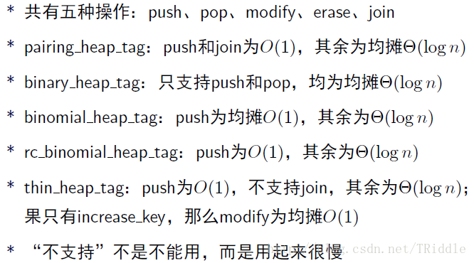
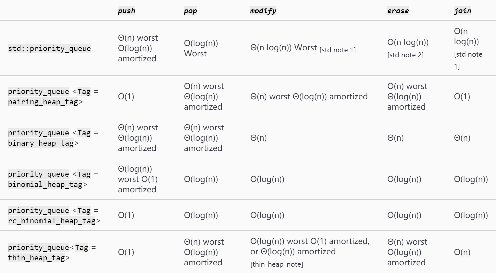

## `__gnu__pbds` 库

听说 NOIp 能用这东西了，故速来测试把玩。

 `__gnu__pbds` 库是 GNU-C++ 自带的一个扩展库，里面封装了哈希，trie，以及几种树，和堆(优先队列)。

## hash 表

pbds中封装了两种 hash 表：

```cpp
#include <ext/pb_ds/assoc_container.hpp>
#include <ext/pb_ds/hash_policy.hpp>

using namespace __gnu_pbds;

cc_hash_table<string,bool> dict;
gp_hash_table<string,bool> dict;
```

这两个东西一个是拉链法 `cc`，一个是查探法 `gp`。用法和 `map` 一样。

对其进行一个大概的测试。测试题目是 P3370字符串hash 的 ~~(私自)~~ 加强版。[题目链接](https://www.luogu.com.cn/problem/U177605) (内含数据与数据生成器)

测试方式是分别提交三次，取平均数。提交为 C++11，无O2

~~代码自己去题目里面翻~~

计算保留一位小数

`map`：$\frac 13(620ms+624ms+625ms)=623.0ms$

`cc_hash_table`：$\frac 13(362ms+352ms+363ms)=362.2ms$

`gp_hash_table`：$\frac 13(403ms+402ms+423ms)=409.3ms$

`unordered_map`：$\frac 13(322ms+334ms+324ms)=326.7ms$

~~恭喜 `unordered_map` 摘得桂冠~~

值得注意的是，在使用 `pbds` 库的时候编译时间明显延长。

---

## 堆

`pbds` 中有五种堆，用 `tag` 来区分，分别是：

- `binary_heap_tag` 二叉堆
- `binomial_heap_tag` 二项堆
- `pairing_heap_tag` 配对堆
- `thin_heap_tag` 改良斐波那契堆
- `rc_binomial_heap_tag` 冗余计数二项堆(？)

常用操作：

```
push()  //插入一个元素
top()    //同 STL
size()   //同 STL
empty()  //同 STL
clear()  //同 STL
pop()    //同 STL
join(priority_queue &other)            //合并两个堆,other会被清空
split(Pred prd,priority_queue &other)  //分离出两个堆
modify(point_iterator it,const key)    //修改一个节点的值
```



官网中给出的表格



我们测试配对堆，二项堆，和冗余计数二项堆在 P3377 可并堆 一题中的表现如何。

配对堆：$272ms$，二项堆 $306ms$，冗余计数二项堆 $720ms$。

code
```cpp
#include <bits/stdc++.h>
#include <ext/pb_ds/assoc_container.hpp>
#include <ext/pb_ds/priority_queue.hpp>
using namespace std;
using namespace __gnu_pbds;

const int N=2e5+10;

int fa[N];
void init_(int n)
{
	for(int i=0;i<=n;i++)
		fa[i]=i;
}
int find(int x)
{
	int x_root=x;
	while(fa[x_root]!=x_root) x_root=fa[x_root];
	while(x!=x_root)
	{
		int tmp=fa[x];
		fa[x]=x_root;  x=tmp;
	}
	return x_root;
}

struct node
{
	int s,id;
	bool operator< (const node &p) const
	{
		if(s==p.s) return id>p.id;//这个东西的排序是反着的，一定注意！
		else return s>p.s;
	}
}; //似乎这个pbds里面所有的堆和树都不能处理重复元素

typedef __gnu_pbds::priority_queue<node,less<node>,pairing_heap_tag > Heap;

Heap q[N];
Heap::iterator itx,ity;

int n,m;
bool vis[N];

int main()
{
//	freopen("P3377_5.in","r",stdin);
//	freopen("ans.out","w",stdout);
	scanf("%d%d",&n,&m);
	init_(n);
	for(int i=1;i<=n;i++)
	{
		int x;
		scanf("%d",&x);
		q[i].push((node){x,i});
	}
	for(int i=1;i<=m;i++)
	{
		int opt;
		scanf("%d",&opt);
		if(opt==1)//合并两个堆
		{
			int x,y;
			scanf("%d%d",&x,&y);
			int x_root=find(x),y_root=find(y);
			if(x_root==y_root||vis[x]||vis[y]) continue;
			if(q[x_root].size()>q[y_root].size())
				q[x_root].join(q[y_root]),fa[y_root]=x_root;
			else
				q[y_root].join(q[x_root]),fa[x_root]=y_root;//启发式合并
		}
		else //删除堆顶元素
		{
			int x;
			scanf("%d",&x);
			int x_root=find(x);
			if(vis[x]||q[x_root].empty())
			{
				printf("-1\n");
				continue;
			}
			else
			{
				node tmp=q[x_root].top();
				q[x_root].pop();
				vis[tmp.id]=1;
				printf("%d\n",tmp.s);
			}
		}
	}
	return 0;
}
```

## 树

pbds 中还封装了三种树：红黑树，Splay，ordered-vector tree (没找到通用译名就直接用英文了)。

~~使用方法先咕着后面来补~~
