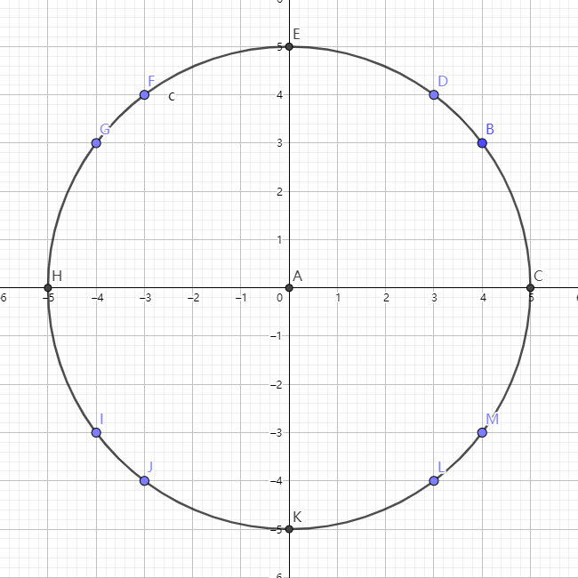

## P2508 [HAOI2008]圆上的整点

给定圆 $x^2+y^2=r^2$ 求圆上的整点数。

讲解参考：[【官方双语】隐藏在素数规律中的π —— 3Blue1Brown](https://www.bilibili.com/video/BV1kx411q7kK)

---

解决问题：$x^2+y^2=N$ 上的整点数

我们看一个半径 $r=\sqrt{25}=5$ 的圆上有哪些整点：

由于 $5^2+0^2=25$ 所以有 $(5,0)$ 和 $(0,5)$。

由于 $3^2+4^2=25$ 所以有 $(3,4)$ 和 $(4,3)$。

又因为我们乘 $-1$ 没有影响，所以还有 $(-5,0),(0,-5),(3,-4),(-3,4),(-3,-4),\\(4,-3),(-4,3)(-4,-3)$ 等一众整点。

而对于 $r=\sqrt {11}$ ，我们无法找到两个整数平方和等于 $11$ ，故它一个整点也不会经过。

我们将圆扔进复平面，不如将一个整点 $(3,4)$ 看做一个复数 $3+4i$。同时有了新的考虑它的坐标和 $3^2+4^2$ 方法：我们让这个复数乘上它的复共轭。
