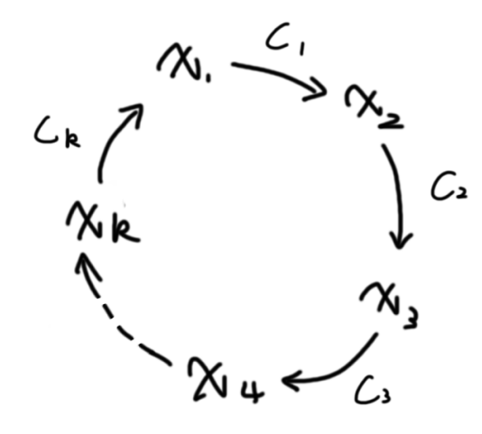

## 差分约束

~~NOIp%你怎么考这啊这我怎么没学啊赶紧补课~~

我们对于一组形如 $x_i\le x_j+c_k$ 的不等式组，可以使用 **差分约束** 求出不等式组的一组 **可行解** 。

观察 $x_i\le x_j+c_k$ 的形式，我们会联想到 $dis_x\le dis_y+w_i$ ，这是最短路的判定式移了个项。同时我们可以知道，我们做完最短路之后，只要图中没有负环，所有的 $dis_x$ 都满足上面的式子。

这意味着我们可以把不等式组的问题转化成一个差分约束的问题。我们将每一个不等式都抽象成边，就将其转换成了一个图论最短/长路问题。需要注意的是，我们跑最短路的时，必须 **找到一个源点能够遍历到所有的边，这样才能考虑到所有的限制条件**。

### 可行解

一般的求可行解的步骤：

1. 先把每个不等式 $x_i\le x_j+c_k$ 转化成一条 $x_j$ 连向 $x_i$ 的权值为 $c_k$ 的有向边。
2. 找一个源点，使得该点能够遍历到所有的边。
3. 从源点求一遍单元最短路。

单源最短路有另外一个问题：负环。

我们来把负环的情况放在不等式中考虑：

假设环的形态如下：



我们根据图中得到的不等关系进行放缩：

那么 $x_2\le x_1+c_1\le x_k+c_1+c_k\le \cdots \le x_2+c_1+c_k+c_{k-1}+\cdots c_4+c_3+c_2$

由于这是个负环，所以 $\sum_{i=1}^kc_i < 0$，设这个式子结果为 $p$，则 $x_2\le x_2+p,\ p<0$。显然不成立。

所以，当图中出现 **负环的时候，证明不等式组无解**。

### 求变量最值

结论：

- **如果求最小值，则化成 $x_i\ge x_j+c$ 求最长路。**
- **如果求最大值，则化成 $x_i\le x_j+c$ 求最短路。**

求最值的时候一定会有一个条件类似 $x_i\le k$，$k$ 为常数。如果没有这类大于或小于常数的限制，那么对于任意一组可行解 $\{x_1,x_2,\dots,x_k\}$ 以及任意一个 $d\in R$ ，$\{x_1+d,x_2+d,\dots x_k+d\}$ 都是一组可行解，没有最值一说。

> 如何转化 $x_i\le k$ 这类的不等式呢？

我们可以先建立一个超级源点 $0$，然后建立 $0\to i$ 的长度为 $k$ 一条边即可。

> 为什么我们这样做就可以求出最大/最小值？

我们以求 $x_i$ 的最大值为例子说明：

从上面负环的例子可以知道，我们从 $0$ 开始求到 $x_i$ 的最短路，其实是求出一个有关变量 $x_i$ 的不等式链，不等式链最后都能转化为 $x_i\le \sum_{i=1}^kc_i$。那么所有的不等式链的 $\sum c_i$ 的最小值就是 $x_i$ 的上界。

同理，求最小值就是在所有的下界中找最大值。

---
---

## 例题

### 『SCOI2011』糖果

[$link\ to\ luogu$](https://www.luogu.com.cn/problem/P3275)

简化题意：

有 $n$ 个变量，有 $k$ 组关系，关系有以下 $5$ 种：

1. $x_i=x_j$
2. $x_i<x_j$
3. $x_i\ge x_j$
4. $x_i>x_j$
5. $x_i\le x_j$

已知所有的 $x\ge 1$ ，求最小和。

#### 解析

来看一下这五种关系：

1. $x_i=x_j\Rightarrow x_i\ge x_j, x_j\ge x_i$。
2. $x_i<x_j\Rightarrow x_j\ge x_i+1$
3. $x_i\ge x_j$ 不需要转化
4. $x_i>x_j\Rightarrow x_i\ge x_j+1$
5. $x_i\le x_j\Rightarrow x_j\ge x_i$。

**注意隐含条件：** $\forall x\ge 1$。

那么这就是所有我们需要的用来建立不等式组的不等式。直接建图跑最长路即可。

```cpp
#include <bits/stdc++.h>
using namespace std;
typedef long long ll;

const int N=200010,M=400010;

ll n,m;
ll head[M],nxt[M],ver[M],edg[M],tot=0;
ll dis[N],cnt[N];
queue<int> q;
bool vis[N];

void add(int x,int y,int z)
{
	ver[++tot]=y;
	edg[tot]=z;
	nxt[tot]=head[x];
	head[x]=tot;
}

bool spfa()
{
	memset(dis,-0x3f,sizeof dis);
	dis[0]=0,vis[0]=1;
	q.push(0);

	while(q.size())
	{
		int x=q.front();
		q.pop();
		vis[x]=0;
		for(int i=head[x];i;i=nxt[i])
		{
			int y=ver[i];
			if(dis[y]<dis[x]+edg[i])
			{
				dis[y]=dis[x]+edg[i];
				if(!vis[y])
				{
					cnt[y]++;
					vis[y]=1;
					q.push(y);
					if(cnt[y]>n) return 0;//判环
				}
			}
		}
	}
	return 1;
}


int main()
{
	scanf("%lld%lld",&n,&m);
	bool flag=0;
	for(int i=1;i<=m;i++)
	{
		int x,a,b;
		scanf("%d%d%d",&x,&a,&b);
		if(x==1) add(a,b,0),add(b,a,0);
		else if(x==2) add(a,b,1),flag=(a==b?1:flag);
		else if(x==3) add(b,a,0);
		else if(x==4) add(b,a,1),flag=(a==b?1:flag);
		else add(a,b,0);
	}
	if(flag==1)
	{
		cout<<-1;
		return 0;
	}

	for(int i=n;i>=1;i--)
		add(0,i,1);
	flag=spfa();
	ll ans=0;
	for(int i=1;i<=n;i++)
		ans+=dis[i];
	if(flag==0) printf("-1");
	else printf("%lld",ans);
	return 0;
}

```
---

### 区间

给定 $n$ 个区间 $[a_i,b_i]$ 和 $n$ 个整数 $c_i$。

你需要构造一个整数集合 $Z$，使得 $\forall i\in [1,n]$，$Z$ 中满足 $a_i≤x≤b_i$ 的整数 $x$ 不少于 $c_i$ 个。

求这样的整数集合 $Z$ 最少包含多少个数。

#### 解析

~~满脑子都是贪心.jpg~~

看着和我们上面讲到的模型没有一点关系是吧？

设 $S_i$ 是 $[1,i]$ 中被选中的数的个数。

我们要求的是 $S_{50001}$ 的最小值。

此时我们试着分析 $S_i$ 的规律，发现：

1. $S_i\ge S_{i-1},\ i\in [1,50001]$

2. $S_i-S_{i-1}\le 1\Rightarrow S_{i-1}+1\ge S_i,i\in [1,50001]$

3. 对于每一个 $[a_i,b_i],S_{b_i}-S_{a_i-1}\ge c_i$。

现在我们想一下，是否是只要满足这几个条件方案就一定合法？

前两个条件是数字的性质，第三条件就是我们题中的限制条件，条件是够了。

然后我们需要找是否有一个源点能遍历到所有的边。由于第一个条件连接所有点成了一条链，所以我们能遍历到所有的点，自然也能摸到所有的边。

所以建边最长路即可。

```cpp
#include <bits/stdc++.h>
using namespace std;

const int N=1e5+10;

int n;
int head[N],ver[N<<1],nxt[N<<1],edg[N<<1],tot=0;
void add(int x,int y,int w)
{
	ver[++tot]=y; edg[tot]=w; nxt[tot]=head[x]; head[x]=tot;
}

int read()
{
	int x=0,w=1;
	char ch=getchar();
	while(ch<'0'||ch>'9') w*=(ch=='-'?-1:1),ch=getchar();
	while(ch>='0'&&ch<='9') x=(x<<1)+(x<<3)+ch-'0',ch=getchar();
	return x*w;
}

int dis[N];
bool vis[N];

void spfa()
{
	memset(vis,0,sizeof vis);
	memset(dis,-0x3f,sizeof dis);
	queue<int> q;
	dis[0]=0; vis[0]=1;
	q.push(0);
	while(q.size())
	{
		int x=q.front();
		q.pop();
		vis[x]=0;
		for(int i=head[x];i;i=nxt[i])
		{
			int y=ver[i];
			if(dis[y]<dis[x]+edg[i])
			{
				dis[y]=dis[x]+edg[i];
				if(!vis[y])
				{
					vis[y]=1;
					q.push(y);
				}
			}
		}
	}
}

int main()
{
	n=read();
	for(int i=1;i<=50001;i++)
	{
		add(i,i-1,-1);
		add(i-1,i,0);
	}
	for(int i=1;i<=n;i++)
	{
		int a,b,c;
		a=read();b=read();c=read();
		add(a-1,b,c);
	}
	spfa();
	printf("%d",dis[50001]);
	return 0;
}
```
---

### 『USACO2005Dec. G』Layout

[$link\ to\ luogu$](https://www.luogu.com.cn/problem/P4878)

不复述题面了自己去看。

#### 解析

设 $x_i$ 是第 $i$ 头奶牛到第一头奶牛的距离。

题面明确了两种条件：

1. $x_a-x_b\ge L$
2. $x_a-x_b\le R$

同时，所有的 $x_i\ge 0,x_i\le x_i-1$。

我们要求 $x_n$ 的最大值，显然要跑最短路。

那么整理一下不等式：

$$
\begin{cases}
x_i\le x_{i+1}\\
x_b \le x_a+L\\
x_a \le x_b-R\
\end{cases}
$$

我们发现连通性似乎有问题，所以我们再加一个不等式： $x_i\ge 0$。这相当于建立了一个超级源点，向每个点都连了一条边。但是我们没有必要把它显性建立出来，只需要在一开始把所有点都入队即可。

现在我们要想如何判定 $1$ 号点与 $n$ 号点距离能否无限大。

此时我们可以令 $x_1$ 为一个定值：让 $x_1=0$，然后去找 $x_n$ 是否受影响。

具体做法：我们只需要从 $x_1$ 向 $x_n$ 跑一遍最短路，判定是否能达到无限大就行了。

```cpp
#include <bits/stdc++.h>
using namespace std;

const int N=1e4+10,M=1e6+10;

int head[N],ver[M],nxt[M],edg[M],tot=0;
void add(int x,int y,int w)
{
	ver[++tot]=y; edg[tot]=w; nxt[tot]=head[x]; head[x]=tot;
}
int n,ml,mr;
int read()
{
	int x=0,w=1;
	char ch=getchar();
	while(ch<'0'||ch>'9') w*=(ch=='-'?-1:1),ch=getchar();
	while(ch>='0'&&ch<='9') x=(x<<1)+(x<<3)+ch-'0',ch=getchar();
	return x*w;
}

int dis[N],cnt[N];
bool vis[N];

bool spfa(int k)
{
	memset(dis,0x3f,sizeof dis);
	memset(vis,0,sizeof vis);
	memset(cnt,0,sizeof cnt);
	queue<int> q;
	for(int i=1;i<=k;i++)
	{
		q.push(i);
		vis[i]=1; dis[i]=0;
		cnt[i]++;
	}
	while(q.size())
	{
		int x=q.front();
		q.pop();
		vis[x]=0;
		for(int i=head[x];i;i=nxt[i])
		{
			int y=ver[i];
			if(dis[y]>dis[x]+edg[i])
			{
				dis[y]=dis[x]+edg[i];
				if(!vis[y])
				{
					vis[y]=1;
					q.push(y);
					if(++cnt[y]>n) return 0;
				}
			}
		}
	}
	return 1;
}

int main()
{
	n=read(),ml=read(),mr=read();
	for(int i=1;i<n;i++) add(i+1,i,0);
	for(int i=1;i<=ml;i++)
	{
		int a,b,c;
		a=read(); b=read(); c=read();
		if(b<a) swap(a,b);
		add(a,b,c);
	}
	for(int i=1;i<=mr;i++)
	{
		int a,b,c;
		a=read(); b=read(); c=read();
		if(b<a) swap(a,b);
		add(b,a,-c);
	}
	if(!spfa(n))
	{
		printf("-1");
		return 0;
	}
	spfa(1);
	if(dis[n]==0x3f3f3f3f) printf("-2");
	else printf("%d",dis[n]);
	return 0;
}
```
