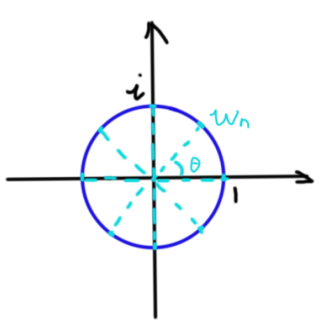
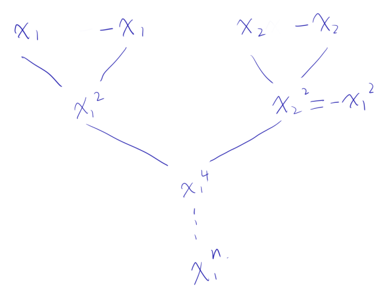
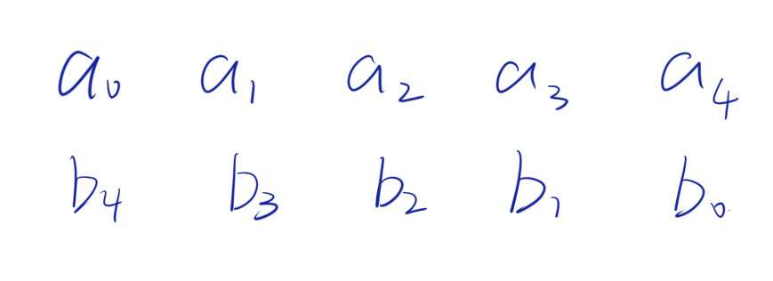
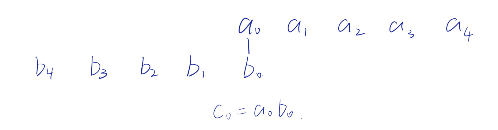
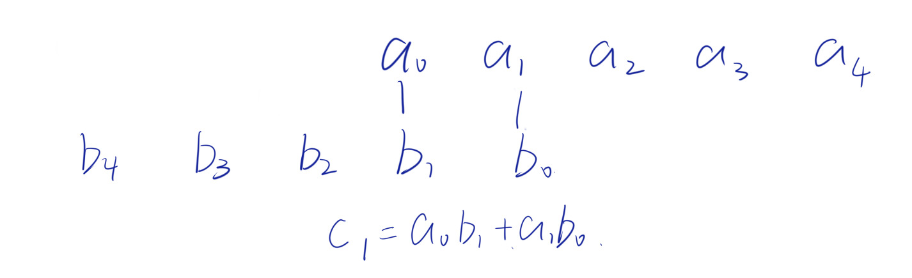
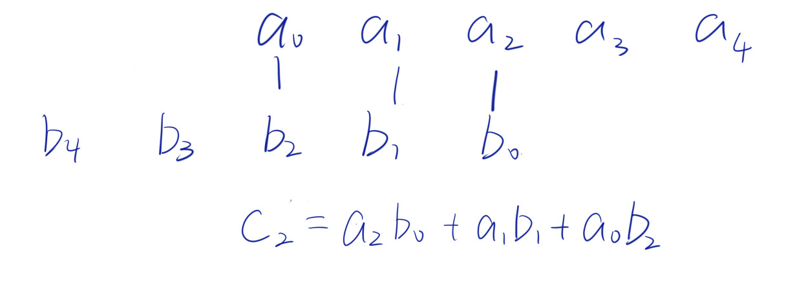
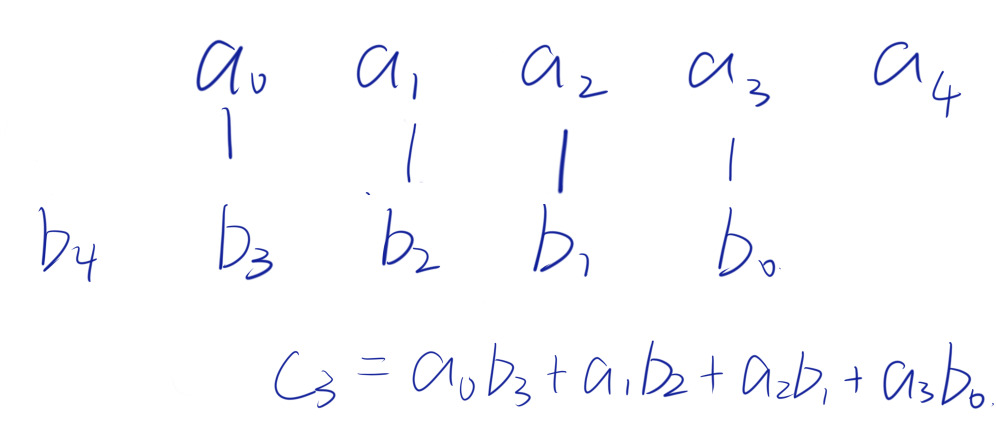
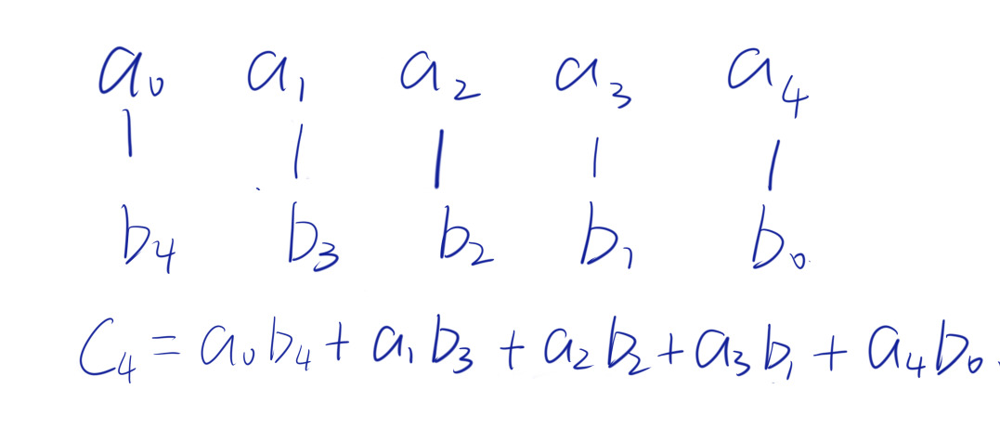

## 前置知识

FFT（Fast Fourier Transformation），中文名快速傅里叶变换，OI中用来加速多项式乘法。实际上是离散傅里叶变换 (Discrete,Fourier Transformation，DFT) 的计算机快速计算方法的统称

朴素高精度乘法时间 $O(n^2)$，但 FFT 能 $O(n\log n)$ 内解决

### 点值表达式

对于多项式 $A(x)=a_0+a_1x+a_2x^2+a_3x^3\dots a_nx^n$。

**任意** $n+1$ **个不同点** $(x_1,A(x_1)),(x_2,A(x_2)),\dots ,(x_{n+1},A(x_{n+1}))$ **可以唯一确定一组** $\{a_i\}$ 。

不严谨验证：

我们将所有的点代入，试图求 $\{a_i\}$ ，得到一个如下图的方程组：

$$
\begin{cases}
a_0+a_1x_1+a_2x_1^2+\dots a_nx_1^n=A(x_1)\\
a_0+a_1x_2+a_2x_2^2+\dots a_nx_2^n=A(x_2)\\
a_0+a_1x_3+a_2x_3^2+\dots a_nx_3^n=A(x_3)\\
\qquad \qquad \qquad \quad \quad \vdots\\
a_0+a_1x_{n+1}+a_2x_{n+1}^2+\dots a_nx_{n+1}^n=A(x_{n+1})
\end{cases}
$$

它的系数矩阵行列式显然是一个转置的 $n+1$ 阶 $Vandermonde$ 行列式：
$$
\begin{vmatrix}
x_1&x_1^2&x_1^3 &\dots &x_1^n\\
x_2&x_2^2&x_2^3 &\dots &x_2^n\\
&&\vdots&&\\
x_{n+1}&x_{n+1}^2&x_{n+1}^3 &\dots &x_{n+1}^n\\
\end{vmatrix}
$$
由于点之间两两不同，所以行列式值一定不为 $0$，则原矩阵满秩，故原方程组有唯一解。(对复数域成立)

那么这个东西方便在哪里呢？

对于两个多项式，我们各取 $n+m+1$ 个点 $x_1,x_2,\dots ,x_{n+m+1}$。

得到 $(x_1,A(x_1))\ ,\ (x_2,A(x_2))\ ,\ (x_3,A(x_3))\ \dots\ (x_{n+m+1},A(x_{n+m+1}))\ ,\ (x_1,B(x_1))\ ,\ \dots (x_{n+m+1},B(x_{n+m+1}))$。

我们将对应点相乘：$(x_1,A(x_1)B(x_1))\ ,\ (x_2,A(x_2)B(x_2))\ ,\ (x_3,A(x_3)B(x_3))\ ,\ \dots\ ,\ (x_{n+m+1}\ ,\ A(x_{n+m+1})B(x_{n+m+1}))$。

发现这些点唯一确定了一个 $C(x)=A(x)B(x)$ 。

使用系数表示法的时候计算乘积的复杂度是 $\Theta(nm)$ ，而上面的方法是 $\Theta (n+m)$ 。

但是我们一般使用的都是系数表示，还要进行点值与系数表示的互相转换。

朴素的系数转点值算法叫做离散傅里叶变换 (DFT)。逆向变换叫做离散傅里叶逆变换 (IDFT)。

---

### 复数

讲 DFT 之前先提亿下复数。

#### 复数定义

称形如 $a+bi,a,b\in R$ 的数，其中 $i$ 是虚数单位，满足 $i^2=-1$。

#### 复平面

复数平面即是 $z=a+bi$ ,它对应的坐标为 $(a,b)$。其中，$a$ 表示的是复平面内的横坐标，$b$ 表示的是复平面内的纵坐标，表示实数 $a$ 的点都在 $x$ 轴上，所以 $x$ 轴又称为“实轴”；表示纯虚数 $bi$ 的点都在 $y$ 轴上，所以 $y$ 轴又称为“虚轴”。$y$ 轴上有且仅有一个实点即为原点 "$0$"。

一个复数可以唯一对应在复平面上的一个点或向量。

#### 复数的模

对于复数 $z=a+bi$ ，它的模 $|\ z\ |=\sqrt{a^2+b^2}$。

#### 共轭复数

对于复数 $z=a+bi$ ，我们记 $\overline{z}=a-bi$ 为 $z$ 的共轭复数。

在复平面上，表示两个共轭复数的点或向量关于 $x$ 轴对称。

共轭复数的性质：

- $|a+bi|=|a-bi|$
- $(a+bi)\times (a-bi)=a^2+b^2$。

#### 复数运算

- 加法：

    代数形式：$(a+bi)+(c+di)=(a+c)+(b+d)i$

- 乘法

    代数形式：$(a+bi)\times(c+di)=(ac-bd)+(bc+ad)i$

    几何意义："模长相乘，幅角相加"。

- 除法

    代数形式：$\frac{a+bi}{c+di}=\frac{(a+bi)(c-di)}{(c+di)(c-di)}=\frac{(a+bi)(c-di)}{c^2+d^2}$ (即分母实数化)

---

### 单位根


在复平面上以原点为中心，以 $1$ 为半径作一个圆，这个圆即是单位圆。在圆内接一个正 $n$ 边形，其中一个顶点对应的复数为 $1$ ，则这些顶点对应的复数就是 $n$ 次单位根。

$n$ 次单位根的严格定义为 $z^n=1$ 的复数解。

**从这里开始，下文单位根的次数 $n$ 均为 $2$ 的整数次幂。**

不妨设 $\omega_n$ 为这些复数解中幅角为正且最小的复数解。则任意一个 $n$ 次单位根可以表示为 $\omega_n^k$。

特殊的，$\omega_n^0=\omega_n^n=1$。

那么如何得到其他单位根的值呢？

先给公式： $\omega_n^k=\cos \frac{2k\pi}{n}+i\sin \frac{2k\pi}{n}$

图形推导：这些单位根在圆上对应的点将圆 $n$ 等分了，考虑最小的复数解 $\omega_n$ ，画图：



其中 $\theta=\frac{2\pi}n$ ，用三角函数表示 $\omega_n=\cos \theta+i\sin \theta$。

所以根据复数乘法的几何意义 $\omega_n^k=\cos k\theta+i\sin k\theta$

根据欧拉公式简单证明：

$$
\begin{aligned}
w_n^n=1&=e^{2i\pi}\\
w_n&=e^{\frac{2i\pi}{n}}\\
w_n^k&=e^{\frac{2ik\pi}{n}}\\
&=\cos \frac{2k\pi}{n}+i\sin \frac{2k\pi}{n}
\end{aligned}
$$

同时易得单位根幅角是圆周角的 $\frac1n$。

单位根还有一些性质：
- $\omega_n^i\ne \omega_n^j$

- $\omega_{2n}^{2k}=\omega^k_n$

- $\omega_{n}^k =- \omega_n^{k+\frac n2}$

证明均只需要代入公式即可。

---

## 理论部分

### 快速傅里叶变换

**接下来的思路参考自bilibili [快速傅里叶变换(FFT)——有史以来最巧妙的算法？](https://www.bilibili.com/video/BV1za411F76U/?spm_id_from=333.337.search-card.all.click&vd_source=3efbf4693518fcef9af0e3b19a47ee0f)**

考虑将下面这个多项式转成点值表达式

$$A(x)=a_0+a_1x+a_2x^2+\ \dots\ +a_{n-1}x^{n-1}$$

首先想到暴力解决：我们随便带入 $n$ 个互不相同的初值，直接计算对应的结果。这样的时间复杂度是 $O(n^2)$ 的，显然不太优秀。

那么如果我们不随便找代入的点，而是去找一些特殊点呢？

比如在高中数学中，我们总是从对称点对 $x$ 和 $-x$ 考虑关于函数的一些性质：若一个函数 $f(x)$ 是偶函数则 $f(x)=f(-x)$ ；如果是奇函数则 $f(-x)+f(x)=0$。

那么考虑将一组相反数 $x_1$ 与 $x_2=-x_1$ 代入 $A(x)$ 得到：

$$
A(x_1)=a_0+a_1x_1+a_2x_1^2+\ \dots\ +a_{n-1}x^{n-1}_1\\
A(-x_1)=a_0-a_1x_1+a_2x_1^2+\ \dots\ -a_{n-1}x^{n-1}_1
$$

观察两个式子的差别，我们将多项式中的奇偶项分类：

$$
A(x)=(a_0+a_2x_1^2+\ \dots\ a_{n-2}x_1^{n-2})+x(a_1+a_3x_1^2+\ \dots\ a_{n-1}x_1^{n-2})
$$

分别设：

$$
A_1(x)=a_0+a_2x+\ \dots\ a_{n-2}x^{\frac n2-1}\\
A_2(x)=a_1+a_3x+\ \dots\ a_{n-1}x^{\frac n2-1}
$$

于是

$$
A(x_1)=A_1(x_1^2)+x_1A_2(x_1^2)\\
A(x_2)=A_1(x_1^2)-x_1A_2(x_1^2)
$$

也就是说，若是要求 $A(x)$ 在 $\pm x_1,\pm x_2,\ \dots\ \pm x_{n/2}$ 位置上的取值，我们需要求 $A_1(x)\ ,\ A_2(x)$ 在 $x_1^2,x_2^2,\ \dots\ x_{n/2}^2$ 处的取值。

一个 $n-1$ 阶多项式 $n$ 点取值问题被转化为了两个 $\frac n2-1$ 阶多项式在 $\frac n2$ 个点的取值问题，我们会联想到递归。

但是真的能递归吗？

细想一下我们会发现，$A_1(x_1^2)$ 和 $A_2(x_1^2)$ 的取值点都必须是正数，但是上面缩小数据范围的方式的关键在于取互为相反数的两个点，而如果我们只能取正点的话，求解单个点时，我们就只能暴力硬算，单次复杂度 $O(n)$ 。总的时间复杂度仍然为 $O(n^2)$，只是少了点常数罢了。

继续往下细想：为什么不能递归？因为有平方的存在，我们不能取到负数点了。

那么什么样的数能够让我们在平方之后还能取到相反值呢？自然的，我们会想到复数。当然单纯 “是复数” 这一个条件是不够的，我们还要找出什么样的复数才能使得递归正常进行。

在递归的过程中，我们需要将两个相反点 $x_1,-x_1$ 相互配对，再往下递归。递归到下一层 $x_1^2$ 之后，我们需要另外一组 $x_2,-x_2$ 递归到 $x_2^2=-x_1^2$ ，这两个数配对在向下递归得到 $x_1^4$ ……



当它最终递归到只剩一项时，会得到 $x_1^n$。我们不妨设 $x_1^n=1$ ，那么这就是单位根的定义！也就是说，我们最开始取点的时候，取 $n$ 阶单位根即可！

现在我们来看代入单位根之后递归过程有什么变化。

我们要求 $A(\omega_n^k)$，即求 $A_1(\omega_{n/2}^k)+\omega_n^kA_2(\omega_{n/2}^k)$

它对应的相反项：$A(\omega_n^{k+n/2})=A_1(\omega_{n/2}^k)-\omega_n^kA_2(\omega_{n/2}^k)$

也就是说我们每次将当前层数对应的点数 $n$ 折成两半 $[0,\frac n2),[\frac n2,n]$，其中 $w_n^k=w_n^{k+n/2},k\in [0,\frac n2)$ 且为整数。

### 快速傅里叶变换的逆变换

设 $(y_0,y_1,y_2,\dots,y_{n-1})$  是多项式 $(a_0,a_1,a_2,\dots, a_{n-1})$ 在 $(\omega_n^0,\omega_n^1,\dots,\omega_n^{n-1})$ 的点值向量，有一个向量 $(c_0,c_1,\dots,c_{n-1})$ 满足

$$
c_k=\sum_{i=0}^{n-1}y_i(\omega_n^{-k})^i
$$

则有 $a_k=\frac{c_k}n$

小小证明一下：
$$
\begin{aligned}
c_k&=\sum_{i=0}^{n-1}\left(\sum_{j=0}^{i-1}a_j(\omega_n^i)^j\right)(\omega_n^{-k})^i\\
&=\sum_{i=0}^{n-1}\sum_{j=0}^{i-1} a_j(\omega_n^j)^i(\omega^{-k}_n)^i\\
&=\sum_{i=0}^{n-1}\sum_{j=0}^{i-1}a_j(\omega_n^{j-k})^i
\end{aligned}
$$

设 $S(x)=\sum_{i=0}^{n-1}x^i$

代入 $\omega_n^{k}$ ：

当 $k\ne 0$ 时，

$$
S(\omega_n^{k})=1+\omega_n^k+(\omega_n^k)^2+\cdots+(\omega_n^k)^{n-1}\\
\omega _n^kS(\omega_n^k)=\omega_n^k+(\omega_n^k)^2+(\omega_n^k)^3+\cdots+(\omega_n^k)^n\\
\begin{aligned}
\therefore S(\omega_n^k)&=\frac{(\omega_n^k)^n-1}{\omega_n^k-1}\\
&=\frac{(\omega_n^n)^k-1}{\omega_n^k-1}\\
&=\frac{1-1}{\omega_n^k-1}\\
&=0
\end{aligned}
$$

当 $k=0$ 时，$\omega_n^0=1,\ S(1)=n$。

我们回到刚才的式子：

$$
\begin{aligned}
c_k&=\sum_{i=0}^{n-1}\sum_{j=0}^{i-1}a_j(\omega_n^{j-k})^i\\
&=\sum_{j=0}^{n-1}a_j\sum_{i=0}^{n-1}(\omega_n^{j-k})^i\\
&=\sum_{j=0}^{n-j}a_jS(\omega_n^{j-k})
\end{aligned}
$$

当 $k\ne j$ 时，该项为 $0$；当 $k=j$ 时该项为 $na_k$。

所以 $c_k=na_k$。

那么如何求 $c_k$ 呢？

构造函数 $B(x)=y_0+y_1x+y_2x^2+\cdots+y_{n-1}x^{n-1}$。我们发现 **$c_k$ 就是这个多项式在 $n$ 次单位根上的点值**，仍然可以利用 FFT 的过程来做。

---

## 实现部分

首先我们可以想到一个按照流程的递归实现。但是很容易知道这样做的常数是巨大的。

所以我们一般用迭代来实现 FFT 。

首先我们观察递归的过程：

对于一个系数向量

$$(a_0,a_1,a_2,a_3,a_4,a_5,a_6,a_7)$$

首先我们会把他们奇偶分项，可以得到两个系数向量：

$$(a_0,a_2,a_4,a_6)\ ,\ (a_1,a_3,a_5,a_7)$$

继续分直至每个向量内只有单个元素：

$$
(a_0,a_4)\ ,\ (a_2,a_6)\ ,\ (a_1,a_5)\ ,\ (a_3,a_7)\\

(a_0)\ ,\ (a_4)\ ,\ (a_2)\ ,\ (a_6)\ ,\ (a_1)\ ,\ (a_5)\ ,\ (a_3)\ ,\ (a_7)
$$

这构成了一棵树的关系，我们首先需要将最底层的顺序处理出来，然后计算最底层的值，并一层层归并上去。

那么如何得到最底层的顺序？

先给出答案：**二进制翻转。**

例如 $a_3$ 的下标为 $3=11_{(2)}$ ，我们将前缀 $0$ 补齐到总位数与 $n-1$ 相同，即 $011$ ，然后翻转，得到 $110$ ，那么 $a_3$ 所在的下标就应该是 $6$。

怎么来的？我们考虑分组的过程。

对于第一次分组，奇偶分项的过程就是看 $a_k$ 的下标 $k$ 二进制最低位是否为 $1$ 。当这一位为 $0$ ，我们会把它放到前半段，此时它在数组中的下标二进制最高位就是 $0$；当这一位为 $1$，那么分组后它在数组中的位置下标最高位就位 $1$。

对于第二次分组，我们只看前半个数组，这里面的所有 $a_k$，$k$ 的最低位都是 $0$。那么我们对它们的奇偶分组就是在看它的次低位是否为 $1$。

对于第三次分组，我们仍然是根据它的第三低位是否为 $1$ 分组。

以此类推，到最后对于某个 $a_k$ 所在位置的下标 $i$，$k$ 的最高位对应 $i$ 的最低位，$k$ 的次高位对应 $i$ 的次低位 …… $k$ 的最低位对应 $i$ 的最高位。

也就是说，$i$ 就是 $k$ 的二进制翻转。

### 代码实现

```cpp
#include <bits/stdc++.h>
using namespace std;

const int N=5e5+10;
const double PI=acos(-1),eps=1e-7;

struct Comp//复数类
{
	double x,y;//实部虚部
	Comp operator + (const Comp &t) const
	{
		return {x+t.x,y+t.y};
	}
	Comp operator - (const Comp &t)const
	{
		return {x-t.x, y-t.y};
	}
	Comp operator * (const Comp &t)const
	{
		return {x*t.x-y*t.y,y*t.x+x*t.y};
	}
} a[N],b[N];//两个多项式的系数

int n,m;
int rev[N],bit;//预处理顺序，最高位
int tot;

void FFT(Comp a[],int inv)
{
	for(int i=0;i<tot;i++)
		if(i<rev[i]) swap(a[i],a[rev[i]]);
	for(int mid=1;mid<tot;mid<<=1)
	{
		Comp w1=Comp({cos(PI/mid),inv*sin(PI/mid)});
		for(int i=0;i<tot;i+=(mid<<1))
		{
			Comp wk=Comp({1,0});
			for(int j=0;j<mid;j++,wk=wk*w1)
			{
				Comp x=a[i+j],y=wk*a[i+j+mid];
				a[i+j]=x+y,a[i+j+mid]=x-y;
			}
		}
	}
}

int main()
{
	scanf("%d%d",&n,&m);
	for(int i=0;i<=n;i++) scanf("%lf",&a[i].x);
	for(int i=0;i<=m;i++) scanf("%lf",&b[i].x);
	while((1<<bit)<n+m+1) ++bit;
	tot=1<<bit;
	for(int i=0;i<tot;i++)
		rev[i]=(rev[i>>1]>>1)|((i&1)<<(bit-1));
	FFT(a,1), FFT(b,1);//FFT
	for(int i=0;i<tot;i++)
		a[i]=a[i]*b[i];//IFFT
	FFT(a,-1);
	for(int i=0;i<=n+m;i++)
		printf("%d ",(int)(a[i].x/tot+0.5));
	return 0;
}
```

---

## FFT 与卷积

### 卷积

这里主要讲针对下标为自然数的数组的离散卷积。

以数组 $\{a_i\},\{b_i\}$ 为例(下标均从 $0$ 开始)，若 $c_n=\sum_{i=0}^na_ib_{n-i}$，则称 $c$ 是 $a,b$ 的卷积数组，记 $c=a*b$。

形式化的语言很抽象，我们拿两个只有 $5$ 项的数组 $a,b$ 来演示一下怎么得到 $c=a*b$。

首先我们把 $b$ 翻转过来



然后让 $b_0$ 和 $a_0$ 对齐，$c_0=a_0b_0$


然后将 $b$ 数组向右移，得到 $c_1=a_1b_0+a_0b_1$


以此类推得到 $c_2,c_3,c_4$





$c_5,c_6\dots$ 之后的项都同理，直到 $b$ 完全和 $a$ 不重合。也就是说最高到 $c_8=a_4b_4$。

### FFT 与卷积的关系

我们其实可以发现，FFT 完成的多项式乘法就是卷积的过程。

比如对于上面的两个数组 $a,b$：
$$
(\sum_{i=0}^4a_ix^i)(\sum_{i=0}^4b_ix^i)=\sum_{i=0}^8c_ix^i
$$

感性的说，每一项的系数 $a_i$ 和该项的次数都是 $i$，那么对于 $c_k=\sum_{i=0}^ka_ib_{k-i}$ 它对应的项次数为 $i+(k-i)=k$。换句话说，它是两个多项式相乘得到的新多项式的 $x^k$ 项的系数。

总而言之，FFT 所做的就是求两个数组 $a,b$ 的卷积数组 $c$ 其中 $c_k=\sum_{i=0}^ka_ib_{k-i}$

### 例题：[AH2017/HNOI2017] 礼物

[link](https://www.luogu.com.cn/problem/P3723)

#### 题目描述

我的室友最近喜欢上了一个可爱的小女生。马上就要到她的生日了，他决定买一对情侣手环，一个留给自己，一个送给她。每个手环上各有 $n$ 个装饰物，并且每个装饰物都有一定的亮度。

但是在她生日的前一天，我的室友突然发现他好像拿错了一个手环，而且已经没时间去更换它了！他只能使用一种特殊的方法，将其中一个手环中所有装饰物的亮度增加一个相同的非负整数 $c$。并且由于这个手环是一个圆，可以以任意的角度旋转它，但是由于上面装饰物的方向是固定的，所以手环不能翻转。需要在经过亮度改造和旋转之后，使得两个手环的差异值最小。

在将两个手环旋转且装饰物对齐了之后，从对齐的某个位置开始逆时针方向对装饰物编号 $1 \sim n$，其中 $n$ 为每个手环的装饰物个数， 第 $1$ 个手环的 $i$ 号位置装饰物亮度为 $x_i$，第 $2$ 个手环的 $i$ 号位置装饰物亮度为 $y_i$，两个手环之间的差异值为（参见输入输出样例和样例解释）：

$$\sum_{i=1}^{n} (x_i-y_i)^2$$

麻烦你帮他计算一下，进行调整（亮度改造和旋转），使得两个手环之间的差异值最小，这个最小值是多少呢？

#### 输入格式

输入数据的第一行有两个数 $n,m$，代表每条手环的装饰物的数量为 $n$，每个装饰物的初始亮度小于等于 $m$。

接下来两行，每行各有 $n$ 个数，分别代表第一条手环和第二条手环上从某个位置开始逆时针方向上各装饰物的亮度。

#### 输出格式

输出一个数，表示两个手环能产生的最小差异值。注意在将手环改造之后，装饰物的亮度可以大于 $m$。

#### 样例输入

```
5 6
1 2 3 4 5
6 3 3 4 5
```

#### 样例输出

```
1
```

#### 样例解释

需要将第一个手环的亮度增加 $1$，第一个手环的亮度变为：$2,3,4,5,6$

旋转一下第二个手环。对于该样例，是将第二个手环的亮度 $6,3,3,4,5$ 向左循环移动一个位置，使得第二手环的最终的亮度为：$3,3,4,5,6$。

此时两个手环的亮度差异值为 $1$。

#### 数据范围

对于 $30\%$ 的数据，$n \le 500$，$m \le 10$；

对于 $70\%$ 的数据，$n \le 5000$；

对于 $100\%$ 的数据，$1 \le n \le 50000$, $1 \le a_i \le m \le 100$。

#### 解析

我们将 $c$ 加进差异值的式子里面计算

$$
\begin{aligned}
&\quad\sum_{i=1}^n(x_i+c-y_i)^2\\
&=\sum_{i=1}^n(x_i^2+c^2+y_i^2-2x_iy_i+2x_ic-2y_ic)\\
&=nc^2+2c\sum_{i=1}^n(x_i-y_i)+\sum_{i=1}^n(x_i^2+y_i^2)-2\sum_{i=1}^nx_iy_i
\end{aligned}
$$

观察到这是一个开口向下的二次函数，要让差异值最小肯定是让 $c=-\frac{\sum_{i=1}^n(x_i-y_i)}{n}$。

然后还有一个问题是求 $\sum_{i=1}^nx_iy_i$ 的最大值，考虑如何快速计算 $\sum_{i=1}^nx_iy_i$

我们将 $x$ 数组倒置 $z_{i}=x_{n-i+1}$ 那么上式等于 $\sum_{i=1}^nz_{n-i+1}y_i$ 即 $z$ 和 $y$ 的卷积。可以使用 fft 计算。

考虑找的是最大化的一个排列，我们可以将 $z$ 倍增，然后和 $y$ 卷，卷积之后的数组在 $n+1\sim 2n$ 项处做最大值即可。

最后答案应该是:

$$
ans=-\frac{[\sum_{i=1}^n(x_i-y_i)]^2}n-2\sum_{i=1}^nx_iy_i+\sum_{i=1}^n(x_i^2+y_i^2)
$$

但是注意这里的 $c$ 是整数所以我们需要代入对称轴附近的两个整数值进行比较，然后再加剩下的项。

```cpp
#include <bits/stdc++.h>
using namespace std;
typedef long long ll;
typedef double db;

const int N=8e5+10;
const db PI=acos(-1);

struct Comp
{
	db x,y;
	Comp operator + (const Comp &t) const {return {x+t.x,y+t.y};}
	Comp operator - (const Comp &t) const {return {x-t.x,y-t.y};}
	Comp operator * (const Comp &t) const {return {x*t.x-y*t.y,t.y*x+t.x*y};}
} A[N],B[N];
int rev[N],bits;
int ftot=0;

void FFT(Comp a[],int inv)
{
	for(int i=0;i<ftot;i++)
		if(i<rev[i]) swap(a[i],a[rev[i]]);
	for(int mid=1;mid<ftot;mid<<=1)
	{
		Comp w1=Comp({cos(PI/mid),inv*sin(PI/mid)});
		for(int i=0;i<ftot;i+=(mid<<1))
		{
			Comp wk=Comp({1,0});
			for(int j=0;j<mid;j++,wk=wk*w1)
			{
				Comp x=a[i+j],y=wk*a[i+j+mid];
				a[i+j]=x+y,a[i+j+mid]=x-y;
			}
		}
	}
}

int n,m;
ll a[N],b[N];

ll func(ll c,ll sum1,ll sum2)
{
	return (ll)n*c*c+2ll*c*(sum1-sum2);
}

int main()
{
	scanf("%d%d",&n,&m);
	ll sum1=0,sum2=0,sqsum=0;
	for(int i=1;i<=n;i++)
	{
		scanf("%lld",&a[n-i+1]);
		sum1+=a[n-i+1]; sqsum+=(a[n-i+1]*a[n-i+1]);
	}
	for(int i=1;i<=n;i++)
	{
		scanf("%lld",&b[i]);
		sum2+=b[i],sqsum+=b[i]*b[i];
	}
	for(int i=0;i<n;i++) A[i]=A[n+i]={a[i+1]*1.0,0};
	for(int i=0;i<n;i++) B[i]={b[i+1]*1.0,0};
	int nn=n*2;
	while((1<<bits)<n+nn+1) bits++;
	ftot=1<<bits;
	for(int i=0;i<ftot;i++)
		rev[i]=(rev[i>>1]>>1)|((i&1)<<(bits-1));
	FFT(A,1),FFT(B,1);
	for(int i=0;i<ftot;i++)
		A[i]=A[i]*B[i];
	FFT(A,-1);
	ll ans=0x3f3f3f3f3f3f3f3f;
	ll mxy=-0x3f3f3f3f;
	for(int i=n;i<=nn;i++)
		mxy=max(mxy,(ll)(A[i].x/ftot+0.5));
	ans=sqsum+min(func(floor(-(double)(sum1-sum2)/n*1.0),sum1,sum2),func(ceil(-(double)(sum1-sum2)/n*1.0),sum1,sum2))-2ll*mxy;
	printf("%lld",ans);
	return 0;
}
```
