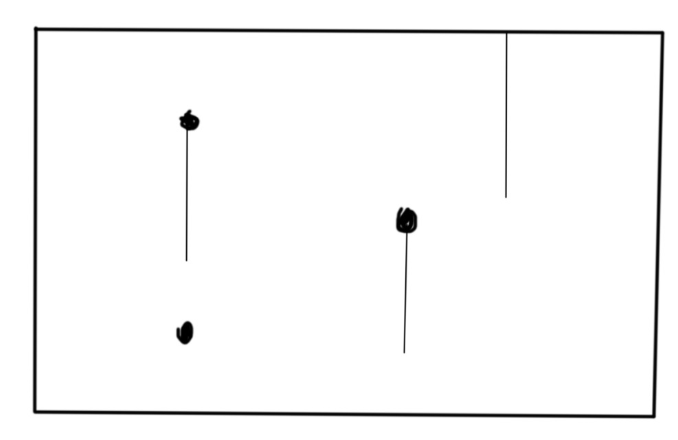
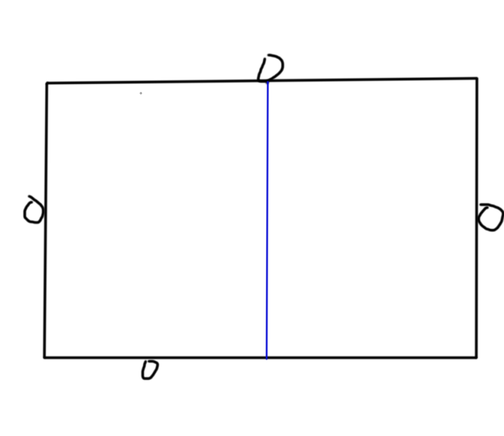
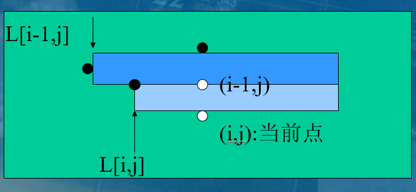

## 悬线法

~~我真的是啥都没学过~~

悬线法是一种用来求解满足某种条件的最大子矩阵的问题且时间复杂度只与矩形面积相关的 DP 算法。

我们以实际问题为例子讲解悬线法。

### 最大子矩形问题

给你一个 $N\times M$ 矩形，里面有一些障碍点，求不包含障碍点的最大子矩形。

为了和代码格式统一，下面的坐标描述使用类似矩阵的坐标描述，即左上角为 $(1,1)$，右下角 $(N,M)$。

首先我们定义 **有效竖线** ：有效竖线即除了端点外不覆盖任何一个障碍点的竖直线段。

有了有效竖线的定义，我们可以定义 **悬线**：只有上端点覆盖了障碍点或者达到矩形边界的有效竖线。

如图：



图中的所有线都是悬线。

定义完之后，我们发现，每一根悬线都和它的下端点一一对应。

我们定义**极大子矩形**是一个无法扩展的的矩形，它的任意一边被扩展都会导致包括障碍点或者越界。

那么我们将极大子矩形无限细分成一组平行的竖直线段，一定有一条线是悬线。



我们把这句话中的关系反过来呢？

一个悬线左右滑动，能够得到的最大的矩形不一定是一个极大子矩形，因为它还可以向下扩展。但是这并不妨碍我们，因为无论怎样，悬线按照上面方法对应的矩阵集合一定包含所有极大子矩形集合。我们可以枚举所有的悬线来找最大子矩形。

悬线数是 $O(NM)$ 级别的。

我们令 $up(i,j)$ 为点 $(i,j)$ 对应的悬线长度。$left(i,j)$ 为点 $(i,j)$ 对应的悬线向左移动的最大位置。 $right(i,j)$ 为点 $(i,j)$ 对应的悬线向右移动的最大位置。

先考虑对于一个点如何处理这几个值。

- $up(i,j)$：

    对于边界和障碍点，$up(i,j)$ 的值为 $0$。

    我们可以把悬线看做是从障碍点和边界向下伸出的一条线。这样考虑，我们可以想到一个点 $(i,j)$ 对应的悬线长度可以从它上方的点 $(i-1,j)$ 对应的悬线长度再延伸一个单位长度得到。

    即 ：$up(i,j)=\begin{cases}up(i-1,j)+1,&\texttt{$(i,j)$ 不是障碍点}\\0,&\texttt{$(i,j)$ 是障碍点} \end{cases}$。

- $left(i,j)$：

    我们仍然考虑利用前面得到的信息。

    画几个图我们可以发现，悬线 $(i,j)$ 在某个位置 $(i,l)$ 是否能继续向左移动，可以通过它左边的悬线 $(i,l-1)$ 的长度来判定。

    - $up(i,j)\le up(i,l-1)$ 时

        此时悬线 $(i,l)$ 能够继续向左移动，且只要悬线 $(i,l-1)$ 能移动到的地方，$(i,j)$ 都能移动到 。所以可以直接让 $up(i,j)=up(i,l-1)$。

    - $up(i,j) > up(i,l-1)$ 时

        此时，悬线 $(i,j)$ 不能继续移动，$up(i,j)=l$。

- $right(i,j)$

    我们试图继承上面的想法。设悬线 $(i,j)$ 平移到了悬线 $(i,r)$，$r\ge j$

    - $up(i,j)\le up(i,r+1)$ 时

        此时悬线 $(i,j)$ 能够继续向左移动，且只要悬线 $(i,r+1)$ 能移动到的地方，$(i,r)$ 都能移动到 。所以可以直接让 $up(i,j)=up(i,r+1)$。

    - $up(i,j) > up(i,r+1)$ 时

        此时，悬线 $(i,j)$ 不能继续移动，$up(i,j)=r$。

    但是我们要先处理出 $(i,j+1)$ 的数据才行。所以这里，行要倒序枚举。

对于每一根悬线，我们处理以上三个信息，悬线对应的矩阵面积为 $(right(i,j)-left(i,j)+1)H(i,j)$。

大致过程：

```cpp
static int L[N],R[N],H[N];//左跳数组，右跳数组，悬线
memset(L,0,sizeof L);
memset(R,0,sizeof R);
int ans=0;
for(int i=1;i<=n;i++)
{
	for(int j=1;j<=m;j++)
	{
		if(arr[i][j]) H[j]=H[j]+1;
		else {H[j]=0;continue;}
		L[j]=j;
		while(arr[i][L[j]-1]&&H[j]<=H[L[j]-1]) L[j]=L[L[j]-1];
	}
	for(int j=m;j>=1;j--)
	{
		if(arr[i][j]==0) continue;
		R[j]=j;
		while(arr[i][R[j]+1]&&H[j]<=H[R[j]+1]) R[j]=R[R[j]+1];
		ans=max(ans,H[j]*(R[j]-L[j]+1));
	}
}
printf("%d",ans);
```

---

对于 $left$ 与 $right$ ，我们还有另外的求法。(其实是王知昆2003年国集答辩论文里给的方法)

这次我们换一个方向考虑，思考我们能否根据上一行的信息求出这一行的东西。

- $left(i,j)$：

    我们考虑悬线 $(i-1,j)$ 能移到的位置。

    

    图片来源于 王知昆 —《浅谈用极大化思想解决最大子矩形问题》

    $left(i,j)$ 如果第 $i$ 行没有阻挡，那么我们一定可以移到相同的位置。如果阻挡了，那么只能移到 $(i,j)$ 左边第一个障碍点的位置。设这样的位置为 $brl(i,j)$，则：

    $$left(i,j)=\max\{left(i-1,j),brl(i,j)\}$$

- $right(i,j)$

    同上面的过程，设 $brr(i,j)$ 为右边第一个障碍点的位置，则有:

    $$right(i,j)=\min\{right(i-1,j),brr(i,j)\}$$

这种方法比较好写，但需要预处理 $brr,brl$。
