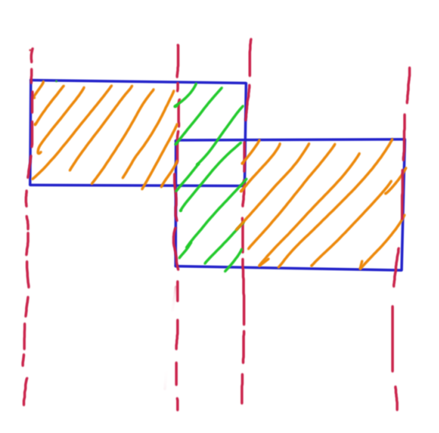

## 扫描线

### 问题描述

在二维平面中给出 $n$ 个矩形，对于第 $i$ 个矩形给出对角坐标 $x_{1_i},y_{1_i},x_{2_i},y_{2_i}$，求它们的面积并。

$1\le n\le 10^5,0\le x_{1_i},y_{1_i},x_{2_i},y_{2_i}\le 10^9$

### 解析

主要问题是如何处理两个矩形相交的问题

矩形好就好在它的形状十分规则，我们可以把下面这样一个复合图形分割成许许多多的小矩形。

 [](https://pic.imgdb.cn/item/611487bd5132923bf823d39b.png)

比如上图这个矩形，就可以分成好几块。

对于每一个块，我们发现其宽是几个矩形所占占据的纵坐标区间，长就是我们划分的块长，首先可以考虑到对整个纵坐标建立线段树，然后做区间合并。按横坐标向后扫描，维护纵坐标是否被覆盖，每次求一遍区间并长度和。

但是再看一下数据范围，就会立刻打消暴力建树的念头。非常非常显然还要再优化。

我们发现瓶颈在于横纵坐标是在是太太太太大了，就在这个上面做文章。

现在我们要把矩形的各个竖边拆开来看，设第 $i$ 条竖边的横坐标是 $x_i$，竖边覆盖的纵坐标区间是 $l_i,r_i$。

对于横坐标上的扫描，能发现我们根本不需要每一个横坐标都做一遍求和，事实上在 $x_i$ 和 $x_{i+1}$ 之间的区间覆盖情况一定是一样的，也就是说一定是一个矩形，我们可以在 $x_i$ 做一遍区间并长度和之后直接先乘 $x_{i+1}-x_i$。横坐标上的最坏时间 $10^9\Rightarrow 10^5$。

对于纵坐标上的维护区间合并。区间合并时，我们其实只会关心区间各个端点的大小关系，类似地沿用上面的方法。我们先把所有的 $l,r$ 放在一起排序得到数组 $y$，在这上面建立线段树，每个节点维护的是 $y_i,y_{i+1}$ 之间的区间被覆盖的次数，如果我们想要覆盖一个区间 $L,R$ 的话我们就可以把 $y_{i_L},y_{i_r-1}$ 区间 $+1$ 即可。

线段树维护区间覆盖次数和区间长度即可(结果这里还卡了我很久)。

```cpp
#include <bits/stdc++.h>
using namespace std;
typedef long long ll;

const int N=1e6+10;

int n,cnt=0;

struct Seg
{
	ll l,r,h;
	int mark;
	bool operator < (const Seg &y) const {
			return h<y.h;
	}
} arr[N<<1];
ll tree[N<<2],treel[N<<2];
ll X[N<<1];

#define lnode node<<1
#define rnode node<<1|1
#define DEFMID int mid=(start+end)>>1

void push_up(int node,int start,int end)
{
	if(tree[node]) treel[node]=X[end+1]-X[start];
	else treel[node]=treel[lnode]+treel[rnode];
}
void build(int node,int start,int end)
{
	tree[node]=0,treel[node]=0;
	if(start==end) return ;
	DEFMID;
	build(lnode,start,mid);
	build(rnode,mid+1,end);
}

void update(int node,int start,int end,ll l,ll r,int x)
{
	if(X[end+1]<=l||r<=X[start]) return ;
	if(l<=X[start] && X[end+1]<=r)
	{
		tree[node]+=x;
		push_up(node,start,end);
		return ;
	}
	DEFMID;
	update(lnode,start,mid,l,r,x);
	update(rnode,mid+1,end,l,r,x);
	push_up(node,start,end);
}

int main()
{
	scanf("%d",&n);
	for(int i=1;i<=n;i++)
	{
		ll ax,ay,bx,by;
		scanf("%lld%lld%lld%lld",&ax,&ay,&bx,&by);
		X[(i<<1)-1]=ax,X[i<<1]=bx;
		arr[(i<<1)-1]={ax,bx,ay,1};
		arr[i<<1]={ax,bx,by,-1};
	}
	n<<=1;
	sort(arr+1,arr+1+n);
	sort(X+1,X+1+n);
	int nn=unique(X+1,X+n+1)-X-1;
	build(1,1,nn-1);
	ll ans=0;
	for(int i=1;i<n;i++)
	{
		update(1,1,nn-1,arr[i].l,arr[i].r,arr[i].mark);
		ans+=treel[1]*(arr[i+1].h-arr[i].h);
	}
	printf("%lld",ans);
	return 0;
}
```
