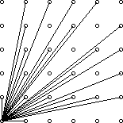

## 基本的质数筛法

### 埃筛

筛去所有已知素数的倍数。

时间复杂度：$O(nlogn)$

(代码仅供参考，不保证能够通过编译及正确性)
```cpp
for(int i=1;i<=n;i++)
{
    if(!mp[i]) prime[++tot]=i;
    else continue;
    for(int j=2*i;j<=n;j+=i)
        mp[i]=1;
}

```

### 线性筛

我们在埃筛的基础上，将过滤的方式改为每个合数只被其最小质因子筛掉。

时间复杂度 $O(n)$

参考代码：
```cpp
for(int i=1;i<=n;i++)
{
    if(!mp[i]) prime[++tot]=i;
    for(int j=1；prime[j]*i<=n;j++)
    {
        mp[prime[j]*i]=1;
        if(i%prime[j]==0) break;
    }
}

```

---

### 例题：哥德巴赫猜想

猜想内容：任意一个严格大于 $4$ 的偶数都可以拆成两个奇素数之和。

现在给你一个 $n$ ，试着将其拆为两个奇素数之和。

多组数据，以 $0$ 结尾。

#### 输入格式

每组数据一行一个整数 $n\in (4,10^6]$。

#### 输出格式

对于每组数据输出一行。

若有解，输出形如 `n=a+b` 表示一组解，若有多组解输出 $b-a$ 最大的一组。

若无解 输出 `Goldbach's conjecture is wrong.`

#### 解析

迄今为止人类并没有找到无解的情况，如果你找到了，那 $......$

那么本题如何做？

首先的暴力做法就是直接枚举两个质数。我们能够飞快得出一个 $n^2$ 的算法。

但是显然我们在知道和的情况下只需要枚举其中一个质数，另外一个用和减去，判定是否为奇质数即可。加上线筛复杂度 $O(n)$。

---

### 例题：

夏洛克有了一个新女友（这太不像他了！）。

情人节到了，他想送给女友一些珠宝当做礼物。

他买了 $n$ 件珠宝，第 $i$ 件的价值是 $i+1$，也就是说，珠宝的价值分别为 $2,3,…,n+1$。

华生挑战夏洛克，让他给这些珠宝染色，使得一件珠宝的价格是另一件珠宝的价格的质因子时，两件珠宝的颜色不同。

并且，华生要求他使用的颜色数尽可能少。

请帮助夏洛克完成这个简单的任务。

#### 输入格式
只有一行一个整数 $n$，表示珠宝件数。

#### 输出格式
第一行一个整数 $k$，表示所使用的颜色数；

第二行 $n$ 个整数，表示第 $1$ 到第 $n$ 件珠宝被染成的颜色。

若有多种答案，输出任意一种。

请用 $1$ 到 $k$ 表示你用到的颜色。

#### 数据范围
$1≤n≤10^5$

#### 输入样例：
```
3
```

#### 输出样例：
```
2
1 1 2
```

#### 解析

给 $2\sim n+1$ 的数染色，合数不能与其质因子染色相同。

~~通过质数和对应合数连边，我们很容易联想到二分图匹配~~。

这个题显然最多只需要两种颜色，我们只需要将所有的质数染成一种颜色，将所有的合数染成另外一种颜色就可以了。

特殊的，$n\le 2$ 时只需要一种颜色。

---

### 例题：UVA10140 Prime Distance
[原题面](https://uva.onlinejudge.org/external/101/p10140.pdf)

- 题意翻译：

    给定两个正整数 $l,r$，求 $[l,r]$ 间 相邻 的两个差最大的质数和 相邻 的两个差最小的质数。如果区间内质数个数 $\le 1$ ，输出 `There are no adjacent primes.`

    $1\le l<r\le 2^{31},r-l\le 10^6$

    多组数据。
#### 输入样例
```
2 17
14 17
```
#### 输出样例
```
2,3 are closest, 7,11 are most distant.
There are no adjacent primes.
```

----

#### 解析

首先要知道，对于一个合数 $n$ ，它必然存在一个因子 $\le \sqrt{n}$。

所以我们虽然不能直接筛出 $[l,r]$ 之间的质数，但是我们可以先把 $1\sim \sqrt{r}$ 下的所有质数全部筛出来。估计一下，规模最多 $50000$ 左右。

然后我们可以利用这些素数，使用类似埃筛的方式 $[l,r]$ 中的质数筛出来。

code(轻度压行)
```cpp
#include <bits/stdc++.h>
using namespace std;
typedef long long ll;

const int N=1e6+10;

int pr[N],tot=0;
bool mp[N];

void init(int n)
{
	for(int i=2;i<=n;i++)
	{
		if(!mp[i]) pr[++tot]=i;
		for(int j=1;pr[j]*i<n;j++)
		{
			mp[pr[j]*i]=1;
			if(i%pr[j]==0) break;
		}
	}
	return ;
}

int pri[N],cnt=0;
bool maps[N];
int main()
{
	init(55000);
	int l,r;
	while(scanf("%d%d",&l,&r)!=EOF&&l&&r)
	{
		memset(maps,0,sizeof maps);
		cnt=0;
		for(int i=1;i<=tot;i++)//枚举质数
		{
			ll prime=(ll)pr[i];
			for(ll j=max((ll)l/prime,(ll)2);prime*j<=r;j++) if(prime*j-l>=0) maps[prime*j-l]=1;
		}
		for(int i=0;i<=r-l;i++)
			if(!maps[i] && i+l>=2) pri[++cnt]=i+l;
		if(cnt<2) {printf("There are no adjacent primes.\n"); continue;}
		ll maxn=pri[2]-pri[1],maxa=pri[1],maxb=pri[2];
		ll minn=pri[2]-pri[1],mina=pri[1],minb=pri[2];
		for(int i=2;i<=cnt;i++)
		{
			if(pri[i]-pri[i-1]>maxn)
			{
				maxn=pri[i]-pri[i-1];
				maxa=pri[i-1],maxb=pri[i];
			}
			if(pri[i]-pri[i-1]<minn)
			{
				minn=pri[i]-pri[i-1];
				mina=pri[i-1],minb=pri[i];
			}
		}
		printf("%lld,%lld are closest, %lld,%lld are most distant.\n",mina,minb,maxa,maxb);
	}
	return 0;
}

```
---
---
## 分解质因数
1s/64M

现在我们能够得到的最快的分解质因数的方法就是暴力短除法。

---

### 例题：阶乘分解

给定整数 $N$，试把阶乘 $N!$ 分解质因数，按照算术基本定理的形式输出分解结果中的 $p_i$ 和 $c_i$ 即可。

#### 输入格式
一个整数 $N$。

#### 输出格式
 $N!$ 分解质因数后的结果，共若干行，每行一对 $p_i,c_i$，表示含有 $p_i^{c_i}$ 项。按照 $p_i$ 从小到大的顺序输出。

#### 数据范围
$1≤N≤10^6$

#### 解析

暴力算是不可能的，就算写高精算出来还要质因数分解时间早炸了。

所以我们一个数一个数分解。

由于 $N!=1\times 2\times 3 \times \cdots \times N$

所以我们可以直接枚举 $1\sim n$ 直接分解质因数

时间复杂度略小于 $O(n\sqrt n)$，仍然不够。

我们可以换个角度考虑，枚举每一个质数，直接计算质数的次数。

接下来问题就是怎么去算一个质数对应的次数。

设这个质数为 $p$，我们首先考察它的倍数 —— 在 $1 \sim n$ 的所有数中，$p$ 的倍数有 $\lfloor \frac{n}{p} \rfloor$ 个。

但是 $p$ 的次数不可能只是 $1$，有的数可能有 $p^2,\ p^3$ 等因子。

先考虑 $p^2$ ：这些数都在 $p^1$ 的情况中被计过一次数了，总共有 $\lfloor \frac{n}{p^2}\rfloor$ 个，我们再计数一次就可以了。也就是 $ans + \lfloor \frac{n}{p^2}\rfloor$。

 $p^3, p^4, ……$ 都同理。

也就是说我们先枚举质因子 $p$，在枚举这个质因子的次数 $i$，算出具有这个因子 $p^i$ 的数有多少个，将所有的 $i$ 对应的计数结果加起来即是这个质因子对应的答案。

每枚举一个质因子对应的数的时间复杂度约为 $O(\log n)$

根据质数分布率的经验公式 $\theta(n) = \frac{n}{\ln n}$，总的时间复杂度大概为 $O(\frac{n}{\ln n}\cdot \log n)$ ，在 $10^6$ 的数据下，接近于一个常数为 $10$ 以内的 $O(n)$，可以接受。

code
```cpp
#include <bits/stdc++.h>
using namespace std;

const int N=2e6+10;
typedef long long ll;

int pr[N],tot=0;
bool mp[N];
void init(int n)
{
	for(int i=2;i<=n;i++)
	{
		if(!mp[i]) pr[++tot]=i;
		for(int j=1;pr[j]*i<=n;j++)
		{
			mp[pr[j]*i]=1;
			if(i%pr[j]==0) break;
		}
	}
}

int main()
{
	int n;
	scanf("%d",&n);
	init(n);
	for(int i=1;i<=tot;i++)// 枚举质因数
	{
		int ans=0;
		ll s=pr[i];
		while(s<=n)
		{
			ans+=n/s;
			s*=pr[i];
		}
		if(ans>0) printf("%d %d\n",pr[i],ans);
	}
	return 0;
}

```
---
---

## 正整数的约数的个数

定义 $d(n)=\sum\limits_{i=1}^{n}[\ i|n\ ]$

我们如果将 $n$ 分解质因子为 $n=p_1^{c_1}\times p_2^{c_2}\times p_3^{c_3}\times \cdots \times p_k^{c_k}$，则 $d(n)=(c_1+1)(c_2+1)(c_3+1) \cdots (c_k+1)$。

同时，$\sum\limits_{i=1}^nd(i)$ 的复杂度大约是 $O(n\log n)$ 阶的。

---

### 例题：轻拍牛头

今天是贝茜的生日，为了庆祝自己的生日，贝茜邀你来玩一个游戏．

贝茜让 $N$ 头奶牛（编号 $1$ 到 $N$）坐成一个圈。

除了 $1$ 号与 $N$ 号奶牛外，$i$ 号奶牛与 $i−1$ 号和 $i+1$ 号奶牛相邻，$N$ 号奶牛与 $1$ 号奶牛相邻。

农夫约翰用很多纸条装满了一个桶，每一张纸条中包含一个 $1$ 到 $1000000$ 之间的数字。

接着每一头奶牛 $i$ 从桶中取出一张纸条，纸条上的数字用 $A_i$ 表示。

所有奶牛都选取完毕后，每头奶牛轮流走上一圈，当走到一头奶牛身旁时，如果自己手中的数字能够被该奶牛手中的数字整除，则拍打该牛的头。

牛们希望你帮助他们确定，每一头奶牛需要拍打的牛的数量。

即共有 $N$ 个整数 $A_1,A_2,…,A_N$，对于每一个数 $A_i$，求其他的数中有多少个是它的约数。

#### 输入格式
第一行包含整数 $N$。

接下来 $N$ 行，每行包含一个整数 $A_i$。

#### 输出格式
共 $N$ 行，第 $i$ 行的数字为第 $i$ 头牛需要拍打的牛的数量。

#### 数据范围
$1≤N≤10^5,
1≤A_i≤10^6$
#### 输入样例：
```
5
2
1
2
3
4
```
#### 输出样例：
```
2
0
2
1
3
```

#### 解析

直接求解约数个数其实是比较困难的，单次 $O(\sqrt n)$。

所以我们考虑一下换个角度，枚举它的倍数。

伪代码(C++风格)大概是这样的：

```
for(i=1;i<N;i++)
{
    for(int j=i;j<N;j+=i)
    {
        ans[j]+=cnt[j];
    }
}
```

其中 `cnt[i]` 表示的是 `i` 在序列中出现的次数。

虽然看起来是一个两重循环的东西，但是实际上，其复杂度是 $\frac{n}{1}+\frac{n}{2}+\cdots +\frac{n}{n}$，其复杂度是 $O(n\log n)$ 。

分解是很难求的，倍数才比较好求。

code
```cpp
#include <bits/stdc++.h>
using namespace std;

const int N=1e6+10;

int n;
int a[N],ans[N],cnt[N];

int main()
{
	scanf("%d",&n);
	for(int i=1;i<=n;i++)
	{
		scanf("%d",&a[i]);
		cnt[a[i]]++;
	}
	for(int i=1;i<N;i++)
	{
		for(int j=i;j<N;j+=i)
			ans[j]+=cnt[i];
	}
	for(int i=1;i<=n;i++) printf("%d\n",ans[a[i]]-1);//记得减去自己
	return 0;
}

```
---

### 例题：樱花

#### 题目简述：

给定正整数 $n$ ，求：$\frac{1}{x}+\frac{1}{y}=\frac{1}{n!}$ 的正整数解组数。
#### 输入格式
一个整数 $n$。

#### 输出格式
一个整数，表示满足条件的数对数量。

答案对 $10^9+7$ 取模。

#### 数据范围
$1≤n≤10^6$
#### 输入样例：
```
2
```
#### 输出样例：
```
3
```

#### 解析

直接开始愉快捣鼓式子

我们试着将 $y$ 表示为 $x$。

$$
\frac{1}{x}+\frac{1}{y}=\frac{1}{n!}\\
\Rightarrow \frac{x+y}{xy}=\frac{1}{n!}\\
\Rightarrow x\cdot n!+y\cdot n!=xy\\
\Rightarrow (x-n!)y=x\cdot n!\\
\Rightarrow y=\frac{x\cdot n!}{x-n!}\\
\Rightarrow y=\frac{(x-n!+n!)n!}{x-n!}\\
\Rightarrow y=n!+\frac{(n!)^2}{x-n!}
$$

由于 $n!$ 一定是一个正整数，我们确定的 $x$ 只需要满足 $\frac{(n!)^2}{x-n!}$ 是正整数就可以了。

换句话说，我们只需要求得 $(n!)^2$ 有多少因子就可以了。

直接参考上面 阶乘分解 一题的方式分解质因数，然后用约数个数定理直接求即可。

---

### 反素数

对于任何正整数 $x$，其约数的个数记作 $g(x)$，例如 $g(1)=1$、$g(6)=4$。

如果某个正整数 $x$ 满足：对于任意的小于 $x$ 的正整数 $i$，都有 $g(x)>g(i)$，则称 $x$ 为反素数。

#### 输入格式
一个正整数 $N$。

#### 输出格式
一个整数，表示不超过 $N$ 的最大反素数。

#### 数据范围
$1≤N≤2\times 10^9$
#### 输入样例：
```
1000
```
#### 输出样例：
```
840
```

#### 解析

对于这类给新定义的题，我们可以去发掘一下这个定义的性质。

首先可以知道，一个反素数的各个质因子次数不会很高。毕竟$2^{31}-1=2147483647> 2\times 10^9$。而且它们的次数还单调递减。

其次根据贪心，我们可以试着如下构造：$x=2\times 3\times 5\times 7\times 11\times 13\times \cdots$ 。我们发现当我们乘到第 $10$ 个质数时，爆`int`了；乘到第 $17$ 个质数时，爆`long long`了。

总之可以得到，$2\times 10^9$ 内，反素数最大有 $9$ 个因子。单个因子次数最大 $30$ 次。

于是，我们可以愉快爆搜。

```cpp
#include<stdio.h>
using namespace std;
typedef long long ll;

int pr[110],tot=0;
bool mp[110];
void init(int n)
{
	for(int i=2;i<=n;i++)
	{
		if(!mp[i]) pr[++tot]=i;
		for(int j=1;pr[j]*i<=n;j++)
		{
			mp[pr[j]*i]=1;
			if(i%pr[j]==0) break;
		}
	}
}

int n;
int anss=0,ansp=0;
void dfs(int x,int cnt,int s,int p)//  枚举到几个质数，剩余可分配的次数(max=30)，当前数大小，当前数约数个数
{
	if((ansp==p&&anss>s)||(ansp<p))
	{
		anss=s,ansp=p;
	}
	if(x>=9) return ;//素数个数上限
	int ss=s;
	for(int i=1;i<=cnt;i++)//枚举因子的次数
	{
		if((ll)pr[x]*ss>n) break;//三年OI一场空，不开long long见祖宗
		ss*=pr[x];
		dfs(x+1,cnt-i,ss,p*(i+1));
	}
	return ;
}

int main()
{
	init(100);
	scanf("%d",&n);
	dfs(1,30,1,1);
	printf("%d",anss);
	return 0;
}

```
---
---

## 欧拉函数

欧拉函数 $\varphi(n)$ 定义为 $1\sim n$ 中与 $n$ 互质的数的个数。

若 $N=p_1^{c_1}\times p_2^{c_2}\times p_3^{c_3}\times \cdots \times p_k^{c_k}$，则

$$\varphi (n)=N(1-\frac{1}{p_1})(1-\frac{1}{p_2})(1-\frac{1}{p_3})\cdots (1-\frac{1}{p_k})$$

这个式子可以由容斥定理得到，~~证明留作练习~~

根据定义，欧拉函数有如下递推式：

$$1.\varphi(i\times p)=\varphi (i)\times p$$

其中 $p$ 为 $i$ 的最小质因子。

$$2.\varphi(i\times p)=\varphi (i)\times (p-1)$$

其中 $p$ 为 $i$ 的非最小质因子。

由于这个性质，我们可以通过线性筛法求解 $\varphi$。

```cpp
int n;
int pr[N],tot=0;
int phi[N];

void init(int n)
{
	phi[1]=1;
	for(int i=1;i<=n;i++)
	{
		if(!mp[i]) pr[++tot]=i,phi[i]=i-1;
		for(int j=1;pr[j]*i<=n;j++)
		{
			mp[pr[j]*i]=1;
			if(i%pr[j]==0) {phi[pr[j]*i]=phi[i]*pr[j]; break;}
			phi[pr[j]*i]=phi[i]*(pr[j]-1);
		}
	}
}

```
---
### 例题：可见的点

在一个平面直角坐标系的第一象限内，如果一个点 $(x,y)$ 与原点 $(0,0)$ 的连线中没有通过其他任何点，则称该点在原点处是可见的。

例如，点 $(4,2)$ 就是不可见的，因为它与原点的连线会通过点 $(2,1)$。

部分可见点与原点的连线如下图所示：



编写一个程序，计算给定整数 $N$ 的情况下，满足 $0≤x,y≤N$ 的可见点 $(x,y)$ 的数量（可见点不包括原点）。

#### 输入格式
第一行包含整数 $C$，表示共有 $C$ 组测试数据。

每组测试数据占一行，包含一个整数 $N$。

#### 输出格式
每组测试数据的输出占据一行。

应包括：测试数据的编号（从 $1$ 开始），该组测试数据对应的 $N$ 以及可见点的数量。

同行数据之间用空格隔开。

#### 数据范围
$1≤N,C≤1000$
#### 输入样例：
```
4
2
4
5
231
```
#### 输出样例：
```
1 2 5
2 4 13
3 5 21
4 231 32549
```

#### 解析

我们可以把每条光线看为一条直线，那么一个点 $(x_0,y_0)$ 要能够被照到需满足以下条件：

- 在一条直线 $l:y=\frac{y_0}{x_0}\cdot x$ 上。
- 这条直线 $l$ 上没有其它的点 $(x_1,y_1)$ 满足 $x_1<x_0$ 。

也就是要求 $(x_0,y_0)$ 互质。

证明留作思考，提示：反证法。

那么，我们枚举 $x_0$ 或 $y_0$，求的就是 $\sum\limits_{x_0=1}^n\varphi(i)$

根据对称以及算上，再 $×2+1$ 即可。

```cpp
#include <bits/stdc++.h>
using namespace std;

const int N=1e6+10;

int pr[N],tot=0,phi[N];
bool mp[N];

void init(int n)
{
	phi[1]=1;
	for(int i=2;i<=n;i++)
	{
		if(!mp[i]) pr[++tot]=i,phi[i]=i-1;
		for(int j=1;pr[j]*i<=n;j++)
		{
			mp[pr[j]*i]=1;
			if(i%pr[j]==0) {phi[pr[j]*i]=phi[i]*pr[j]; break;}
			phi[pr[j]*i]=phi[i]*(pr[j]-1);
		}
	}
	for(int i=2;i<=n;i++)
		phi[i]+=phi[i-1];
}

int main()
{
	int T; scanf("%d",&T);
	int t=T; init(10000);
	while(T--)
	{
		int n;
		scanf("%d",&n);
		printf("%d %d %d\n",t-T,n,phi[n]*2+1);
	}
	return 0;
}

```
---

### 例题：GCD

给定整数 $N$，求 $1≤x,y≤N$ 且 $GCD(x,y)$ 为素数的数对 $(x,y)$ 有多少对。

$GCD(x,y)$ 即求 $x,y$ 的最大公约数。

#### 输入格式
输入一个整数 $N$。

#### 输出格式
输出一个整数，表示满足条件的数对数量。

#### 数据范围
$1≤N≤10^7$
#### 输入样例：
```
4
```
#### 输出样例：
```
4
```

#### 解析

~~莫反sb题~~

题目求 $\sum\limits_{i=1}^n\sum\limits_{j=1}^n[gcd(i,j)\ is\ prime]$ 。

我们套路地令 $gcd(i,j)=d$

然后捣鼓式子 $\sum\limits_{d=1}^n[d\ is\ prime]\sum\limits_{i=1}^{n/d}\sum\limits_{j=1}^{n/d}[gcd(i,j)=1]$

~~就可以直接套结论了。~~

现在仔细一看，这不就上一道题？

所以我们可以套上一题的结论，直接线筛欧拉函数求解。

```cpp
#include <bits/stdc++.h>
using namespace std;
typedef long long ll;

const int N=1e7+10;

ll pr[N],tot=0,phi[N];
bool mp[N];

void init(ll n)
{
	phi[1]=1;
	for(int i=2;i<=n;i++)
	{
		if(!mp[i]) pr[++tot]=i,phi[i]=i-1;
		for(int j=1;pr[j]*i<=n;j++)
		{
			mp[(ll)pr[j]*i]=1;
			if(i%pr[j]==0)
			{
				phi[(ll)pr[j]*i]=phi[i]*pr[j];
				break;
			}
			phi[(ll)pr[j]*i]=phi[i]*(pr[j]-1);
		}
	}
	for(int i=1;i<=n;i++)
		phi[i]+=phi[i-1];
}

int main()
{
	ll n;
	scanf("%lld",&n);
	init(n);
	ll res=0;
	for(int i=1;i<=tot;i++)
		res+=phi[n/pr[i]]*2-1;
	printf("%lld",res);
	return 0;
}

```

---
---

## 同余

设 $m$ 是一个给定的正整数。$a,b$ 是两个整数，**如果 $a,b$ 对 $m$ 做带余除法得到的余数相等**，则我们称 **$a,b$ 关于 $m$ 同余**，在不引起歧义的情况下，**简称 $a,b$ 同余**。

同余的概念还能够被表达为：

- 当 $a=b+km\ ,(k\in Z)$ 时，$a,b$ 同余。

- 当 $m|(a-b)$ 时，$a,b$ 同余。

#### 性质：

同余式具有以下性质。

 1. 多个同模数同余式可以两边相加相乘。

     即若 $a_1\equiv b_1,a_2\equiv b_2,\dots ,a_k\equiv b_k \quad (\mod m)$，则 $\sum\limits_{i=1}^ka_i\equiv \sum\limits_{i=1}^kb_i\quad (\mod m)$

 2. 同余式可以直接移项。

    即若 $a+c\equiv b\quad (\mod m)$，则 $a\equiv b-c\quad (\mod m)$

 3. 同余式任意一边都可以加上或减去任意整数倍模数 $m$。
 4. 如果同余式两边有**和模数互质的公因子**，则两边可以同时除以这个公因子，模数不变。

    即若 $a\equiv b\quad (\mod m)\ ,\ a=a_1d\ ,\ b=b_1d$ 且 $gcd(d,m)=1$ ，则 $a_1\equiv b_1\quad (\mod m)$

 5. 同余式两边的数和模可以同时被它们任一公约数除。

    即若 $a\equiv b\quad (\mod m)\ , \  a=a_1d\ , \ b=b_1d\ ,\ m=m_1d$ ，则 $a_1\equiv b_1\quad (\mod m_1)$

 6. 模数与同余式两边可以都同时乘任意非零整数 $k$。
 7. 如果同余式的一边和模数同时能被某个整数除尽，那么同余式的另一边也可被这个这个数除尽。
 8. 同余式一边上的数与模的最大公约数，等于另一边上的数与模的最大公约数。

---

---

## 费马小定理

若 $p$ 是质数且 $gcd(a,p)=1$，则 $a^{p-1}\equiv 1\quad (\mod p)$。

我们可以利用费马小定理来简化幂模运算：由于 $a^{p-1}≡a^0≡1\quad(\mod p)$ ，所以 $a^x\quad(\mod p)$ 有循环节，长度为 $p-1$，所以 $a^x≡a^{x\%(p-1)}\quad (\mod p)$

---

---

## 扩展欧几里得算法

已知 $gcd(a,b)=d$ ，我们想要求解一组 $x,y$ 满足 $ax+by=d$。

之前欧几里得算法的原理是 $(a,b)=(b,a\ mod\ b)$。我们可以使用这个算法求解两数 $gcd$，现在我们在回溯过程中试图求解上述问题。

我们假设已经算出了一组 $x,y$ 使得 $yb+x(a\ mod\ b)=d$ ，现在我们要搞 $x^{\prime},y^{\prime}$ 使得 $ax^{\prime}+by^{\prime}=d$ 。

我们直接展开。

$$
yb+x(a-\lfloor\frac{a}{b}\rfloor\times b)=d\\
\Rightarrow yb+xa-x\lfloor\frac{a}{b}\rfloor \times b\\
\Rightarrow ax+b(y-\lfloor\frac{a}{b}\rfloor x)=d\\
$$

所以我们只需要让 $x^{\prime}=x\ ,\ y^{\prime}=y-\lfloor\frac{a}{b}\rfloor x$ 即可。

最终求出来的 $x_0,y_0$ 便是上面不定方程的一组特解。

其通解应为
$\begin{cases}
x=x_0+k\lfloor\frac{b}{d}\rfloor\\
y=y_0-k\lfloor\frac{a}{d}\rfloor\\
\end{cases}$

---

### 例题：同余方程

求关于 $x$ 的同余方程 $ax\equiv 1\quad (\mod b)$ 的最小正整数解。

#### 输入格式

一行两个整数 $a,b$，意义如题。

#### 输出格式

一行一个整数，表示最小正整数解。

#### 数据范围

$2\le a,b\le 2\times 10^9$

输入保证有解。

#### 解析

对于线性同余方程 $ax\equiv b\quad (\mod c)$ ，其等价于 $ax+cy=b$。

也就是说我们可以直接使用exgcd来求解。

对于这个题我们可以先求一组解 $x_0,y_0$ 使得 $ax_0+by_0=1$ 成立。

然后，我们通过通解公式 $x=x_0+kb\ne 0$ 得到，最小正整数和应该是 $x_0\ mod\ b$。

code
```cpp
#include <bits/stdc++.h>
using namespace std;
typedef long long ll;

int exgcd(int a,int b,int &x,int &y)//x,y是对应的解，返回值是a,b的GCD
{
	if(!b)
	{
		x=1,y=0;
		return a;
	}
	int d=exgcd(b,a%b,y,x);//x,y颠倒一下好算
	y-=a/b*x;
	return d;
}

int main()
{
	int a,b;
	scanf("%d%d",&a,&b);
	int x,y;
	exgcd(a,b,x,y);
	printf("%d",(x%b+b)%b);
	return 0;
}

```

### 例题：青蛙的约会

1s/10M

两只青蛙在网上相识了，它们聊得很开心，于是觉得很有必要见一面。

它们很高兴地发现它们住在同一条纬度线上，于是它们约定各自朝西跳，直到碰面为止。

可是它们出发之前忘记了一件很重要的事情，既没有问清楚对方的特征，也没有约定见面的具体位置。

不过青蛙们都是很乐观的，它们觉得只要一直朝着某个方向跳下去，总能碰到对方的。

但是除非这两只青蛙在同一时间跳到同一点上，不然是永远都不可能碰面的。

为了帮助这两只乐观的青蛙，你被要求写一个程序来判断这两只青蛙是否能够碰面，会在什么时候碰面。

我们把这两只青蛙分别叫做青蛙 $A$ 和青蛙 $B$，并且规定纬度线上东经 $0$ 度处为原点，由东往西为正方向，单位长度 $1$ 米，这样我们就得到了一条首尾相接的数轴。

设青蛙 $A$ 的出发点坐标是 $x$，青蛙 $B$ 的出发点坐标是 $y$。

青蛙 $A$ 一次能跳 $m$ 米，青蛙 $B$ 一次能跳 $n$ 米，两只青蛙跳一次所花费的时间相同。

纬度线总长 $L$ 米。

现在要你求出它们跳了几次以后才会碰面。

#### 输入格式
输入只包括一行 $5$ 个整数 $x,y,m,n,L$。

#### 输出格式
输出碰面所需要的跳跃次数，如果永远不可能碰面则输出一行 `Impossible`。

#### 数据范围
$x≠y<2\times 10^9,\\
0<m,n<2\times 10^9,\\
0<L<2.1\times 10^9$
#### 输入样例
```
1 2 3 4 5
```
#### 输出样例：
```
4
```

####  解析

已知 $x,y,n,m,L$ ，求 $x+km\equiv y+kn\quad (\mod L)$ 最小正整数解。

移项，合并同类项： $(m-n)k=y-x\quad (\mod L)$

所以我们解这个东西就可以了。

将同余方程写成等式 $(m-n)k+pL=y-x$。

我们求出任意一组解 $k_0,p_0$，就可以得到最小正整数解。

```cpp
#include <bits/stdc++.h>
using namespace std;
typedef long long ll;

const int N=1e6+10;

ll exgcd(ll a,ll b,ll &x,ll &y)
{
	if(!b)
	{
		x=1,y=0;
		return a;
	}
	ll d=exgcd(b,a%b,y,x);
	y-=a/b*x;
	return d;
}

int main()
{
	ll a,b,n,m,l;
	scanf("%lld%lld%lld%lld%lld",&a,&b,&m,&n,&l);
	ll x,y;
	ll d=exgcd(m-n,l,x,y);
	if((b-a)%d)//无解判定
	{
		printf("Impossible\n");
		return 0;
	}
	/*
    此时求出来的方程等式左边是 d
    求出来解之后，我们还要把等式两边扩大若干倍，使得等式左边为b-a
    */
	x*=(b-a)/d;
	ll t=(ll)abs(l/d);
	printf("%lld\n",(x%t+t)%t);
	return 0;
}

```
---
### 例题：幸运数字

$8$ 是中国的幸运数字，如果一个数字的每一位都由 $8$ 构成则该数字被称作是幸运数字。

现在给定一个正整数 $L$，请问至少多少个 $8$ 连在一起组成的正整数（即最小幸运数字）是 $L$ 的倍数。

#### 输入格式
输入包含多组测试用例。

每组测试用例占一行，包含一个整数 $L$。

当输入用例 $L=0$ 时，表示输入终止，该用例无需处理。

#### 输出格式
每组测试用例输出结果占一行。

结果为 `Case i:` $+$ 一个整数 $N$，$N$ 代表满足条件的最小幸运数字的位数。

如果满足条件的幸运数字不存在，则 $N=0$。

#### 数据范围
$1≤L≤2×10^9$
#### 输入样例：
```
8
11
16
0
```
#### 输出样例：
```
Case 1: 1
Case 2: 2
Case 3: 0
```

#### 解析

我们试图将这样的数表示为公式。

对于一个 $8888888$，我们可以把它拆成 $8\times 1111111$ 。

还是没有什么线索。我们继续对这一堆 $1$ 乱搞。

$1111111=\frac{9999999}{9}=\frac{10^x-1}{9}$

总算有个人样了。

现在，我们要解的东西就变成了：当 $x$ 取多少时，$L|8\times \frac{10^x-1}{9}$。

再化一下简：

$$
L|8\times \frac{10^x-1}{9}\\
\Rightarrow 9L|8(10^x-1)\\\ \\
\text {令 $d=gcd(8\ ,\ L)$ }\\\ \\
原式\Rightarrow \frac{9L}{d}|10^x-1
$$

令 $C=\frac{9L}{d}$ 转化为同余方程，就是让我们求解：$10^x\equiv 1\quad (\mod C)$

这个问题就很清楚了。

根据欧拉定理，当 $gcd(a,n)=1$ 时，有 $a^{\varphi(n)}\equiv 1\quad (\mod n)$。

而在这个题中，若是 $gcd(C,10)\ne 1$ ，同余式右边绝不可能等于 $1$。

所以 $gcd(C,10)$ 一定要等于 $1$，不然无解。

综上，我们只需要求解 $\varphi(C)$ 即可。

我们如何求解最小呢？欧拉定理只能求出一个可行解，并不保证这个解是最小的。

这里我们先猜测结论：满足这个同余方程的最小正整数 $x$ 一定能够整除 $\varphi(C)$。

这样我们只需要求解 $\varphi(C)$ 约数就可。

假设有一个 $x$ 满足等式，且不是 $\varphi (C)$ 的因子。

令 $\varphi(C)=kx+r,\quad (0<r<x)$，把它写成带余除法的形式。

$\because 10^x\equiv 1\ ,\ 10^{\varphi(C)}\equiv 1$

$\therefore  10^{kx+r}\equiv 10^x \Rightarrow 10^{r}\equiv 1$

故 $x$ 不是最小的数，所以假设不成立，原命题成立。

现在我们要做的就是求 $C$ 的所有因子就可以了。

总结一下算法步骤:

- 首先我们要求解 $d$ ，$d=gcd(L,8)$ 。
- 求解 $C=\frac{9L}{d}$ 。
- 求解 $\varphi(C)$，以及最小因子。

另外，这个题乘法可能爆 `long long` 要写龟速乘。

```cpp
#include <bits/stdc++.h>
using namespace std;
typedef long long ll;

ll gcd(ll a,ll b)
{
	return b==0?a:gcd(b,a%b);
}

ll qmul(ll a,ll k,ll mod)//龟速乘
{
	ll res=0;
	while(k)
	{
		if(k&1) res=(res+a)%mod;
		a=(a+a)%mod;
		k>>=1;
	}
	return res;
}

ll fpow(ll a,ll k,ll mod)
{
	ll res=1;
	while(k)
	{
		if(k&1) res=qmul(res,a,mod);
		a=qmul(a,a,mod);
		k>>=1;
	}
	return res;
}

ll get_eular(ll C)
{
	ll res=C;
	for(ll i=2;i<=C/i;i++)
	{
		if(C%i==0)
		{
			while(C%i==0) C/=i;
			res=res/i*(i-1);
		}
	}
	if(C>1) res=res/C*(C-1);
	return res;
}

int main()
{
	int t=0;
	ll L;
	while(scanf("%lld",&L)!=EOF && L)
	{
		int d=gcd(L,8);
		ll C=9*L/d;
		ll phi=get_eular(C);
		ll res=1e18;
		if(C%2==0||C%5==0)
		{
			res=0;
			printf("Case %d: %lld\n",++t,res);
			continue;
		}
		for(ll p=1;p*p<=phi;p++)
		{
			if(phi%p==0)
			{
				if(fpow(10,p,C)==1) res=min(res,p);
				if(fpow(10,phi/p,C)==1) res=min(res,phi/p);
			}
		}
		printf("Case %d: %lld\n",++t,res);
	}
	return 0;
}

```

## CRT

### 曹冲养猪

自从曹冲搞定了大象以后，曹操就开始琢磨让儿子干些事业，于是派他到中原养猪场养猪，可是曹冲很不高兴，于是在工作中马马虎虎，有一次曹操想知道母猪的数量，于是曹冲想狠狠耍曹操一把。

举个例子，假如有 $16$ 头母猪，如果建了 $3$ 个猪圈，剩下 $1$ 头猪就没有地方安家了；如果建造了 $5$ 个猪圈，但是仍然有 $1$ 头猪没有地方去；如果建造了 $7$ 个猪圈，还有 2 头没有地方去。

你作为曹总的私人秘书理所当然要将准确的猪数报给曹总，你该怎么办？

#### 输入格式
第一行包含一个整数 $n$，表示建立猪圈的次数；

接下来 $n$ 行，每行两个整数 $a_i$,$b_i$，表示建立了 $a_i$ 个猪圈，有 $b_i$ 头猪没有去处。

你可以假定 $a_i$,$a_j$ 互质。

#### 输出格式
输出仅包含一个正整数，即为曹冲至少养猪的数目。

#### 数据范围
$1≤n≤10,\\
1≤bi≤ai≤1100000$

所有 $a_i$ 的乘积不超过 $10^{18}$
#### 输入样例：
```
3
3 1
5 1
7 2
```
#### 输出样例：
```
16
```

#### 解析

~~有小学奥数钠味？~~

这是一道几乎算是中国剩余定理(或者叫孙子定理， CRT )的裸题。

先来回顾一下中国剩余定理：

有一组线性同余方程：

$$
\begin{cases}
x\equiv a_1\quad \mod m_1\\
x\equiv a_2\quad \mod m_2\\
x\equiv a_3\quad \mod m_3\\
\cdots\\
x\equiv a_n\quad \mod m_n\\

\end{cases}
$$

我们要解出 $x$ 的一个正整数解。

当 $m_1\sim m_n$ 两两互质(不互质可以使用扩展 CRT )时可以有如下解法：

设 $M=m_1m_2m_3\cdots m_n$

我们令 $M_i=\frac{M}{m_i}\ ,\ t_i\equiv M_i^{-1}(\mod m_i)$  

则 $x=\sum\limits_{i=1}^na_iM_it_i$ 。

这是一个构造性结论，建议背过。

这个题就是把中国剩余定理实现一下就可以了。

```cpp
#include<bits/stdc++.h>
using namespace std;
typedef long long ll;

const int N=150;

int n;
ll A[N],B[N];


void exgcd(ll a,ll b,ll &x,ll &y)
{
	if(!b) x=1,y=0;
	else
	{
		exgcd(b,a%b,y,x);
		y-=a/b*x;
	}
}

int main()
{
	scanf("%d",&n);
	ll M=1;
	for(int i=1;i<=n;i++)
	{
		scanf("%lld%lld",&A[i],&B[i]);
		M*=(ll)A[i];
	}
	ll res=0;
	for(int i=1;i<=n;i++)
	{
		ll Mi=M/A[i];
		ll ti,x;
		exgcd(Mi,A[i],ti,x);//解 Mi*ti≡1(mod mi) -> 解 Mi*ti+mi*x=1
		res+=B[i]*Mi*ti;
	}
	printf("%lld",(res%M+M)%M);//最后答案记得模M
	return 0;
}

```

---

## EXCRT

话不多述直接看题：

### 线性同余方程组

1s/500M

给定 $n$ 非负整数 $a_i,b_i$ 求解关于 $x$ 的如下方程组的最小非负整数解：

$$
\begin{cases}
x\equiv a_1 \quad \mod b_1\\
x\equiv a_2 \quad \mod b_2\\
x\equiv a_3 \quad \mod b_3\\
\cdots \\
x\equiv a_n \quad \mod b_n
\end{cases}
$$

#### 输入格式
输入第一行包括一个整数 $n$。

接下来 $n$ 行，每行两个非负整数 $a_i,b_i$ 。

#### 输出格式
一行一个整数 $x$，表示方程组的最小非负整数解。

#### 输入样例
```
3
11 6
25 9
33 17
```
#### 输出样例
```
809
```

#### 数据规模

对于100%的数据：$1\le n\le 10^5,\ 1\le a_i\le 10^{12},\ 0\le b_i\le a_i$

数据保证有解，保证 $lcm\{a_i\}\le 10^{18}$。

**注意运行过程中乘法可能有溢出风险。**

#### 解析

现在两两互质的条件没了，CRT 无法使用了，要使用其他的方法。

我们先从最简单的两个式子开始考虑，看看能不能将问题合并/缩小。

$$
\begin{cases}
x\equiv a_1 \quad \mod m_1\\
x\equiv a_2 \quad \mod m_2\\
\end{cases}
$$

我们把两个方程写开成等式：$\begin{cases}x=a_1+k_1m_1&\cdots ①\\ x=a_2+k_2m_2 &\cdots ②\end{cases}$

发现 $a_1,a_2,m_1,m_2$ 都是已知的，未知数只有 $x,k_1,k_2$。

试图联立一下，找到 $k_1,k_2$ 的关系：

$$
a_1+k_1m_1=a_2+k_2m_2\\
\Rightarrow k_1m_1-k_2m_2=a_2-a_1
$$

观察，我们得到了一个不定方程，可使用 $exgcd$ 得到它的整个解系。

我们假设有特解 $k_1=X+q_1\cdot \frac{(a_2-a_1)\cdot m_1}{gcd(m_1,m_2)}\quad \cdots ③$

回代到 $①$ 中，得到 $x=a_1+Xm_1+q_1\cdot \frac{(a_2-a_1)m_1m_2}{\gcd(m_1,m_2)}$

由于 $\gcd(m_1,m_2)=\frac{m_1m_2}{lcm(m_1,m_2)}$

所以 $x=a_1+Xm_1+q_1(a_2-a_1)\cdot lcm(m_1,m_2)$。

于是方程被转换为了有关于 $x$ 的解系。

由于 $q_1$ 可以任取，我们还可以把它转回同余方程的形式:

$x\equiv a_1+Xm_1\quad (\mod (a_2-a_1)\cdot lcm(m_1,m_2))$

按照这样的方法，我们可以继续合并，最终得到一个方程然后求解。

无解的情况就是exgcd无解的情况。

总结算法流程：

1. 输入方程组
2. 弹出两个方程，判断是否有解。
    - 若无解，视具体题目处理。
    - 若有解，合并成同一个方程，放入方程组中，重复2操作。
3. 若只剩一个方程，解出来 $x$ 即为整个方程组的解。


code(洛谷会炸一个点)
```cpp
#include <bits/stdc++.h>
using namespace std;
typedef long long ll;

const int N=1e6+10;

int n;
ll ai[N],mi[N];

ll exgcd(ll a,ll b,ll &x,ll &y)
{
	if(!b) {x=1,y=0; return a;}
	else
	{
		ll d=exgcd(b,a%b,y,x);
		y-=a/b*x;
		return d;
	}
}

void excrt()
{
	bool flag=1;//是否有解
	ll a1=ai[1],m1=mi[1];
	for(int i=2;i<=n;i++)
	{
		ll a2=ai[i],m2=mi[i];
		ll k1,k2;
		ll d=exgcd(m1,-m2,k1,k2);
		if((a2-a1)%d!=0)//无解
		{
			flag=0;
			break;
		}
		k1*=(a2-a1)/d;
		ll t=m2/d;
		k1=(k1%t+t)%t;

		a1=m1*k1+a1;
		m1=abs(m1/d*m2);
	}
	if(flag) printf("%lld",(a1%m1+m1)%m1);
	else printf("-1");
}

int main()
{
	scanf("%d",&n);
	for(int i=1;i<=n;i++)
		scanf("%lld%lld",&mi[i],&ai[i]);
	excrt();
	return 0;
}

```

---

## 剩余系

剩余系有两种：完全剩余系和缩剩余系(简化剩余系)。

### 定义

**完全剩余系**：对于一个给定的正整数 $n$ ，一个非负整数模 $n$ 的答案有 $0,1,2,\cdots n-1$。其所有的答案构成一个集合 $\{0,1,2,\cdots n-1\}$ 就叫做模 $n$ 的完全剩余系，在不引起歧义的情况下可简称完全剩余系或完系。

**缩剩余系**：对于一个正整数 $n$ ，其对应完全剩余系为 $D$，定义缩剩余系 $S$ 为 $S=\{x|x\in D, \gcd(x,n)=1\}$ ，也就是将完全剩余系中所有与 $n$ 互质的数组成的集合，这个集合的元素个数 $|S|=\varphi(n)$，$\varphi$ 是欧拉函数。有时也简称缩系。

### 性质

1. 加法不变性

    若 $\{a_1,a_2,a_3\dots,a_n\}$ 为一完系

完全剩余系和缩剩余系还有许多群论性质，这里不作讨论。

---

## 威尔逊定理

一个数 $p$ 是素数的充要条件是 $(p-1)!\equiv -1 \quad (\mod p)$

没太大实际用途，记一下以防万一。

~~不会吧不会吧不会真的有人为了判质数算阶乘吧？~~
