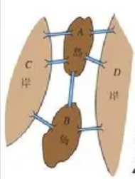

惊奇的发现自己还没系统学这个东西，赶紧补课。

## 起源

源于哥尼斯堡七桥问题。

>$18$ 世纪初普鲁士的哥尼斯堡，有一条河穿过，河上有两个小岛，有七座桥把两个岛与河岸联系起来（如概述图）。有个人提出一个问题：一个步行者怎样才能不重复、不遗漏地一次走完七座桥，最后回到出发点？

大数学家欧拉将其转化为了一笔画问题，并开创了图论这个数学分支。

---

## 欧拉路径与欧拉回路

### 定义与性质

**欧拉路径**：能够不重不漏走完所有的边的路径。

**欧拉回路**：首尾相接的欧拉路径即为欧拉回路。

对于无向图：
1. 存在欧拉路径的充要条件：所有边联通且度数为奇数的点只有 $0$ 或 $2$ 个。
2. 存在欧拉回路的充要条件：所有边联通且不能存在度数为奇数的点。

对于有向图：
1. 存在欧拉路径的充要条件：所有边联通，且所有点的出度均等于入度；或有且只有两个点外其他点出度等于入度，剩余两个点应当满足一个入度比出度多 $1$ 一个入度比出度少 $1$。
2. 存在欧拉回路的充要条件：所有边联通且所有的点入度均等于出度。

我们可以通过 DFS 来构造欧拉路径 / 回路。

我们每次 DFS 的时候我们对边进行判重。

事实上我们只需 DFS 到底然后在回溯的时候记录路径就可以构造出一个欧拉路径/回路
