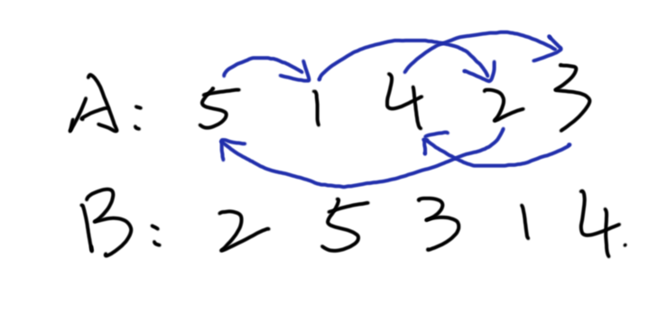
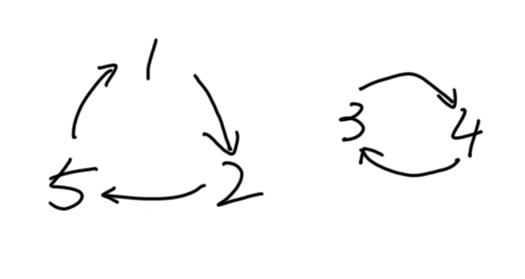

## 环图

Acwing 1921, 1361, 4626

图论应用。

先看一道例题：

---

### 例题『USACO14 Mar B』Reordering the Cows

[Acwing 1921](https://www.acwing.com/problem/content/1923/)

农夫约翰的 $N$ 头奶牛排成一排，编号 $1∼N$。

它们的排序可以由一个数组 $A$
来描述，其中 $A(i)$ 是位于位置 $i$ 的奶牛的编号。约翰希望将它们重新排列为一个不同的顺序。新顺序用数组 $B$ 来描述，其中 $B(i)$ 是位于位置 $i$ 的奶牛的编号。

假设奶牛开始时的顺序为：
```
A = 5 1 4 2 3
```
并假设约翰希望它们重新排列为：
 ```
 B = 2 5 3 1 4
 ```
为了从 $A$ 顺序重新排列为 $B$ 顺序，奶牛们进行了许多“循环”移位。

所谓循环移位，是指挑选排列中的若干头奶牛分在一组，组中奶牛进行循环移动位置，即第一头奶牛移动至第二头奶牛的位置，第二头奶牛移动至第三头奶牛的位置……最后一头奶牛移动至第一头奶牛的位置。

如上例中，将 $5,1,2$
号奶牛分在一组进行循环移位，移动过后，$5$ 号奶牛移动至位置 2，$1$ 号奶牛移动至位置 $4$，$2$ 号奶牛移动至位置 1；将 $4,3$ 号奶牛分在另一组进行循环移位，移动过后，$4$ 号奶牛位于位置 $5$，$3$ 号奶牛位于位置 $3$ ；最终完成重新排列。

每头奶牛都恰好参与一组循环移位，除非其在 $A,B$ 中的位置没有变化。

请计算奶牛们完成重新排列，共需多少组循环移位，最长的一组循环移位的长度是多少。
#### 输入格式

第一行包含整数 $N$ 。

接下来 $N$ 行包含 $A(i)$。

再接下来 $N$ 行包含 $B(i)$。
#### 输出格式

输出循环移位的组数，以及最长的一组循环移位的长度。

如果不存在循环移位，则第二个数输出 $−1$ 。
#### 数据范围
$1≤N≤100,1≤A(i),B(i)≤N$
#### 输入样例：
```
5
5
1
4
2
3
2
5
3
1
4
```
#### 输出样例：
```
2 3
```
---
### 解析

考虑循环移位的过程，我们很快可以得到一个可行的方案：

每头奶牛找到它应该在的位置并移动到该位置，该位置的奶牛又去找自己应该在的位置，那个位置上的奶牛继续重复这样的操作……以此类推。

这样的操作显然是会在有限步数内结束的，因为每个奶牛只有一个应在位置。

题中例子模拟过程如下：



我们将牛的编号抽象为点，移动抽象为边，那么整个循环过程可以用这样一个图来表示：



这样的图会由数个环组成，因为每个点一定有一个出度和一个入度(一开始位置就正确的点我们考虑为自环或者直接不考虑)。而每一个环都对应了一组循环移位。

所以，对于这个题，我们需要建图并找出图中有多少个环，并求最大环的长度。$O(n)$ DFS即可。

Code:
```cpp

#include <bits/stdc++.h>
using namespace std;

const int N=110;

int ver[N<<1],nxt[N<<1],head[N],tot=0;
void add(int x,int y) {ver[++tot]=y; nxt[tot]=head[x], head[x]=tot;}

int n;
int arr[N],vis[N];

int ans1=0,ans2=-1;

int dfs(int x)
{
	int size_=1; vis[x]=1;
	for(int i=head[x];i;i=nxt[i])
	{
		int y=ver[i];
		if(vis[y]) continue;
		size_+=dfs(y);
	}
	return size_;
}

int main()
{
	scanf("%d",&n);
	for(int i=1;i<=n;i++)
	{
		int x;
		scanf("%d",&x); arr[x]=i;//当前位置
	}
	for(int i=1;i<=n;i++)
	{
		int a;
		scanf("%d",&a);//理想位置
		if(arr[a]!=i) add(arr[a],i);
		else vis[i]=1;
	}
	for(int i=1;i<=n;i++)
		if(!vis[i]) ans2=max(ans2,dfs(i)),ans1++;
	printf("%d %d",ans1,ans2);
	return 0;
}
```
---

上面例子中构造的那有着一堆环的图就叫环图。

同时我们可以发现：当我们要对一个序列排序，并且已经知道序列排序后的样子的时候可以 $O(n)$ 求出它通过 “循环移位” 操作得到序列所需要的步数，与每次操作的点个数。

有了这个想法，让我们看看下面这个题：

---

### 三值排序问题

[Acwing 1361](https://www.acwing.com/problem/content/1363/)

给定一个长度为 $N$ 的序列，序列中只包含 $1,2,3$ 三种数字。

现在需要你将序列按升序进行排序，排序必须通过一系列的交换操作来完成。

交换操作是指将两个位置 $p$ 和 $q$ 上的元素进行互换。

请你求出将序列排成升序序列，最少需要进行多少次交换w操作。

#### 输入格式

第一行包含整数 $N$ 。

接下来 $N$ 行，每行包含一个 $1∼3$ 之间的整数，表示序列中的一个元素。
输出格式

共一行，包含一个整数，表示将序列排成升序需要的最少交换次数。

#### 数据范围

$1≤N≤1000$

#### 输入样例：
```
9
2
2
1
3
3
3
2
3
1
```
#### 输出样例：
```
4
```
---

和例题类似的，我们都是对一个序列进行排序，并且知道这个序列排序前后的样子然后求最少的操作次数，所以这个题也会和上个题那样想到环图的思路。

但是这个题中不同的是序列中只有三种数字 $1,2,3$ ，相同数字间等价，因此我们不可能对每个位置建点。并且，本题中数字间只能两两交换，而不能一次性置换多个数字。

首先对于第一个问题，考虑到所有相同数字间都是等价的，所以我们只考虑建 $3$ 个点分别代表 $1,2,3$ 。然后思路照抄上题，考虑当前序列与目标序列之间的差异：

比如对于样例：
```
当前序列：2 2 1 3 3 2 3 1
目标序列：1 1 2 2 2 3 3 3
```

第一位 $2$ 所在的位置应该是 $1$ ，则 $2$ 向 $1$ 连一条有向边；第三位 $1$ 所在的位置应该是 $2$ 那么 $1$ 向 $2$ 连一条边。后面的数都同理，初始序列和目标序列相同的位置可以看做向自己连边。这样我们就得到了一个环图，每个环都代表了一组循环置换关系。

那么来到了第二个问题：我们一次只能操作两个数 — 这意味着我们只能一次解决一个两元环，三元环不能只通过一次操作解决。如何才能处理一个三元环？怎样的操作方式才能达到最优呢？

我们考虑一次操作下来这个图发生了什么。当我们对一个环中有边相连的两个点进行交换时，相当于把
