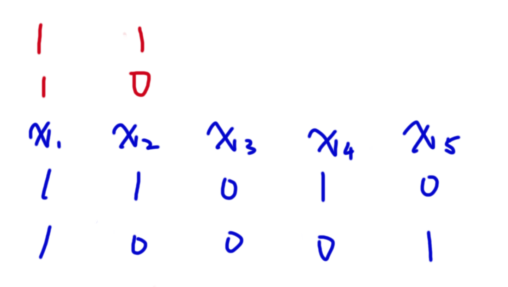

## 理论知识

首先给出一些定义：(有线代基础的奆佬可以直接跳到下面线性基章节)

### 向量

**向量**是一个由 $n$ 个实数组成的有序数组，是一个 $1\times n$ 的矩阵 ( $n$ 维行向量) 或一个 $n\times 1$ 的矩阵 ( $n$ 维列向量)。

如 $A=\begin{bmatrix}x_1&x_2&x_3&\dots&x_k\end{bmatrix}$ 是一个 $k$ 维行向量，$B=\begin{bmatrix}x_1\\x_2\\ \vdots\\ x_k\end{bmatrix}$ 是一个 $k$ 维列向量。


### 向量的线性运算(加法，数量乘法)

#### 加法

在所有的向量组成的集合 $V$ 中定义加法运算：

$\alpha,\beta \in V$，设 $\alpha = \begin{bmatrix}x_1&x_2&x_3\dots x_k\end{bmatrix},\beta=\begin{bmatrix}y_1&y_2&y_3\dots y_k\end{bmatrix}$，

则 $\alpha +\beta =\begin{bmatrix}x_1+y_1&x_2+y_2&x_3+y_3\dots x_k+y_k\end{bmatrix}$ 称为 $\alpha$ 与 $\beta$ 的和。

#### 数量乘法(数乘)

在向量集合与实数域的元素之间定义数量乘法运算：

设 $\alpha=\begin{bmatrix}x_1&x_2&x_3\dots x_i\end{bmatrix},k\in R$ ，

则 $k\alpha = \begin{bmatrix}kx_1&kx_2&kx_3\dots kx_i\end{bmatrix}$ 称为 $k$ 与 $\alpha$ 的积。

### 向量组

**向量组**是有限个相同维数的行向量或列向量组成的集合。

一个向量集合 $S=\{A_1,A_2,A_3\dots A_n\}$ 是向量组当且仅当  $\forall A_i\in S$ 是 $k$ 维行向量或 $\forall A_i\in S$ 是 $k$ 维列向量

#### 等价向量组

若两个向量组之间可以互相线性表示出来，那么称这两个向量组是等价向量组

### 线性空间，子空间与生成子集

#### 线性空间

向量空间亦称线性空间。它是线性代数的中心内容和基本概念之一。设 $V$ 是一个非空集合，$P$ 是一个域。若：

1. 在V中定义了一种运算，称为加法，即对 $V$ 中任意两个元素 $α$ 与 $β$ 都按某一法则对应于 $V$ 内惟一确定的一个元素 $α+β$，称为 $α$ 与 $β$ 的和。

2. 在 $P$ 与 $V$ 的元素间定义了一种运算，称为纯量乘法(亦称数量乘法)，即对 $V$ 中任意元素 $α$ 和 $P$ 中任意元素 $k$，都按某一法则对应 $V$ 内惟一确定的一个元素 $kα$，称为 $k$ 与 $α$ 的积。

3. 加法与纯量乘法满足以下条件：
    1) $α+β=β+α$，对任意$α,β\in V$.
    2) $α+(β+γ)=(α+β)+γ$，对任意 $α,β,γ\in V$.
    3) 存在一个元素 $0\in V$ ，对一切 $α\in V$ 有 $α+0=α$ ，元素 $0$ 称为 $V$ 的零元.
    4) 对任一 $α\in V$，都存在 $β\in V使α+β=0$，β称为α的负元素，记为 $-α$.
    5) 对P中单位元 $1$ ，有 $1α=α(α\in V)$.
    6) 对任意 $k,l\in P,\ α\in V$ 有 $(kl)α=k(lα)$.
    7) 对任意 $k,l\in P, α\in V$ 有 $(k+l)α=kα+lα$.
    8) 对任意 $k\in P,\ α,β∈V$ 有 $k(α+β)=kα+kβ$.

则称 $V$ 为域 $P$ 上的一个**线性空间**，或**向量空间**。$V$ 中元素称为向量，$V$ 的零元称为**零向量**，$P$ 称为线性空间的**基域**。当 $P$ 是实数域时，$V$ 称为**实线性空间**；当 $P$ 是复数域时，$V$ 称为**复线性空间**。

**易知，之前对向量及其运算的定义满足实线性空间的条件。**

#### 子空间与生成子集

已知一个向量组 $S=\{A_1,A_2,A_3,A_4,\dots A_i\}$，则集合 $T=\{k_1A_1+k_2A_2+\dots k_iA_i\ |\ k_i\in R\}$ 为这个向量组 $S$ 的**子空间**，向量组 $S$ 是 $T$ 的**生成子集**。

### 线性相关与线性无关，基底

#### 线性相关与线性无关

我们称一个向量组**线性相关**，当其中的某个向量能被其他向量线性运算的结果表示出来；反之，若任何一个向量都无法被其他的向量线性运算表示，那么我们称这个向量组**线性无关**。

#### 基底与维度

若一个向量组 $S$ 线性无关，那么它是它的子空 $T$ 的 **基底**。这个向量组中元素的个数称为 **维度**。

### 向量组的秩

#### 极大线性无关向量组

向量组 $S$ 中若有一部分组满足 $A_1,A_2,\dots A_i$ 满足 $\{A_1,A_2,\dots,A_i\}$ 线性无关，且任取 $\beta \in S$，有 $\{A_1,A_2,\dots,A_i,\beta \}$ 线性相关，则称 $A_1,A_2,\dots A_i$ 为**极大线性无关向量组**，简称**极大无关组**。

#### 向量组的秩

一个向量组包含的极大无关组的向量个数即为向量组的秩。

#### 求向量组的秩

我们想要求向量组的秩，就要求向量组的极大无关组。

求向量组的极大无关组一般使用**高斯消元**。

高斯消元有三种操作：

1. 交换行

2. 一行乘以一个非零常数

3. 将一行的若干倍加在另一行上

在矩阵中，高斯消元做完之后会形成一个类对角线矩阵，此时我们将这个矩阵拆做数个行向量。由于每一个向量都有一个独有的位置，它下面的向量这一位都是 $0$。所以这些向量一定线性无关。那么这些向量构成的向量组即是一个极大无关组。这个极大无关组同时也是原向量组生成的子空间的一组基底。

### 一个重要性质

- 一个向量组 $S$ 生成的子空间 $T$ 的任意两个基底 $B_1,B_2$ 一定等价且维数相同。

    这个性质有多nb呢？

    现在手上我们有 $10^5$ 个 $63$ 维的向量组成的向量组。由于上面的性质，我们利用高斯消元随便求出一个极大无关组，这个无关组向量数一定小于等于 $63$ ，而这 $63$ 个向量组成的向量组生成的子空间一定与原向量组等价的，相当于我们用 $63$ 个向量干了 $10^5$ 向量干的事情。


## 线性基

BB了那么多线性代数的知识，实际上线性基是个很简单的东西，它就是我们上文中用高斯消元在求的极大无关组。

### 例题：线性基

给定 $n$ 个整数 $S_i$（数字可能重复），求在这些数中选取任意个，使得他们的异或和最大。

$1\le n\le 10^5,0\le S_i\le 2^{63}-1$

### 例题解析

由于异或相当于不进位加法，所以把加法定义成异或，上面的那一串东西一定还是成立。

我们可以把每一个数都看作是一个长度是 $63$ 的由 $0,1$ 组成的向量。我们想要知道这 $10^5$ 个数能凑出来的最大的数是多少，实际上就是在找它的子空间里能表示的最大数是多少。所以我们可先找到所有向量的线性基。线性基只有不到 $63$ 个。我们做高斯消元最后会形成一个对角线全是 $1$ ，每一位的 $1$ 最多只存在于一个向量的的类对角线矩阵。

$$
\begin{matrix}
[&1&0&0&0&0&\dots &0&]\\
[&0&1&0&0&0&\dots &0&]\\
[&0&0&1&0&0&\dots &0&]\\
&\vdots&&\vdots&\vdots&&\vdots&\\
[&\dots&&\dots&\dots&&\dots&1&]
\end{matrix}
$$

此时我们可以观察到，若是把所有的基底全部选到，其异或值一定最大。

```cpp
#include <bits/stdc++.h>
using namespace std;
typedef long long ll;

const int N=1e5+10;

int n;
ll a[N];

int main()
{
	scanf("%d",&n);
	for(int i=0;i<n;i++) scanf("%lld",&a[i]);

	int k=0;
	for(int i=62;i>=0;i--)//高斯消元求线性基
	{
		for(int j=k;j<n;j++)
			if(a[j]>>i&1)
				{swap(a[j],a[k]); break;}
		if(!(a[k]>>i&1)) continue;
		for(int j=0;j<n;j++)
			if(j!=k&&(a[j]>>i&1))
				a[j]^=a[k];
		k++;
		if(k==n) break;
	}
	ll res=0;
	for(int i=0;i<n;i++)  res^=a[i];//答案将所有的线性基异或起来
	printf("%lld",res);
	return 0;
}
```

高斯消元求解线性基的复杂度大概是 $O(n)$。~~目测~~

---
### 异或运算

给定你由 $n$ 个整数构成的整数序列，你可以从中选取一些（**至少一个**）进行异或运算，从而得到很多不同的结果。

请问，所有能得到的不同的结果中第 $k$ 小的结果是多少。

**对于一个序列会有多组询问**，多组测试数据

设 $Q$ 为询问次数，每次询问 $k_i$，
$1≤N,Q≤10000,1≤a_i,k_i≤10^{18}$。

### 解析

线性基求第 $k$ 小异或和。

我们第一步肯定还是先求线性基。

求完之后我们现在要想怎么才能把线性基的子空间里的第 $k$ 小的向量搞出来。

同时这也涉及到另外一个问题，子空间的定义是允许所有的向量的系数为 $0$ 的。但是在这个题中我们必须至少选一个向量，我们需要考虑 $0$ 向量能否被其他方式凑出来。

考虑题目给我们的 $n$ 个向量，求解之后在极大无关组中的向量有 $k$ 个，$k\le n$。如果 $k<0$ ，那么就是说存在一个向量 $x_i$ 能被线性表示。即:
$$x_i=a_1x_1+a_2x_2+\dots+a_kx_k$$
我们移个项，得到
$$0=a_1x_1+a_2x_2+\dots+a_kx_k-x_i$$

这里的 $-$ 定义为 $+$ 的逆运算。

所以，**当** $k<n$ **的时候就可以断定** $0$ **向量能被其他向量凑出来**。

现在我们不妨先假设 $k<n$，考虑如何求第 $k$ 小。

先放结论：**我们将** $k-1$ **二进制拆分**，**每一个有** $1$ **的二进制位对应的最高位为那一位的向量异或和就是第** $k$ **大**。

首先我们二进制拆分，严格小于 $k-1$ 的二进制拆分有 $k-1$ 种，同时对应了 $k-1$ 种选向量的方案，我们需要知道这里面任意一种方案是否严格小于 $k-1$ 对应的选数的方案。

我们从一个特殊情况来看。

[](https://pic.imgdb.cn/item/612e365344eaada739014d01.png)

找到位置最靠前的不同点，在 $x_2$ 的位置。

对于前面的 $x_1$ ，两种情况都选择了，前面的这些位一定相同；而对于 $x_2$ 这一位来说，第一行的情况选了，第二行的情况没有选，那么这一位第二行就是 $0$，第一行就是 $1$ ，第二行要小于第一行。

其他情况同理。所以小于 $k-1$ 的二进制表示对应的方案一定严格小于 $k-1$ 对应的方案。

```cpp
#include <bits/stdc++.h>
using namespace std;
typedef long long ll;

const int N=1e5+10;

int n;
ll arr[N];

int main()
{
	int t;
	scanf("%d",&t);
	for(int T=1;T<=t;T++)
	{
		printf("Case #%d:\n",T);
		scanf("%d",&n);
		memset(arr,0,sizeof arr);
		for(int i=0;i<n;i++) scanf("%lld",&arr[i]);
		int k=0;
		for(int i=62;i>=0;i--)//求解线性基
		{
			for(int j=k;j<n;j++)
				if(arr[j]>>i&1)
				{
					swap(arr[j],arr[k]);
					break;
				}
			if(!(arr[k]>>i&1)) continue;
			for(int j=0;j<n;j++)
				if(j!=k&&(arr[j]>>i&1))
					arr[j]^=arr[k];
			k++;
			if(k==n) break;
		}
		reverse(arr,arr+k);//我们的线性基是反着求的，0是最高位，所以需要翻转
		int q;
		scanf("%d",&q);
		for(int i=1;i<=q;i++)
		{
			ll x;
			scanf("%lld",&x);
			if(k<n) x--;
			if(x>=(1ll<<k))
			{
				printf("-1\n");
				continue;
			}
			ll ans=0;
			for(int j=0;j<k;j++)
				if(x>>j&1) ans^=arr[j];
			printf("%lld\n",ans);
		}
	}
	return 0;
}
```

---

乱七八糟的习题(luogu)，以后会写解题报告/题解的(大概)

[P3857 [TJOI2008]彩灯](https://www.luogu.com.cn/problemnew/show/P3857)

[P4301 [CQOI2013] 新Nim游戏](https://www.luogu.com.cn/problemnew/show/P4301)

[P4570 [BJWC2011]元素](https://www.luogu.com.cn/problemnew/show/P4570)

[P4151 [WC2011]最大XOR和路径](https://www.luogu.com.cn/problemnew/show/P4151)

[P3292 [SCOI2016]幸运数字](https://www.luogu.com.cn/problemnew/show/P3292)
