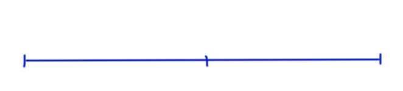
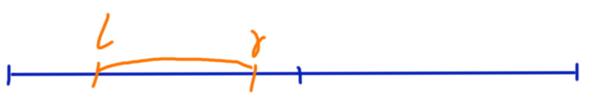
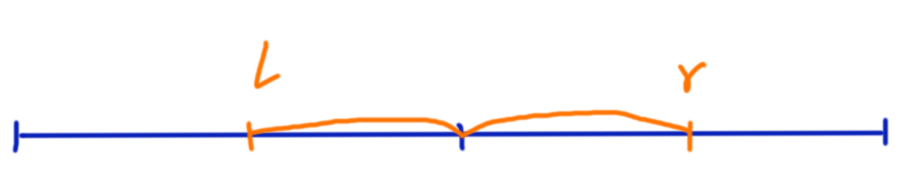
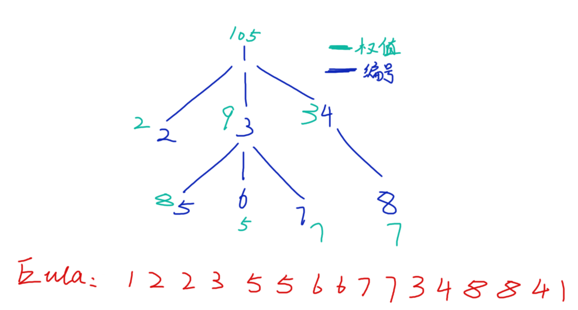

## 莫队

莫队是 IOIer 莫涛 dalao 发明的一个神奇的算法，本质上是优雅的暴力，解决区间询问问题。

对于区间询问，我们可以将询问按照以下顺序排序：

- 按照左端点分块，若在不同块中，按照左端点的升序排序。
- 若在同一块中：
    - 当块的标号是偶数时，按照右端点降序排序。
    - 当块的编号是奇数时，按照右端点升序排序。

排完序后我们枚举每个询问：

假设上一个询问是 $[l_1,r_1]$ ，当前询问是 $[l_2,r_2]$

如果 $l_1<l_2$，那么 $l_1,l_2$ 之间的数据是多余的，我们可将其中的元素对于答案的贡献一一删掉。

如果 $l_1>l_2$，那么 $l_1,l_2$ 之间的数据是需要补充的，我们可将其中的元素暴力统计到答案中来。我们只需要考虑当区间内删去/增加一个元素时候的答案变化就可以了。

建议背板。

### 数颜色

给定一个长度为 $n$ 正整数序列 $\{a_n\}$，每一个正整数表示一种颜色，相同的正整数表示相同的颜色。有 $m$ 个询问，每次询问给出一个区间 $[l,r]$ 求其中有多少种不同的颜色。

$1\le n\le 10^5,\ 1\le m\le 10^5$

(具体题面可以参考[『SDOI2009』HH的项链](https://www.luogu.com.cn/problem/P1972))

#### 解析

这就是莫队模板。

我们考虑增加/删去一个元素时，答案变化情况。

对于这样的题，我们可以统计每个元素出现的次数，$>0$ 的就是出现了的数。

设 $res$ 为当前区间内的颜色种数， $sum_i$ 表示颜色 $i$ 出现的次数。

考虑当区间内增删一个元素的时候，以上两个变量的变化情况。

- 增加颜色 $x$：

    此时 $sum_x$ 显然要 $+1$。

    若 $+1$ 前 $sum_x=0$ 证明这个颜色第一次出现，$res$ 应当 $+1$。

- 删除颜色 $x$：

    此时 $sum_x$ 要 $-1$。

    如果 $-1$ 后 $sum_x=0$ 了，就代表这个颜色在当前区间里面没有出现，所以 $res$ 要 $-1$。

code:(HH的项链)
```cpp
#include <bits/stdc++.h>
using namespace std;
typedef long long ll;

const int N=7e6+10;

inline void read(int &s)
{
	s=0;
	char g=getchar();
	while(g<'0'||g>'9') g=getchar();
	while(g>='0'&&g<='9') s=(s<<1)+(s<<3)+(g^48),g=getchar();
}

int n,m;
int poi[N];
struct Query
{
	int l,r,no;
} Q[N];
int block;
bool cmp(Query a,Query b)
{
	int aa=a.l/1704,bb=b.l/1704;
	if(aa!=bb) return a.l<b.l;
	if(aa&1) return a.r>b.r;
	else return a.r<b.r;
}
int sum[N],ans[N];

int main()
{
	ios::sync_with_stdio(0);
	cin.tie(0);
	cout.tie(0);
	read(n);
	for(register int i=1;i<=n;++i) read(poi[i]);
	read(m);
	for(register int i=0;i<m;++i)
	{
		int l,r;
		read(l); read(r);
		Q[i]=(Query){l,r,i};
	}
	sort(Q,Q+m,cmp);
	int res=0;
	for(register int i=0,l=0,r=0;i<m;++i)
	{
		int ll=Q[i].l,rr=Q[i].r;
		while(l<ll)
		{
			--sum[poi[l]];
			if(!sum[poi[l]]) --res;
			++l;
		}
		while(l>ll)
		{
			--l;
			if(!sum[poi[l]]) ++res;
			++sum[poi[l]];
		}
		while(r<rr)
		{
			++r;
			if(!sum[poi[r]]) ++res;
			++sum[poi[r]];
		}
		while(r>rr)
		{
			--sum[poi[r]];
			if(!sum[poi[r]]) --res;
			--r;
		}
		ans[Q[i].no]=res;
	}
	for(register int i=0;i<m;++i)
		cout<<ans[i]<<'\n';
	return 0;
}
```
---

## 带修莫队

在上面的问题中，莫队的做法是直接将询问强行离线下来然后排序。

但是许多的区间问题是带修改的，这大大限制了普通莫队的使用范围。

所以我们可以试着通过某种方法让莫队也能支持修改。

### 数颜色/维护队列

[$link$](https://www.luogu.com.cn/problem/P1903)

墨墨购买了一套N支彩色画笔（其中有些颜色可能相同），摆成一排，你需要回答墨墨的提问。墨墨会向你发布如下指令：

1.  `Q L R` 代表询问你从第 $L$ 支画笔到第 $R$ 支画笔中共有几种不同颜色的画笔。
2.  `R P Col` 把第 $P$ 支画笔替换为颜色 $Col$。

为了满足墨墨的要求，你知道你需要干什么了吗？

#### 解析

带修莫队模板。

在普通莫队中，我们将所有的询问离线了下来。下面我们考虑怎么解决区间修改。

我们在可持久化中介绍过，修改其实可以被记住和回溯。

也就是我们将这数组 $\texttt{arr[i]}$ 加一维 $\texttt j$ ，代表是第 $j$ 个时间点过后的数组。

那么询问也要加一维 $\texttt j$，表示这个询问在 $j$ 时间点。

此时我们的莫队就相当于在解决这样一个问题：

- 给定数组 $\texttt{sum[i][j]}$ ，询问第 $k$ 行第 $l$ 个元素到第 $r$ 个元素的颜色个数。

数组多一维，我们需要多一个指针 $t$ 枚举罢了。

但是，若对于每个修改我们都记住当前的数组，那么空间大小就会达到 $O(nm)$，并且由于莫队**只会从一个修改后的状态移动到另一个相邻的修改后的状态**，把所有的修改后状态记住也是没有必要的。

我们从上面叙述的相邻性质出发考虑修改。

- 假设我们要做第二个修改，也就是从第一个修改后的状态移动到第二个修改后状态，那么我们就要**将修改的位置 $i$ 上的数 $x_i$ 删去，然后添加新数 $x^{\prime}_i$ 。**

- 假设我们要从第二个修改后的状态回溯到第一个修改后的状态，那么我们就要**将修改的位置 $i$ 上的 $x_i^{\prime}$ 删去，把 $x_i$ 添加回来。**

综合上面的过程，我们可以在修改的时候**将存储在修改的 $x_i^{\prime}$ 与数组中的 $x_i$ 执行 $\texttt{swap}$ 操作**，那么修改和回溯的过程执行的操作是完全一样的。

现在我们考虑如何对询问排序。

当某个指针单调的时候，我们扫描这个指针的复杂度是 $O(n)$ 的。所以我们还是考虑让某个指针单调，然后其他指针分块做。

其实就是一个三关键字排序。对于一个询问 $\{l,r,t\}$ 第一关键字为左端点 $l$ 所在块的编号，第二个关键字为右端点 $r$ 所在块的编号，第三关键字为时间戳 $t$ 所在块的编号。

我们来关心一下时间复杂度：

按上面执行下来，假设块大小为 $a$，块的个数 $\frac n a$，查询 $m$ 次，修改 $c$ 次。

主要复杂度分为三个部分：

- 移动左指针 $l$ 的总复杂度

    分两部分：一部分是在块之间移动的复杂度，另一部分是在块内移动的复杂度。

    - 在块之间移动时：

        每次最多移动 $2a$ 的长度，共 $\frac na$ 个块，复杂度 $O(2a\cdot \frac na)=O(n)$。

    - 在块内移动时：

        每次最多移动 $a$ 的长度，最坏共 $m$ 个询问，复杂度 $O(am)$

    总的时间复杂度 $O(am+n)$。

- 移动右指针 $r$ 的总复杂度

    仍然分两部分：块内移动和块间移动。
    - 块内移动

        每次仍然最多移动 $a$ 次，共 $m$ 个询问，复杂度 $O(am)$。

    - 块间移动

        每次对于同一块内的 $l$ 最多从 $1$ 到 $n$ 移动一次，共 $O(n)$ 次。对于每一个 $l$ 的分块，都可能这样来上一次，总复杂度 $O(n\cdot \frac na)=O(\frac{n^2}a)$。

    总的时间复杂度 $O(am+\frac{n^2}{a})$

- 移动修改指针 $t$ 的总复杂度

    当 $l,r$ 在同一块且固定时，$t$ 是单调递增的，枚举时间约为 $O(c)$ ；总共块数 $\frac na$ ，那么总的枚举时间： $O(c\cdot \frac na \cdot\frac na)=O(\frac{n^2}{a^2}c)$。

由于 $n,m$ 同阶，总的时间复杂度就是 $O(\max\{an,an+\frac{n^2}a,\frac{n^2}{a^2}c\})$。

当 $a$ 取 $\sqrt[3]{nc}$ 可以达到 $O(c^{\frac 13 }n^{\frac 43})$。若 $c,n$ 同阶，那么复杂度 $O(n^{\frac 53})$

```cpp
#include <bits/stdc++.h>
using namespace std;

const int N=5e6+10;

void swap_(int &x,int &y)
{
	if(x!=y) x^=y^=x^=y;
}
#define swap swap_

int n,m;
int poi[N];
struct Query
{
	int l,r,no,cc;//左端点，右端点，编号，最近的一组修改
} Q[N];
struct Modif
{
	int l,c;
} M[N];
int qm=0,cm=0,block;
bool cmp(Query a,Query b)
{
	int al=a.l/2610,bl=b.l/2610;
	int ar=a.r/2610,br=b.r/2610;//cbrt(133333^2)≈2610
	if(al!=bl) return al<bl;
	if(ar!=br) return ar<br;
	return a.cc<b.cc;
}
int cnt[N],ans[N];
int main()
{
	ios::sync_with_stdio(0);
	cin.tie(0); cout.tie(0);
	cin>>n>>m;
	for(int i=1;i<=n;++i) cin>>poi[i];
	for(int i=1;i<=m;++i)
	{
		int a,b;
		char s;
		cin>>s>>a>>b;
		if(s=='Q')
			++qm, Q[qm]=(Query){a,b,qm,cm};
		else M[++cm]=(Modif){a,b};
	}
	sort(Q+1,Q+1+qm,cmp);

	for(int i=1,l=1,r=0,t=0,res=0;i<=qm;++i)
	{
		int id=Q[i].no, ll=Q[i].l, rr=Q[i].r, tt=Q[i].cc;
		while(l<ll)
		{
			--cnt[poi[l]];
			if(!cnt[poi[l]]) --res;
			++l;
		}
		while(l>ll)
		{
			--l;
			if(!cnt[poi[l]]) ++res;
			++cnt[poi[l]];
		}
		while(r<rr)
		{
			++r;
			if(!cnt[poi[r]]) ++res;
			++cnt[poi[r]];
		}
		while(r>rr)
		{
			--cnt[poi[r]];
			if(!cnt[poi[r]]) --res;
			--r;
		}
		while(t<tt)
		{
			++t;
			if(l<=M[t].l&&M[t].l<=r)
			{
				--cnt[poi[M[t].l]];
				if(!cnt[poi[M[t].l]]) --res;
				if(!cnt[M[t].c]) ++res;
				++cnt[M[t].c];
			}
			swap(M[t].c,poi[M[t].l]);
		}
		while(t>tt)
		{
			if(l<=M[t].l&&M[t].l<=r)
			{
				--cnt[poi[M[t].l]];
				if(!cnt[poi[M[t].l]]) --res;
				if(!cnt[M[t].c]) ++res;
				++cnt[M[t].c];
			}
			swap(M[t].c,poi[M[t].l]);
			--t;
		}
		ans[id]=res;
	}
	for(int i=1;i<=qm;++i)
		cout<<ans[i]<<'\n';
	return 0;
}

```
---
## 回滚莫队

回滚莫队适用于莫队解决问题时发现删除不好删除的时候。

比如我们想用莫队维护一个集合最大值，插入一个数的时候只需要打擂台记录最大值即可，但是删除的时候就不好来直接寻找删除后的最大值。

当然例子中的这个具体问题也可以用个线段树啊堆啊什么的维护一下……这样做大概 $O(n\sqrt{n}\log n)$ 。

### 『JOI2013』歴史の研究

IOI 国历史研究的第一人——JOI 教授，最近获得了一份被认为是古代 IOI 国的住民写下的日记。

JOI 教授为了通过这份日记来研究古代 IOI 国的生活，开始着手调查日记中记载的事件。

日记中记录了连续 $N$ 天发生的时间，大约每天发生一件。

事件有种类之分。第 $i$ 天 $(1≤i≤N)$ 发生的事件的种类用一个整数 $X_i$ 表示，$X_i$ 越大，事件的规模就越大。

JOI 教授决定用如下的方法分析这些日记：

- 选择日记中连续的一些天作为分析的时间段
- 事件种类 $t$ 的重要度为 $t × \text{(这段时间内重要度为 }t\text{ 的事件数)}$
- 计算出所有事件种类的重要度，找到其中的最大值

现在你被要求制作一个帮助教授分析的程序，每次给出分析的区间，你需要输出重要度的最大值。

#### 输入格式
第一行两个空格分隔的整数 $N$ 和 $Q$，表示日记一共记录了 $N$ 天，询问有 $Q$ 次。

接下来一行 $N$ 个空格分隔的整数 $X_1\cdots X_N$，$X_i$ 表示第 $i$ 天发生的事件的种类。

接下来 $Q$ 行，第 $i$ 行 $(1≤i≤Q)$ 有两个空格分隔整数 $A_i$ 和 $B_i$，表示第 $i$ 次询问的区间为 $[A_i,B_i]$。

#### 输出格式
输出 $Q$ 行，第 $i$ 行 $(1≤i≤Q)$ 一个整数，表示第 $i$ 次询问的最大重要度。

#### 数据范围
$1≤N≤10^5,
1≤Q≤10^5,
1≤X_i≤10^9$
#### 输入样例：
```
5 5
9 8 7 8 9
1 2
3 4
4 4
1 4
2 4
```
#### 输出样例：
```
9
8
8
16
16
```
#### 解析

~~会滚的~~ 回滚莫队板子题。

观察其实可以知道，这题插入非常简单，而直接删除几乎是不可行的。

我们取块长 $\sqrt n$，仍然照着普通莫队的方法来对询问排序(去掉奇偶优化)。

排序后，询问左端点所在块的编号单调递增，左端点块编号相同的询问右端点单调递增。

此时我们考虑对每一个块内怎么去做。



我们考虑处理所有左端点在左边块内的所有询问。左边块内的询问有两种情况：

- 右端点在左块内

    

    这个时候我们可以直接暴力求，由于块长最大 $\sqrt n$，所以处理单个这类询问的总复杂度最多 $O(\sqrt n)$。

- 右端点在右块外

    

    此时我们可以将询问分为两个部分：在左块内的部分，在右块内的部分。

    由于我们的排序策略，我们知道右块内部分是持续增加的。真正涉及到删除操作的是左端点。

    但是我们无法优秀地完成删除操作怎么办？

    此时，想想你在玩 galgame 玩出最坏的 BE 的时候，你是不是会选择回档？

    我们也可以让莫队“回档”，也就是我们的**回滚**操作：

    1. 在做块外的询问前，我们把莫队的两个指针 $l,r$ 设到右块的初始位置。
    1. 每遇到一个询问，我们先移动 $r$，这里只会涉及添加操作。移动完后，记录下当前的答案和状态数组(如记录数字出现次数之类的数组)。
    1. 移动左指针，记录这个询问答案。
    1. 最重要的一步：我们将**上一步涉及到所有的状态以及答案变量恢复到之前记录的状态**，然后继续做下一个询问。

    难度在回档的实现上。有可能直接撤销就完事了，也有可能复杂到要再整个数据结构什么的。

    当然，对于这个题，我们直接撤销即可。

总时间复杂度在块取 $\sqrt n$ 时 $O(n\sqrt n)$

```cpp
#include <bits/stdc++.h>
using namespace std;
typedef long long ll;
const int N=1e5+10;

int n,m;
struct Query
{
	int l,r,id;
} Q[N];
int poi[N],cnt[N];
vector<int> nums;
ll ans[N];
int block;

inline int get(int x)
{
	return x/block;
}

bool cmp(Query a,Query b)
{
	int al=get(a.l),bl=get(b.l);
	if(al!=bl) return al<bl;
	return a.r<b.r;
}

void add(int &x,ll &res)
{
	cnt[x]++;
	res=max(res,(ll)cnt[x]*nums[x]);
}

int main()
{
	scanf("%d%d",&n,&m);
	for(int i=1;i<=n;++i) scanf("%d",&poi[i]),nums.push_back(poi[i]);
	sort(nums.begin(),nums.end());
	nums.erase(unique(nums.begin(),nums.end()),nums.end());
	for(int i=1;i<=n;i++) poi[i]=lower_bound(nums.begin(),nums.end(),poi[i])-nums.begin();
	for(int i=1;i<=m;i++)
	{
		int l,r;
		scanf("%d%d",&l,&r);
		Q[i]=(Query){l,r,i};
	}
	block=max(10,(int)sqrt(n));
	sort(Q+1,Q+1+m,cmp);

	for(int x=1;x<=m;)
	{
		int y=x;
		while(y<=m && get(Q[y].l)==get(Q[x].l)) y++;
		int right=get(Q[x].l)*block+block-1;

		/*处理块内询问*/
		while(x<y && Q[x].r<=right)
		{
			ll res=0;
			int id=Q[x].id,l=Q[x].l,r=Q[x].r;
			for(int k=l;k<=r;k++) add(poi[k],res);
			ans[id]=res;
			for(int k=l;k<=r;k++) --cnt[poi[k]];
			++x;
		}

		/*处理块外的询问*/
		ll res=0;
		int l=right+1,r=right;
		while(x<y)
		{
			int id=Q[x].id,ll=Q[x].l,rr=Q[x].r;
			while(r<rr) add(poi[++r],res);
			long long backup_=res;
			while(l>ll) add(poi[--l],res);
			ans[id]=res;
			while(l<right+1) --cnt[poi[l++]];
			res=backup_;
			++x;
		}
		memset(cnt,0,sizeof cnt);
	}
	for(int i=1;i<=m;i++) printf("%lld\n",ans[i]);
	return 0;
}
```
---

## 树上莫队

现在，我们把莫队搬到树上来。

首先我们能够想到的是直接整个 DFS 序(比如轻重链剖分)，然后将询问区间分解，在 DFS 序列上跑正常的莫队。

但是这样的复杂度几乎是 $O(n\sqrt{m\log m})$，非常容易被卡。

所以我们会用到另一种基于 DFS 的遍历序。

先看例题：

### COT2-Count On Tree II

给出一棵 $n$ 个节点的树，每个节点有一个颜色，第 $i$ 个点的颜色用一个整数 $a_i$ 表示。有 $m$ 种询问，每次询问给出 $u,v$，查询 $u\to v$ 的路径上(含 $u,v$ )有多少不同的颜色。

#### 输入格式

第一行包含两个整数 $n,m$。

第二行包含 $n$ 个整数，其中第 $i$ 个整数表示点 $i$ 的颜色 $a_i$。

接下来 $n-1$ 行，每行包含两个整数 $x,y$，表示点 $x$ 和点 $y$ 之间存在一条边。

最后 $m$ 行，每行包含两个整数 $u,v$，表示一个询问。

#### 输出格式

对于每一个询问，输出一行表示对应询问的答案。

#### 输入样例
```cpp
8 2
105 2 9 3 8 5 7 7
1 2
1 3
1 4
3 5
3 6
3 7
4 8
2 5
7 8
```
#### 输出样例
```cpp
4
4
```
#### 数据范围与约定
$1≤n≤4\times 10^4,\ 1≤m≤10^5,\ 1≤x,y,u,v≤n,\ 0\le |a_i|\le 2^{31}$。

1s/128MB

#### 解析

这就是树上莫队板子题。我们要干的事情是把树上的问题转化成序列问题。

如最开始叙述的那样，普通的 DFS 序无法满足我们的需求。我们需要使用另一个叫 **欧拉序** 的东西。

- **欧拉序**：
    也叫出栈入栈序。DFS 可以看成是一个将节点出栈入栈的过程，当这个节点入栈的时候记录一次该节点，当这个节点出点的时候再次记录该节点。

    具体的，当我们搜到的一个节点 $i$ 时，将该节点计入序列，继续搜索其子树。当它的子树全部搜索完毕，将要回溯的时候，我们再将节点 $i$ 计入一次序列。

- **欧拉序的性质**：

    - 每个节点在欧拉序列中严格出现两次。

    - 对于一个节点两次出现的位置之间区间即是其子树的欧拉序。

    - 对于一条在树上的直系路径，总能在欧拉序中找到找到一个区间有且仅有路径上的点。

    - 对于一条在树上的非直系(即两个端点互不在子树内)的路径，总能在欧拉序中找到一个区间内只有路径上除 LCA 外的点。

根据上面的性质，肯定就能想到利用欧拉序的后两个性质来做这个题。

但是我们的欧拉序中点有出现一次的，有出现两次的，怎么正确统计路径上的答案呢？

这要我们落脚到欧拉序的构造方式去：



如上是按照例题中样例构造的一个欧拉序。

假设 $u$ 比 $v$ 先搜到。

- 当 $lca_{u,v}=u$ 时

    我们考察 $1,2,2,3,5,5,6,6,7$ ，即 $1$ 入栈到 $7$ 入栈这一段。

    从 $1$ 到 $7$ 依次经过 $1,3,7$ ，这些都在我们取出来的区间中出现了一次。而没有经过的 $2,5,6$ 出现了两次

- 当 $lca_{u,v}\ne u\land lca_{u,v}\ne v$时

    我们研究其中 $6,7,7,3,4,8$ ，即从 $6$ 出栈到 $8$ 入栈这一段。

    从 $6$ 到 $8$ 依次会经过 $6,3,1,4,8$ ，由于 $1$ 是 $6,8$ 的 LCA ，一直在栈内，所以没有出现；而不该出现的 $7$ 出现了两次。

我们猜想，是否所有我们不需要的点都会出现偶数次？

答案为是。不妨假设 $u$ 比 $v$ 先搜到，我们将 $(u,v)$ 路径拆成两半：一半是 $u$ 到 $lca_{u,v}$，一半是 $lca_{u,v}$ 到 $v$，我们从 $u$ 出栈时开始统计，相当于 $lca_{u,v}$ 到 $u$ 入栈的过程被我们省略了。所以 $u$ 到 $lca_{u,v}$ 路径上的点只会出现一次。而对于这条路上的每一条分支，要么就在 $lca_{u,v}$ 下行到 $u$ 的时候就已经搜过了。要么就在上行的时候搜完回到上行路径。无论怎样，分支中的点要么不出现，要么严格出现偶数次。

换句话说，我们统计答案的时候，开一个计数变量，当统计到一个点奇数次，就加上它对答案的贡献，否则就去掉其对答案的贡献。

到这里问题就算是解决了。对于优化，求 LCA 有时可以用 Tarjan 离线处理所有 LCA 。同时，树分块在某些玄学情况下比直接在欧拉序上分块效率高。

```cpp
#include<bits/stdc++.h>
using namespace std;

const int N=2e6+10;

int n,m;
int head[N],ver[N],nxt[N],tot=0;
void add_(int x,int y)
{
	ver[++tot]=y; nxt[tot]=head[x]; head[x]=tot;
	ver[++tot]=x; nxt[tot]=head[y]; head[y]=tot;
}
int poi[N];
int eula[N],cnt=0;
int st[N],ed[N];
int dpt[N],size_[N],top[N],son[N],fa[N];

void dfs(int x,int f)
{
	dpt[x]=dpt[f]+1;
	size_[x]=1; fa[x]=f;
	eula[++cnt]=x; st[x]=cnt;
	for(int i=head[x];i;i=nxt[i])
	{
		int y=ver[i];
		if(y==f) continue;
		dfs(y,x);
		size_[x]+=size_[y];
		if(size_[y]>size_[son[x]]) son[x]=y;
	}
	eula[++cnt]=x; ed[x]=cnt;
	return ;
}
void dfs2(int x,int t)
{
	top[x]=t;
	if(!son[x]) return ;
	dfs2(son[x],t);
	for(int i=head[x];i;i=nxt[i])
	{
		int y=ver[i];
		if(y==fa[x]||y==son[x]) continue;
		dfs2(y,y);
	}
	return ;
}

int LCA(int x,int y)
{
	while(top[x]!=top[y])
	{
		if(dpt[top[x]]<dpt[top[y]]) swap(x,y);
		x=fa[top[x]];
	}
	return dpt[x]<dpt[y]?x:y;
}

vector<int> disc;

struct Query
{
	int l,r,lca,no;
} Q[N];

int blo;
int get(int x)
{
	return x/blo;
}
bool cmp(Query a,Query b)
{
	int al=get(a.l),bl=get(b.l);
	if(al!=bl) return al<bl;
	return a.r<b.r;
}

int con[N],vis[N],ans[N];
void Add(int x,int &res)
{
	vis[x]^=1;
	if(!vis[x])
	{
		--con[poi[x]];
		if(!con[poi[x]]) --res;
	}
	else
	{
		if(!con[poi[x]]) ++res;
		++con[poi[x]];
	}
}

int main()
{
	scanf("%d%d",&n,&m);
	for(int i=1;i<=n;i++) scanf("%d",&poi[i]),disc.push_back(poi[i]);
	sort(disc.begin(),disc.end());
	disc.erase(unique(disc.begin(),disc.end()),disc.end());
	for(int i=1;i<=n;i++) poi[i]=lower_bound(disc.begin(),disc.end(),poi[i])-disc.begin();
	for(int i=1;i<n;i++)
	{
		int x,y;
		scanf("%d%d",&x,&y);
		add_(x,y);
	}
	dfs(1,1);
	dfs2(1,1);
	for(int i=1;i<=m;i++)
	{
		int a,b;
		scanf("%d%d",&a,&b);
		if(st[a]>st[b]) swap(a,b);
		int lca=LCA(a,b);
		if(lca==a) Q[i]=(Query){st[a],st[b],0,i};
		else Q[i]=(Query){ed[a],st[b],lca,i};
	}
	blo=max((int)sqrt(cnt),10);
	sort(Q+1,Q+1+m,cmp);
	for(int l=1,r=0,res=0,i=1;i<=m;i++)
	{
		int ll=Q[i].l,rr=Q[i].r,id=Q[i].no,lca=Q[i].lca;
		if(ll>rr) swap(ll,rr);
		while(l<ll) Add(eula[l++],res);//我们其实可以发现，删除和添加操作在本题中是可以等价的
		while(l>ll) Add(eula[--l],res);
		while(r<rr) Add(eula[++r],res);
		while(r>rr) Add(eula[r--],res);
		if(lca) Add(lca,res);
		ans[id]=res;
		if(lca) Add(lca,res);
	}
	for(int i=1;i<=m;i++) printf("%d\n",ans[i]);
	return 0;
}
```
---

## 二次离线莫队

我们还会遇到一种情况，那就是直接更新答案根本不可能为 $O(1)$ 的情况。设单次插入删除的复杂度为 $f(n)$，那么莫队复杂度 $O(f(n)n\sqrt n)$ ，当 $f(n)=\log^2n$ 时就已经不大可以接受了。

而二次离线莫队就是把我们做询问时候的修改操作再次离线下来，平衡一下复杂度，以此来加速莫队的移动。

口胡完毕开始看题。

---

### luogu P4887 【模板】莫队二次离线（第十四分块(前体)）

[$link$](https://www.luogu.com.cn/problem/P4887)

给定一个长度为 $n$ 的序列 $a_1,a_2,…,a_n$ 以及一个整数 $k$。

现在要进行 $m$ 次询问，每次询问给定一个区间 $[l,r]$，请你求出共有多少个数对 $(i,j)$ 满足 $l\le i<j\le r$ 且 $a_i\oplus a_j$ 的结果在二进制表示下恰好有 $k$ 个 $1$。

注：$\oplus$ 表示按位异或操作。

$1≤n,m≤10^5,0≤k≤14,0≤ai<2^{14},1≤l<r≤n$

#### 解析

为了称呼简便，我们下面称 $a_i$ 与 $a_j$ 配对当且仅当 $a_i\oplus a_j$.
