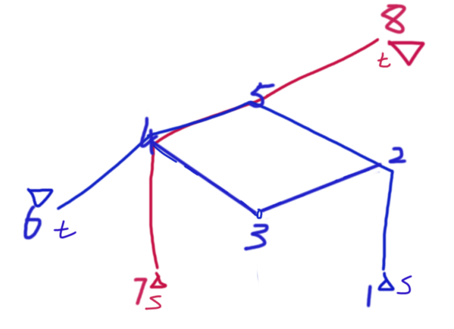

## P2149 [SDOI2009]Elaxia的路线

一道不错的图论题。

给一张无向图，和两对起终点，求两条最短路的最长公共路径。

由于与最短路无关的边我们都不关心，所以我们首先考虑将两对起始点的最短路图建立出来。即把所有可能在最短路中的边和端点全部选出来构成。

**具体方法**：我们从起点 $s$ 和终点 $t$ 分别跑一次最短路，得到 $dis1,dis2$ 两个数组，若一条权值为 $w$ 的边 $(u,v)$ 在最短路图内，当且仅当 $dis1(u)+dis2(v)+w=dis1(t)$ 或 $dis2(u)+dis1(v)+w=dis1(t)$。



我们考虑对其人为定向，定义 $u$ 点的深度是从起点 $s$ 按最短路走到终点 $t$ 时到 $u$ 需要的步数，一条边的方向 $(u,v)$ 是 $u\to v$ 当 $u$ 的深度小于 $v$ 的深度。

这样我们就得到了两个 DAG ，考虑求它们重合的部分的最长链。

我们可以在一个 DAG 中将重合的边标记出来，不重合的边和答案没有关系，所以我们可以直接认为不重合的边没有权值。以此来看，我们只需要建一个 DAG，在建立的时候判断选中的边是否在另一个 DAG 内。若在，则赋予这条边本来的权值；若不在，那这条边没有权值。

接下来要解决求这个 DAG 的最大权值和路径的问题。这里的路径里面的任意一条边都应该有权值。

求 DAG 最长路径问题我们可以考虑 DP 。

设 $f(x)$ 为 $s$ 到 $i$ 的最长路径，我们要求的是 $f(t)$；我们还需要一个辅助数组 $g(i)$，记录以 $i$ 结尾的最长重合路径。

考察状态 $f(i)$ 来源的状态集合组成，$f(i)$ 与 $f(u)$ 有关当且仅当存在一条边 $(u,i)$。

对边 $(u,i)$ 分情况讨论：

- 当 $(u,i)$ 边没有权值

    此时 $f(i)$ 应该保持 $f(u)$，$g(i)$ 应当清零。

    即 $f(i)=\max\{f(i),f(u)\},\ g(i)=0$。

- 当 $(u,i)$ 边有权值 $w$

    此时 $f(i)=\max\{f(i),g(u)+w\},\ g(i)=g(u)+w\}$。

边界条件 $f(i)=0,g(i)=0$。在拓补序上递推刷表即可。由于每个点的出度最大为 $n-1$ 所以时间复杂度为 $n^2$。

总的时间复杂度 $O(4(m+n)\log n+m+m+n^2)$，由于 $m$ 最坏与 $n^2$ 同阶所以复杂度 $O(n^2\log n)$。

~~但是吸氧能到最优解第4~~

code:(由于很懒所以用了不少STL)

```cpp
#include <bits/stdc++.h>
using namespace std;
typedef pair<int,int> PII;

const int N=3000,M=6e6+10;

int head[N],ver[M],nxt[M],edg[M],tot=0;
void add(int x,int y,int z)
{
	ver[++tot]=y; edg[tot]=z; nxt[tot]=head[x]; head[x]=tot;
}
struct EDG
{
	int l,r,w;
} E[M];

int n,m;
int dis1[N],dis2[N],dis3[N],dis4[N];
bool vis[N];
priority_queue<PII,vector<PII>,greater<PII> > q;

void dijkstra(int s,int t,int dis[])
{
	memset(vis,0,sizeof vis);
	memset(dis,0x3f,sizeof head);
	dis[s]=0; q.push({0,s});
	while(q.size())
	{
		int x=q.top().second;
		q.pop();
		if(vis[x]) continue;
		vis[x]=1;
		for(int i=head[x];i;i=nxt[i])
		{
			int y=ver[i];
			if(dis[y]>dis[x]+edg[i])
			{
				dis[y]=dis[x]+edg[i];
				q.push({dis[y],y});
			}
		}
	}
}

int ind[N],oud[N],seq[N],cnt=0;
queue<int> q_;
void topo()
{
	for(int i=1;i<=n;i++)
		if(ind[i]==0) q_.push(i);
	while(q_.size())
	{
		int x=q_.front();
		q_.pop();
		seq[++cnt]=x;
		for(int i=head[x];i;i=nxt[i])
		{
			int y=ver[i];
			--ind[y];
			if(!ind[y]) q_.push(y);
		}
	}
}
int f[N],g[N];

int main()
{
	scanf("%d%d",&n,&m);
	int s1,t1,s2,t2;
	scanf("%d%d%d%d",&s1,&t1,&s2,&t2);
	for(int i=1;i<=m;i++)
	{
		int a,b,c;
		scanf("%d%d%d",&a,&b,&c);
		E[i]=(EDG){a,b,c};
		add(a,b,c);
		add(b,a,c);
	}
	dijkstra(s1,t1,dis1); dijkstra(t1,s1,dis2);
	dijkstra(s2,t2,dis3); dijkstra(t2,s1,dis4);//跑四遍dj
	memset(head,0,sizeof head); tot=0;
	for(int i=1;i<=m;i++)//搞出最短路DAG
	{
		int w=E[i].w,u=E[i].l,v=E[i].r;
		bool flag=0;
		if(dis1[u]+w+dis2[v]==dis1[t1])//一种在 A 的最短路图内的情况
		{
			if(dis3[u]+w+dis4[v]==dis3[t2]||dis4[u]+w+dis3[v]==dis4[s2])//在 3 的最短路图内
				add(u,v,w);
			else add(u,v,-1);//不在则这条边没有权值
			++ind[v]; ++oud[u];flag=1;
		}
		else if(dis2[u]+w+dis1[v]==dis2[s1])//另一种在 A 最短图内的情况
		{
			if(dis3[u]+w+dis4[v]==dis3[t2]||dis4[u]+w+dis3[v]==dis4[s2])//在 3 的最短路图内
				add(v,u,w);
			else add(v,u,-1);//不在则这条边没有权值
			++ind[u]; ++oud[v];flag=1;
		}
	}
	topo();
	for(int k=1;k<=cnt;k++)
	{
		int x=seq[k];
		for(int i=head[x];i;i=nxt[i])//刷表法
		{
			int y=ver[i];
			if(edg[i]==-1) f[y]=max(f[y],f[x]);
			else g[y]=g[x]+edg[i],f[y]=max(f[y],g[x]+edg[i]);
		}
	}
	printf("%d",f[seq[cnt]]);
	return 0;
}
```
