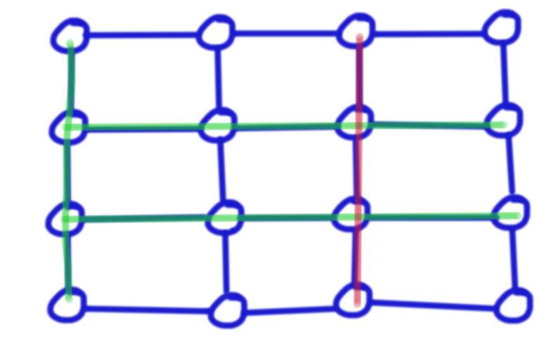

##  P5687 [CSP-S2019 江西] 网格图

考对 Kruskal 的理解。

第一想法肯定是暴力建边然后跑 Kruskal ，写出来就有 $64$ pts。

但是看到最后一档数据 $3\le n,m,\le 3\times 10^5$ ，并且题目中每一行每一列的边权值一样，正解一定不想让我们去遍历每个点每条边，而是想让我们根据行和列的性质一次处理一行/列的边之类的。

我们考虑 Kruskal 实际上是一种贪心：每次尽量取最小的边，然后保证图的联通。

先对权值排序，然后我们将最小的行和列加进来，这两组边一定会选，易证没有最优方案优于不选这两组边。

那么接下来我们继续一整列一整行的加入，就会遇到另一个问题：判环。

考虑环出现的情况，一个环出现的时候，一定是选了一行边穿过了多列已经选择的列，或是选择一列穿过了多行已选择行。

eg：



绿色是之前选中的边，红色列的边选中之后就会形成一个环。

如何避免这种情况又尽量多加入这列的边？其实我们每次加边的时候将连接到之前就加入行或列的边删去一条即可。由于我们不在乎是哪条边删去了，只在乎有没有边删去与权值和的变化，所以我们每次记录选了多少行 / 列，然后每次选行列的时候减去对应数量的边即可。当选完所有的行或列的时候就能得到总的权值和。

```cpp
#include <bits/stdc++.h>
using namespace std;
typedef long long ll;

const int N=3e5+10;

ll n,m;
ll a[N],b[N];

int main()
{
   scanf("%lld%lld",&n,&m);
   for(int i=1;i<=n;i++)
       scanf("%lld",&a[i]);
   for(int i=1;i<=m;i++)
       scanf("%lld",&b[i]);
   sort(a+1,a+1+n);sort(b+1,b+1+m);
   ll ans=a[1]*(m-1)+b[1]*(n-1);
   ll cnt1=2,cnt2=2,line=1,row=1;
   while(cnt1<=n&&cnt2<=m)
   {
       if(a[cnt1]<b[cnt2]) ans+=(ll)a[cnt1++]*(m-line),row++;//贪心
       else ans+=(ll)b[cnt2++]*(n-row),line++;
   }
   printf("%lld",ans);
   return 0;
}

```
